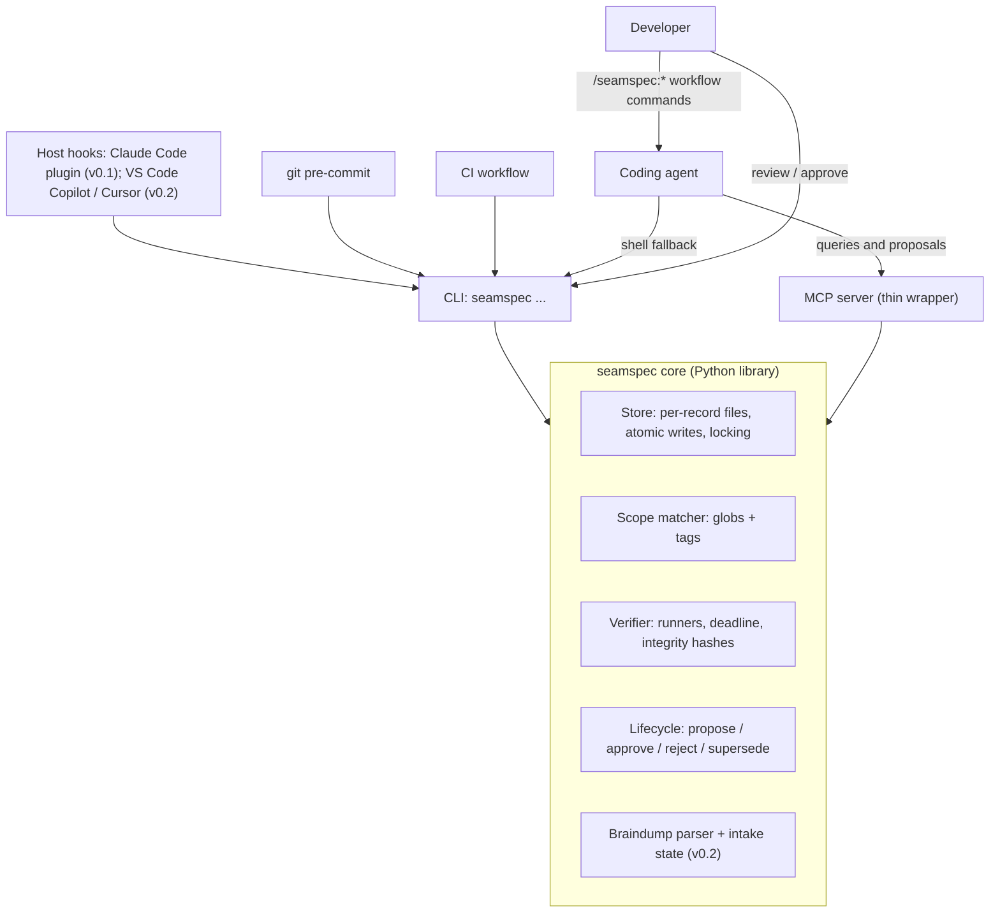
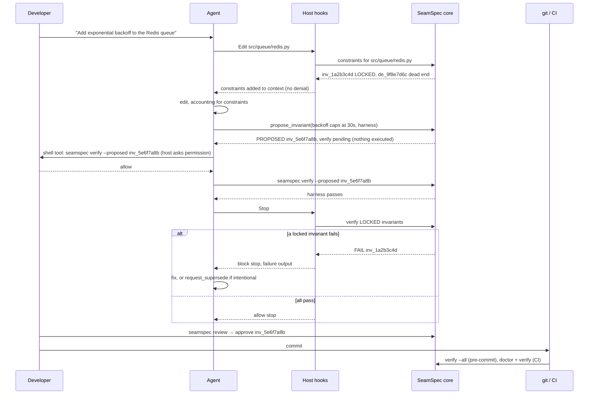
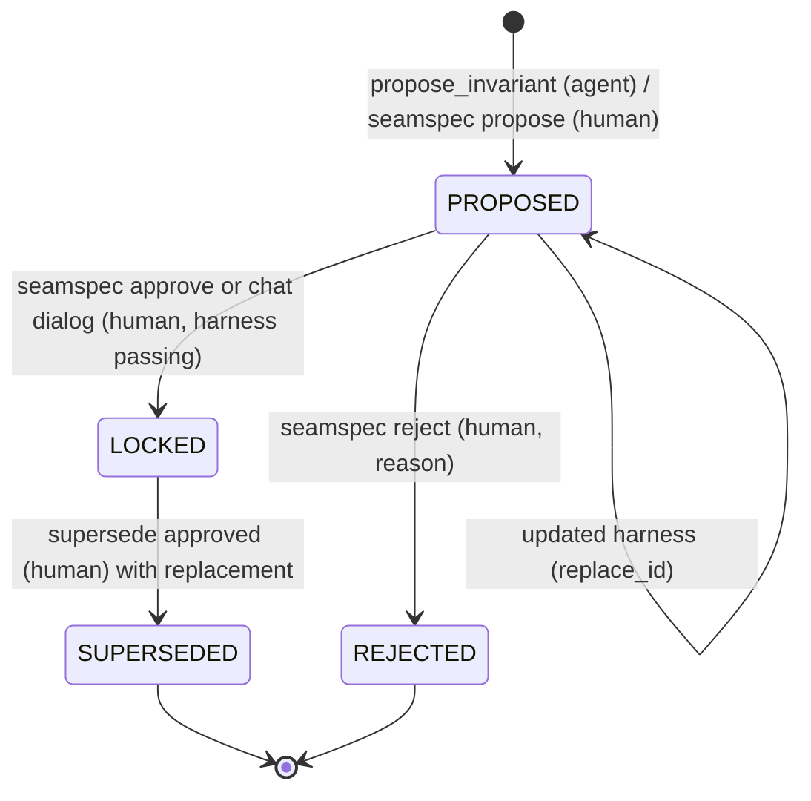
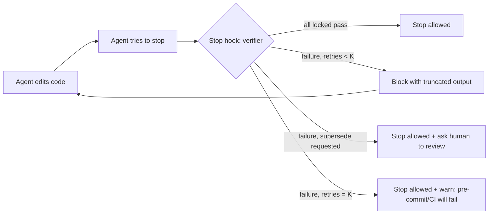

# SeamSpec — Design Specification

> **Status:** Draft v1.0 · **Supersedes:** `Idea.md`, `mcp_advantages.md`
> **Tagline:** *Build first; every seam that works gets a spec.*

---

## Table of Contents

0. [What Changed From Idea.md](#0-what-changed-from-ideamd)
1. [The Problem](#1-the-problem)
2. [What SeamSpec Is](#2-what-seamspec-is)
3. [Design Principles](#3-design-principles)
4. [SeamSpec vs OpenSpec](#4-seamspec-vs-openspec)
5. [The "Pick Two" Resolution](#5-the-pick-two-resolution)
6. [System Architecture](#6-system-architecture)
7. [Enforcement Model](#7-enforcement-model)
8. [Host Support Matrix](#8-host-support-matrix)
9. [Data Model & Storage](#9-data-model--storage)
10. [Record Schemas](#10-record-schemas)
11. [Lifecycles](#11-lifecycles)
12. [The Verifier (Not a Sandbox)](#12-the-verifier-not-a-sandbox)
    - [12A. Language Support](#12a-language-support)
13. [BRAINDUMP.md](#13-braindumpmd)
14. [MCP Surface](#14-mcp-surface)
15. [CLI Surface](#15-cli-surface)
    - [15A. Workflow Commands](#15a-workflow-commands)
16. [Host Adapters & Hook Specifications](#16-host-adapters--hook-specifications)
17. [The Self-Healing Loop](#17-the-self-healing-loop)
18. [Agent Directive (Advisory Layer)](#18-agent-directive-advisory-layer)
19. [Reference Implementation](#19-reference-implementation)
20. [Security Considerations](#20-security-considerations)
21. [Package Layout](#21-package-layout)
22. [Roadmap](#22-roadmap)
23. [Benchmark Plan](#23-benchmark-plan)
24. [Positioning & Launch](#24-positioning--launch)
25. [Risks & Mitigations](#25-risks--mitigations)
26. [Resolved Decisions](#26-resolved-decisions)
27. [Appendix A — Idea.md Issue → Fix Map](#appendix-a--ideamd-issue--fix-map)
28. [Appendix B — Glossary](#appendix-b--glossary)

---

## 0. What Changed From Idea.md

| Area | Idea.md | This spec | Why |
|---|---|---|---|
| Enforcement | "Architecturally blocked" via MCP | Hooks + git pre-commit + CI enforce; MCP is the interface | MCP tools are only called when the agent chooses to call them; they cannot intercept edits |
| Developer overhead | "Zero" | **Near-zero**: one-keystroke approval of proposed invariants | Fully autonomous locking produces junk invariants |
| Invariant lifecycle | `PROPOSED` existed but code jumped to `LOCKED`; no retirement | `PROPOSED → LOCKED → SUPERSEDED`, plus `REJECTED`; human-gated transitions | Without a way to retire rules, the ledger blocks legitimate change |
| Sandbox | "Isolated Sandbox Loop" with `shell=True` | **Verifier**: fixed commands from config, argv lists, timeouts | Containers add friction and no real security over what the agent can already do |
| Storage | Single `ledger.json` | **One file per record**; index is generated and local | Avoids git merge conflicts |
| Schema location | `.seamspec/schema.json` | Schema ships **in the package**; records reference `schema_version` | Schema is a definition, not project data |
| Scope matching | Substring (`f in scope`) | gitignore-style globs (`pathspec`) + optional tags | Substring matching never matched globs |
| Tamper detection | `hash()` (randomized per process) | SHA-256 of assertion **and** test file | `hash()` is not stable across runs |
| BRAINDUMP.md | Agent "read-only" yet also strikes through notes | Human-owned; SeamSpec writes only below a marker; gitignored by default | Resolves the contradiction; protects personal notes |
| Braindump extraction | Implied separate LLM | The **in-session agent** classifies; SeamSpec validates and stores | SeamSpec stays model-free, needs no API keys |
| MCP tool count | Growing | **7 small tools + 2 resources** (5 tools in v0.1); every tool has a CLI equivalent | Tool definitions cost context on every session (see §4.3) |
| Workflow commands | None (only rules-file directives) | **`/seamspec:*` chat slash commands** + MCP prompts, rendered per host from one template set (§15A) | Gives developers explicit "crystallize" moments without leaving the chat |
| Execution consent | Agent-supplied shell commands run inside the MCP server | **MCP never runs unapproved code**; proposed tests run only via the agent's permission-checked shell tool, MCP elicitation, or the human; one-time auto-run consent; repo trust; env scrubbing (§12.4) | With no sandbox, *who decides when code runs* is the control |
| Review load | Unbounded agent proposals | Per-run cap + **project-wide pending cap** (`proposals.max_pending = 10`); rejection can record a dead end with one key (§11.1, §26) | Too many proposals for the human to review would kill the approval step |
| Host support | "Runs identically" everywhere | Explicit per-host matrix; same core, different enforcement strength. **v0.1 ships Claude Code only** (as a plugin); Cursor and Copilot follow in v0.2 | Hosts differ in hook capabilities; a smaller v0.1 tests the core idea sooner |
| Languages | Implicitly Python (`pytest`, `.seamspec/tests/`) | **Language-agnostic runners**: v0.1 presets for pytest and vitest; jest, Go, Rust and `custom` in v0.2; per-runner test folders; failure attribution via JUnit XML, `go test -json`, or isolated reruns (§12A) | Go and Rust can't run tests from `.seamspec/`; the runner design must allow every language from day one |
| Positioning | OpenSpec described as manual and heavy | Honest comparison: the difference is *when* the gate happens and *whether the spec runs* | A strawman comparison would be called out by expert readers |

---

## 1. The Problem

Conversational AI coding ("vibecoding") collapses the time from idea to running prototype. But long sessions hit an **entropy wall**:

| Phase | What happens |
|---|---|
| Early turns | High velocity; the agent holds the full picture |
| Middle turns | Constraints stated earlier silently erode as context fills with diffs and tool output |
| Late turns | Circular regressions: fixing bug A reintroduces bug B; approaches that already failed get retried |

> [!NOTE]
> The turn numbers in `Idea.md` (1–3 / 4–8 / 9+) are plausible but unmeasured. §23 defines a benchmark to measure this instead of asserting it.

Root causes:

1. **Constraint amnesia** — decisions live only in chat history, which scrolls out of effective attention.
2. **No negative memory** — nothing records *what was tried and failed*, so agents retry dead ends.
3. **No executable contract** — rules are prose; nothing mechanically checks that earlier decisions still hold.
4. **Cross-session reset** — a new session starts from zero except for whatever static rules file exists.

---

## 2. What SeamSpec Is

**SeamSpec is an open-source governance layer for AI coding agents that turns validated decisions into protected, executable invariants — while the developer keeps vibecoding.**

In one line: **OpenSpec is "specify, then build." SeamSpec is "build, and the spec hardens behind you."**

It maintains a **living ledger** of:

- **Invariants** — behavioral rules, each backed by an executable test, scoped to files.
- **Dead ends** — approaches that were tried and failed, with the failure symptom.
- **Decisions (ADRs)** — the *why* behind invariants, in Michael Nygard format.

And it **enforces** them through host hooks, git, and CI — not through prompt compliance.

---

## 3. Design Principles

1. **Enforce outcomes, not actions.** Agents can modify files many ways (Edit tool, Bash, scripts). Enforcement that matters checks *results* (tests pass, hashes match), not *which tool was used*.
2. **Asymmetric trust.** Things that *constrain the future* (invariants) require human approval. Things that merely *warn* (dead ends) can be recorded by the agent directly.
3. **Near-zero, not zero, overhead.** One keystroke to approve is the price of trustworthy rules.
4. **One brain, many adapters.** A single core library; CLI, MCP, hooks, git, and CI are thin adapters over it. They can never disagree.
5. **Model-free core.** SeamSpec never calls an LLM itself. The agent already in the session does all language work; SeamSpec validates, stores, verifies, and enforces.
6. **Honest claims.** Every capability is labeled with its real enforcement strength per host.
7. **Git-native.** Plain files, one record per file, reviewable in PRs, mergeable without conflicts.
8. **Fail open in-session, fail closed at the gate.** A crashing hook must not brick the agent; CI is the uncompromising backstop.

---

## 4. SeamSpec vs OpenSpec

### 4.1 What OpenSpec Is

OpenSpec is a spec-driven development framework. Work flows through a proposal lifecycle:

1. **Propose** — the agent drafts `openspec/changes/<id>/` with `proposal.md`, delta specs (`ADDED` / `MODIFIED` / `REMOVED`), `tasks.md`, and optional `design.md`.
2. **Review** — a human reviews the proposal *before* implementation.
3. **Apply** — the agent works through `tasks.md`.
4. **Validate** — `openspec validate` checks the **structure** of specs and changes.
5. **Archive** — `openspec archive` merges deltas into `openspec/specs/`, the source of truth.

OpenSpec **does not execute code**. Its CLI validates documents and manages their lifecycle.

### 4.2 The Real Differences

| Dimension | OpenSpec | SeamSpec |
|---|---|---|
| **When the spec exists** | Before code — describes the *intended* future | After green tests — records *proven* behavior |
| **Nature of the spec** | Prescriptive design document | Empirical, accumulated record |
| **Where the human gate is** | Before implementation (proposal review) | After verification (invariant approval) |
| **Does the spec run?** | No — prose and structure validation | Yes — every invariant is an executable test |
| **Enforcement** | Agent reads `AGENTS.md` / slash commands | Hooks, git pre-commit, CI |
| **On violation** | Human notices and steers | Agent is blocked from finishing; tests must pass or a supersede must be requested |
| **Memory** | Current system state + archived changes | Current state + **failed approaches** + provenance of every rule |
| **Developer flow** | Stop, propose, review, then build | Keep building; review proposed invariants in batches |

> [!IMPORTANT]
> **Honest trade-off:** Because SeamSpec's spec is backward-looking, it **prevents regressions, not bad designs**. OpenSpec's up-front review can catch a wrong architecture before code exists; SeamSpec can only ensure you don't break what already works. The two are complementary, and a future `import` origin type (§10.1) can ingest OpenSpec requirements as proposed invariants.

> [!NOTE]
> The developer-overhead difference is smaller than `Idea.md` claimed: in current OpenSpec, the AI drafts proposals and humans review. The defensible difference is **gate timing** and **executability**, not who types.

### 4.3 OpenSpec and MCP (Issue #319)

Issue [#319](https://github.com/Fission-AI/OpenSpec/issues/319) ("Implement OpenSpec as an MCP Server") was opened Nov 2025 and closed as *not planned* in Aug 2026, moved to Discussions #1539.

- The proposed MCP surface was **document management only**: `list-specs`, `get-change`, `validate-change`, `show-delta`, `compare-specs`, plus proposal prompts. Even with MCP, OpenSpec's model remains a human-reviewed proposal lifecycle — no execution, no tests, no enforcement.
- A maintainer pushed back on MCP itself, comparing it to `gh` CLI vs GitHub MCP: **MCP tool definitions consume context in every session**, even when unused. Other commenters agreed a CLI serves both humans and scripts.
- Adjacent work exists: a community PR (#379) and [`Pimzino/spec-workflow-mcp`](https://github.com/Pimzino/spec-workflow-mcp).

**Lessons applied to SeamSpec:**

1. **CLI first.** Every MCP tool has a CLI equivalent; agents without MCP can use `seamspec context <files>` via shell. MCP is optional.
2. **Small MCP surface.** 7 tools (5 in v0.1), 2 resources; target < 1,500 tokens of tool definitions (measured in CI, §22).
3. **The argument for MCP** in SeamSpec is **structured, validated writes** to the ledger (propose, log dead end, request supersede) that work identically in every client — a stronger case than read-only document access.

### 4.4 SeamSpec vs Plain Tests + a Stop Hook

The real baseline is not OpenSpec. It is ordinary tests in `tests/`, a host `Stop` hook that runs them, and CODEOWNERS. Anyone can set that up in about 20 lines, and it already delivers most of the "wall" (§7.1 layers 4–6). Expert readers will ask about this first, so the honest answer is stated here:

| | Plain tests + Stop hook | SeamSpec |
|---|---|---|
| **Capture** | Someone has to decide to write a test, later | `/lock` turns a moment in the conversation ("this works now") into a proposed test, with its origin recorded |
| **Approval** | Tests appear in diffs like any other code | Every rule is explicitly approved by a human before it can block anything |
| **Protection** | The agent can quietly edit, skip or delete a test to make it pass | Locked tests are hash-checked; test config, skips and status changes are flagged (§12.2, §7.1) |
| **Negative memory** | None | Dead ends: what was tried, and why it failed |
| **Context at edit time** | Agent finds out at Stop, after the damage | Constraints are shown before the agent edits a governed file (§7.2) |
| **Setup** | ~20 lines, no new tool | A tool to install and learn |

> [!IMPORTANT]
> If benchmark condition (C) does not clearly beat (D) in §23, the value is in **capture, approval and dead ends**, not in enforcement, and the positioning must say so.

---

## 5. The "Pick Two" Resolution

`Idea.md` promised three things that conflict:

| Promise | Meaning |
|---|---|
| **Zero overhead** | Developer never reviews anything |
| **Autonomous** | Agent locks invariants on its own |
| **Trustworthy** | Locked rules are correct and enforced |

- Zero overhead + autonomous → junk tests get locked (trivially true, overfit, implementation-coupled).
- Autonomous + trustworthy → requires human approval (not zero overhead).
- Zero overhead + trustworthy → requires near-perfect inference that doesn't exist.

**Resolution: Autonomous + Trustworthy, with near-zero overhead.**

- The agent **proposes** invariants autonomously (with tests that already pass).
- The human **approves in batches** with one keystroke (`seamspec review`).
- Pre-commit shows a non-blocking reminder: `3 invariants awaiting review`.
- Dead ends need no approval (asymmetric trust, §3).

---

## 6. System Architecture

### 6.1 Layers



| Layer | Responsibility | Enforcement role |
|---|---|---|
| **Core** | All logic: storage, matching, verification, lifecycle | None directly — pure logic |
| **CLI** | Human UX + hook/git/CI entry points | Entry point for every gate |
| **MCP server** | Agent-facing typed tools and resources | None — interface only |
| **Host hooks** | Inject constraints, gate edits, gate completion | In-session enforcement |
| **git pre-commit** | Run locked invariants before commit | Local backstop (skippable with `--no-verify`) |
| **CI** | Full verification + ledger integrity + retirement summary | Final gate for accidents; PR review is the gate for intent (§7.1) |

### 6.2 End-to-End Flow



---

## 7. Enforcement Model

### 7.1 Layers of Enforcement

| # | Layer | Mechanism | Strength | Catches Bash writes? |
|---|---|---|---|---|
| 1 | Context | MCP `get_constraints`, rules file | Soft | n/a |
| 2 | Edit-time context | Host hook adds constraints to the agent's context before it edits a governed file (§7.2) | Soft, but delivered at the right moment | ❌ |
| 3 | Ledger protection | `PreToolUse` denies direct edits to `.seamspec/**`, every runner's harness files and fingerprinted runner config (§12A.5, §12.2) | Hard for Edit/Write tools | ❌ (caught by layer 4/6) |
| 4 | Completion gate | Host `Stop` hook runs the verifier within one overall deadline; blocks finishing while locked invariants fail, and flags unjournaled status changes | Hard against accidents, retry-capped | ✅ (checks outcomes) |
| 5 | Local backstop | git pre-commit: `seamspec verify --all --gate` | Hard against accidents, skippable (`--no-verify`) | ✅ |
| 6 | Final gate | CI: `seamspec doctor --ci` + `seamspec verify --all --ci`, plus a summary of every rule retired in the PR | Hard against accidents | ✅ |
| 7 | Human review | PR review of `.seamspec/` changes (CODEOWNERS in `strict`) | The only layer that stops a *deliberate* bypass | ✅ |

> [!IMPORTANT]
> Layers 2–3 are an **early-warning system**. Layers 4–6 are **the wall against accidental regressions**: they check outcomes regardless of how files were modified. They are **not** proof against a deliberately adversarial agent with shell access, which can, for example, mark a rule `SUPERSEDED` itself or make code detect that it is under test. SeamSpec makes such changes **noisy** (journal check at Stop, retirement summary in CI); only human review of the PR actually **stops** them.

### 7.2 Edit-Time Context (formerly "Deny Once")

The agent should see the relevant rules and dead ends *before* it edits a governed file. Denying the edit is the portable way to do that, but a denial can backfire: models sometimes read it as "the user refused" and then write the file through Bash (`cat > file`), which skips the gate entirely. So the default delivers context **without denying**:

1. Agent is about to edit (or has just read) a file governed by locked invariants or active dead ends.
2. Hook checks session state for key `(session_id, file, ledger_revision)`.
3. **First time:** add the constraints to the agent's context. Record the key. *(Claude Code: `PreToolUse` returning only `hookSpecificOutput.additionalContext`, which the hooks reference confirms reaches the model. Never return `permissionDecision: "allow"`, which would bypass the user's own permission prompts (ADR-20261005-5009).)*
4. Later edits in the same session pass silently.
5. If the ledger changes (`ledger_revision` differs), it re-arms.

`hooks.gate_mode`: `context` (default where the host supports context injection), `deny_once` (fallback for hosts without it, and always used for a **brand-new** file created inside a governed path), `off`.

### 7.3 Modes

`seamspec init --mode <mode>`:

| Mode | Installs | Enforcement | Use when |
|---|---|---|---|
| `advisory` | MCP config + rules file | Prompt-based (labeled honestly) | Trying SeamSpec; hosts without hooks |
| `enforced` *(default)* | + host hooks + git pre-commit + **CI workflow (offered; `--ci` / `--no-ci`)** | In-session + commit-time + PR | Daily individual use |
| `strict` | + CI workflow (always), `fail_closed = true`, `trust_level = "harness"`, CODEOWNERS entry for `.seamspec/` | Everything above, hooks fail closed (retry-capped), any new upstream test needs re-trust | Teams, shared repos |

**CI by mode** (ADR-20261005-c41d): `init` in `enforced` mode asks *"Add a CI workflow (.github/workflows/seamspec.yml)? [Y/n]"*; `--ci` / `--no-ci` answer it for scripts. `strict` always installs it, plus CODEOWNERS. `advisory` never does. The workflow is the same in every mode (§16.5). **An unreleased SeamSpec (a development build) doesn't ask:** it says the workflow isn't offered yet, because a CI runner couldn't install this build, and that `seamspec init --ci` adds it anyway (ADR-20261011-a9f3).

`advisory` mode **never runs tests automatically**. `enforced` and `strict` show a one-time auto-run consent screen at `init`, and automatic runs only happen in trusted clones (§12.4).

**Changing the mode later** (ADR-20261007-1b4c) means re-running `seamspec init --mode <mode>`:
- **No `--mode`:** keeps `enforced` or `strict` as they are, so they're never lowered silently. A new or advisory setup is offered `enforced`, so re-running `init` with consent turns automatic runs on.
- **Raising the mode** needs automatic runs allowed on this machine (the consent screen). Otherwise the config is kept and `init` says why. Consent is only asked when raising the mode or setting up: lowering it, or choosing advisory, asks nothing and keeps this machine's earlier answer.
- **Lowering the mode** (strict → enforced, or anything → advisory) switches checks off, so it's a **human decision**, like approving. `init` needs an interactive terminal and asks *"Lower the mode from … to …?"*. Like approving, this is a **speed bump, not a boundary**: an agent with an unrestricted shell could still edit `config.toml` or call the Python API. The backstop is review, since `doctor --ci` shows the change.
- **Rewrites are minimal.** Only the `mode` line changes, plus, when entering or leaving `strict`, the `fail_closed` / `trust_level` lines that `init` itself wrote. Values a human edited stay.
- **Switching to `advisory`** removes SeamSpec's own pre-commit hook, never anyone else's. The `seamspec verify --gate` check also runs nothing in advisory mode.
- **Switching to `strict`** adds the CI workflow and the CODEOWNERS block.
- **In review:** `doctor --ci` shows a mode change at the top of the retirement summary, so a PR that lowers enforcement is visible.

### 7.4 Known Limits (Stated Publicly)

- Agents can modify files via Bash, bypassing `PreToolUse` matchers on Edit/Write. Layers 4–6 catch the *outcome*.
- `git commit --no-verify` skips pre-commit. CI does not.
- **A deliberately adversarial agent can defeat layers 4–6** (retire a rule itself, make code detect a test run). SeamSpec makes this noisy; only PR review stops it (§7.1 layer 7).
- Host hook APIs evolve; adapters must be re-verified per release (§8).
- SeamSpec guards against regressions of *approved* behavior. It does not judge whether new code is good.
- **No sandbox:** approved tests, and the project code they import, run with the developer's user permissions. SeamSpec controls *when* code runs and *who consented* (§12.4), not what that code can access.

---

## 8. Host Support Matrix

| Capability | Claude Code | VS Code (Copilot agent) | Cursor | Cline / Windsurf / other MCP clients |
|---|---|---|---|---|
| MCP tools + resources | ✅ | ✅ | ✅ | ✅ |
| CLI fallback via shell | ✅ | ✅ | ✅ | ✅ |
| Edit-time context (§7.2) | ✅ `PreToolUse` `additionalContext` | ✅ `PreToolUse` (deny-once fallback: `permissionDecision: "deny"`) | ✅ `preToolUse` (deny-once fallback: `permission: "deny"`) | ❌ |
| Ledger protection | ✅ | ✅ | ✅ | ❌ |
| Completion gate | ✅ `Stop` + `decision: block` | ✅ `Stop` + `decision: block` | ✅ `stop` + `followup_message` (auto-continue, capped by `loop_limit`) | ❌ |
| Session-start agreements summary *(v0.1, ADR-20261007-ac04)* + braindump nudge (§13.9) *(v0.2)* | ✅ `SessionStart` | ✅ `SessionStart` | ✅ `sessionStart` (local agents) | Directive fallback |
| git pre-commit | ✅ | ✅ | ✅ | ✅ |
| CI gate | ✅ | ✅ | ✅ | ✅ |
| **Ships in** | **v0.1** | v0.2 | v0.2 | v0.1 (MCP + CLI + git/CI) |
| **Tier** | **Full** | **Full** *(hooks API in Preview)* | **Full** | **Commit-time** |

> [!WARNING]
> Copilot and Cursor capabilities were re-checked against their official hook docs on 2026-10-05 (VS Code agent hooks reference; cursor.com/docs/hooks), **not yet hands-on**. VS Code labels agent hooks as Preview. Cursor's completion gate works by auto-submitting a "fix this" follow-up message rather than refusing to stop, and Cursor cloud agents don't run every hook (e.g. `sessionStart`). Every adapter is a thin config file over the shared CLI and must be re-verified before each release. `seamspec doctor` reports the detected tier per host.

**Launch strategy:** **v0.1 ships Claude Code only**, as a Claude Code plugin (§16.1), because it has the most mature hooks and keeps the first release small enough to finish and measure. Copilot and Cursor adapters follow in **v0.2**, soon after, since they are thin config files over the same CLI (§22). Other MCP clients get commit-time enforcement until they add hooks.

---

## 9. Data Model & Storage

### 9.1 Directory Layout

```
<repo>/
├── BRAINDUMP.md                      # human-owned scratchpad (gitignored by default) — v0.2
├── CLAUDE.md                         # SeamSpec directive block between markers, written by init (§18)
├── .claude/
│   └── settings.json                 # enables the seamspec Claude Code plugin for the team (§16.1; key names to verify)
├── .github/
│   ├── hooks/seamspec.json           # VS Code Copilot hooks (generated) — v0.2
│   ├── prompts/seamspec-*.prompt.md  # Copilot workflow commands (generated, §15A) — v0.2
│   ├── workflows/seamspec.yml        # CI gate (enforced: offered at init; strict: always; §7.3)
│   └── CODEOWNERS                    # .seamspec/ ownership (strict mode)
├── .cursor/                          # v0.2
│   ├── mcp.json
│   ├── commands/seamspec-*.md        # Cursor workflow commands (generated, §15A)
│   └── hooks.json
├── .vscode/mcp.json                  # v0.2
└── .seamspec/
    ├── config.toml                   # project configuration (committed)
    ├── commands/                     # optional per-project overrides of command templates (committed)
    ├── invariants/
    │   ├── inv_1a2b3c4d.json         # one file per invariant (committed)
    │   └── inv_5e6f7a8b.json
    ├── dead_ends/
    │   └── de_9f8e7d6c.json          # one file per dead end (committed)
    ├── adrs/
    │   └── ADR-20261003-4f8a-redis-queue-backoff.md   # Nygard format + YAML frontmatter
    ├── pytest.ini                    # SeamSpec's own pytest config: pythonpath = . (no conftest; §12.3)
    ├── vitest.config.mjs             # SeamSpec's own vitest config (no project setupFiles; §12.3)
    ├── fingerprints.json             # hashes of every runner's config_files, confirmed by a human (§12.2)
    ├── tests/                        # default harness_dir (pytest) for LOCKED harnesses; other runners choose their own (§12A)
    │   └── test_inv_1a2b3c4d.py      # one harness per invariant
    ├── proposed/                     # harnesses of PROPOSED invariants, kept out of every test tree until approved (§12A.5)
    ├── retired/                      # harnesses of SUPERSEDED/REJECTED invariants, moved out of test trees (§12A.5)
    └── .local/                       # gitignored: machine-local state
        ├── index.json                # generated cache; rebuilt when stale
        ├── sessions/                 # hook state per session_id
        ├── journal.jsonl             # status changes made through the CLI (§11.1); Stop flags changes missing from it
        ├── braindump.json            # processed braindump item state
        ├── requests/                 # pending supersede requests
        ├── reports/                  # per-runner test reports (JUnit XML), overwritten each run
        ├── last_verify.json          # last verifier results + tree fingerprint
        └── store.lock
```

LOCKED harnesses for other languages live where their toolchain can find them (§12A.2). Proposed ones wait in `.seamspec/proposed/` and are moved here on approval:

```
<repo>/
├── tests/seamspec/inv_5e6f7a8b.test.ts                 # vitest / jest
├── internal/seamspec/inv_0d1e2f3a/seamspec_test.go     # go (one package per invariant) — v0.2
└── tests/seamspec_inv_8a9b0c1d.rs                      # cargo (top-level integration test) — v0.2
```

### 9.2 Why One File Per Record

- Two branches each adding an invariant create **two new files** → no merge conflict.
- PR diffs show exactly which rule changed.
- The index (`.local/index.json`) is a **generated cache**, never committed, rebuilt when any record's mtime is newer.

### 9.3 IDs

| Record | Format | Example | Notes |
|---|---|---|---|
| Invariant | `inv_` + 8 hex | `inv_1a2b3c4d` | Random; checked for collision at creation |
| Dead end | `de_` + 8 hex | `de_9f8e7d6c` | Random |
| ADR | `ADR-YYYYMMDD-` + 4 hex | `ADR-20261003-4f8a` | Date-ordered and branch-safe; sequential numbers collide across branches |
| Braindump item | `bd_` + 8 hex of normalized text | `bd_77aa0c12` | Content-derived; editing an item makes it a new item |

### 9.4 Schema Location

- JSON Schemas ship **inside the package** at `seamspec/schemas/v1/*.json` and are published on GitHub Pages at `https://seamspec.github.io/schemas/v1/` (the `$id` base). Validation always uses the packaged copy, so the URL is an identifier, not a runtime dependency. If a custom domain is acquired later, the old URLs keep serving (redirect pages) so existing `$id`s never break.
- `config.json` is generated from the config model (`config_json_schema()`, §19.2); `invariant.json` and `dead_end.json` are hand-written and checked against the models by the tests.
- Each record carries `"schema_version": "1"`.
- `seamspec doctor` validates every record; `seamspec migrate` upgrades records when the schema version changes.

### 9.5 `config.toml`

```toml
schema_version = "1"
mode = "enforced"              # advisory | enforced | strict

[verify]
timeout_seconds = 120          # per runner invocation, never longer than the time left in the deadline
stop_deadline_seconds = 240    # ONE overall budget for a Stop/gate run (groups + isolated reruns); max 270, below the 300 s Stop hook timeout (ADR-20261005-5675)
max_output_chars = 4000        # truncated output fed back to the agent
max_stop_retries = 3           # self-healing ceiling (K); also applies to the error path (§16.1)
run_on_stop = "auto"           # auto | all | scoped (only invariants matching changed files)
stop_all_threshold = 100       # auto: run all LOCKED below this count, scoped at or above it
isolate_on_failure = 10        # if a group fails and can't be attributed, rerun up to N harnesses one at a time (within the deadline)

# Runners are generated by `seamspec init` from detected languages (§12A.7).
# Full preset list: §12A.3. v0.1 ships pytest and vitest.
[runners.pytest]
cmd = ["pytest", "-c", ".seamspec/pytest.ini", "--rootdir=.", "--noconftest", "--continue-on-collection-errors", "-q", "-p", "no:cacheprovider", "--junitxml={report}", "{each}"]
harness_dir = ".seamspec/tests"
filename = "test_{id}.py"
report = "junit"
config_files = [".seamspec/pytest.ini"]        # fingerprinted (§12.2); project conftest/addopts are ignored by the flags above
paths = ["**/*.py"]

[runners.vitest]
cmd = ["npx", "vitest", "run", "--config", ".seamspec/vitest.config.mjs", "--reporter=default", "--reporter=junit", "--outputFile.junit={report}", "{each}"]
harness_dir = "tests/seamspec"
filename = "{id}.test.ts"
report = "junit"
config_files = [".seamspec/vitest.config.mjs"]   # fingerprinted (§12.2); SeamSpec's own config, so project setupFiles don't apply
paths = ["**/*.ts", "**/*.tsx", "**/*.js", "**/*.jsx"]

[hooks]
gate_mode = "context"          # context | deny_once | off (§7.2)
fail_closed = false            # strict mode defaults to true

[braindump]                     # v0.2
path = "BRAINDUMP.md"
marker = "<!-- seamspec:processed -->"
redact_secrets = true
nudge = "ask"                  # ask | off — session-start offer to sort new notes (§13.9)

[protect]
paths = [".seamspec/**"]

[commands]
namespace = "seamspec"         # /seamspec:lock (Claude Code plugin) or /seamspec-lock (Cursor, Copilot; v0.2)
hosts = ["auto"]               # auto | claude | cursor | vscode (v0.1: claude)
max_proposals_per_run = 3      # cap for /seamspec:checkpoint and /seamspec:drain

[proposals]
max_pending = 10               # project-wide cap on PROPOSED invariants awaiting review

[execution]                    # §12.4 Execution Consent
run_proposed = "auto"          # auto | host | ask | never — how proposed (unapproved) tests may run (v0.1: host | never; ask = v0.2)
env_passthrough = []           # extra env vars tests may see, e.g. ["DATABASE_URL"]
trust_level = "runners"        # runners | harness — strict mode defaults to harness

[review]                       # §11.5 Approvals in chat
chat_approvals = false         # approve, reject and supersede in a chat dialog — off in every mode until Claude Code shows the whole dialog (ADR-20261008-5d1e)
```

- Commands are **argv lists**, never shell strings.
- `{each}` expands the runner's `each` template once per harness (default `["{path}"]`); `{report}` is the report file SeamSpec reads afterwards. `{harnesses}` is accepted as an alias for `{each}`. Full key reference: §12A.3.
- The agent never supplies a command; it supplies a **runner name** that must exist in config.
- **Mode-dependent defaults:** in `strict` mode, `hooks.fail_closed` defaults to `true` and `execution.trust_level` to `"harness"`. `seamspec init --mode strict` writes those values into `config.toml`; if a key is missing, the config loader applies the same strict defaults. An explicit value in `config.toml` always wins (§19.2), and `doctor` warns when a `strict` repo has loosened either one.

---

## 10. Record Schemas

### 10.1 Invariant (`seamspec/schemas/v1/invariant.json`)

```json
{
  "$schema": "https://json-schema.org/draft/2020-12/schema",
  "$id": "https://seamspec.github.io/schemas/v1/invariant.json",
  "title": "Invariant",
  "type": "object",
  "additionalProperties": false,
  "required": ["schema_version", "id", "title", "assertion", "scope", "status", "origin", "verification", "created_at"],
  "properties": {
    "schema_version": { "const": "1" },
    "id": { "type": "string", "pattern": "^inv_[a-f0-9]{8}$" },
    "title": { "type": "string", "minLength": 3, "maxLength": 120 },
    "assertion": {
      "type": "string",
      "minLength": 10,
      "description": "Behavioral rule in plain language, e.g. 'Retry delay never exceeds 30s'"
    },
    "scope": {
      "type": "object",
      "additionalProperties": false,
      "required": ["paths"],
      "properties": {
        "paths": {
          "type": "array", "minItems": 1, "items": { "type": "string" },
          "description": "gitignore-style globs relative to repo root, e.g. src/queue/**"
        },
        "tags": {
          "type": "array", "items": { "type": "string" },
          "description": "Cross-cutting concerns, e.g. tenant-isolation"
        }
      }
    },
    "status": { "enum": ["PROPOSED", "LOCKED", "SUPERSEDED", "REJECTED"] },
    "origin": {
      "type": "object",
      "additionalProperties": false,
      "required": ["type", "text"],
      "properties": {
        "type": { "enum": ["prompt", "braindump", "manual", "import"] },
        "text": { "type": "string", "maxLength": 2000, "description": "Redacted copy of the originating intent" },
        "ref": { "type": ["string", "null"], "description": "e.g. braindump item id bd_77aa0c12" }
      }
    },
    "verification": {
      "type": "object",
      "additionalProperties": false,
      "required": ["runner", "harness_path"],
      "properties": {
        "runner": { "type": "string" },
        "harness_path": { "type": "string" },
        "harness_sha256": { "type": ["string", "null"], "pattern": "^[a-f0-9]{64}$" },
        "assertion_sha256": { "type": ["string", "null"], "pattern": "^[a-f0-9]{64}$" }
      }
    },
    "adr_id": { "type": ["string", "null"], "pattern": "^ADR-[0-9]{8}-[a-f0-9]{4}$" },
    "created_at": { "type": "string", "format": "date-time" },
    "approved_at": { "type": ["string", "null"], "format": "date-time" },
    "approved_by": { "type": ["string", "null"] },
    "superseded_by": { "type": ["string", "null"], "pattern": "^inv_[a-f0-9]{8}$" },
    "status_reason": { "type": ["string", "null"], "description": "Why rejected or superseded" },
    "decided_via": { "enum": ["terminal", "chat", null], "description": "Where a human made the decision that set the status; null means the terminal (ADR-20261006-c300)" }
  },
  "allOf": [
    {
      "if": { "properties": { "status": { "const": "LOCKED" } } },
      "then": {
        "required": ["approved_at", "approved_by"],
        "properties": {
          "approved_at": { "type": "string" },
          "approved_by": { "type": "string" },
          "verification": {
            "required": ["harness_sha256", "assertion_sha256"],
            "properties": {
              "harness_sha256": { "type": "string" },
              "assertion_sha256": { "type": "string" }
            }
          }
        }
      }
    },
    {
      "if": { "properties": { "status": { "const": "SUPERSEDED" } } },
      "then": {
        "required": ["superseded_by", "status_reason"],
        "properties": { "status_reason": { "type": "string" } }
      }
    },
    {
      "if": { "properties": { "status": { "const": "REJECTED" } } },
      "then": {
        "required": ["status_reason"],
        "properties": { "status_reason": { "type": "string" } }
      }
    }
  ]
}
```

> The schemas above are copies of the packaged files in `seamspec/schemas/v1/`, which are the source of truth. The `then` branches require the status-specific fields to be **non-null strings**, not just present: every record carries every key, so a bare `required` would accept `null` (ADR-20261005-6f2a).

**Example — `.seamspec/invariants/inv_1a2b3c4d.json`:**

```json
{
  "schema_version": "1",
  "id": "inv_1a2b3c4d",
  "title": "Redis retry delay is capped",
  "assertion": "Exponential backoff for Redis queue retries never exceeds 30 seconds between attempts.",
  "scope": { "paths": ["src/queue/**"], "tags": ["resilience"] },
  "status": "LOCKED",
  "origin": {
    "type": "prompt",
    "text": "Add exponential backoff to the Redis queue, but don't let it wait more than 30s.",
    "ref": null
  },
  "verification": {
    "runner": "pytest",
    "harness_path": ".seamspec/tests/test_inv_1a2b3c4d.py",
    "harness_sha256": "3f1c...e9",
    "assertion_sha256": "a87d...10"
  },
  "adr_id": "ADR-20261003-4f8a",
  "created_at": "2026-10-03T08:12:00Z",
  "approved_at": "2026-10-03T08:20:41Z",
  "approved_by": "Maya Rao <12345+maya@users.noreply.github.com>",
  "superseded_by": null,
  "status_reason": null,
  "decided_via": "terminal"
}
```

> Hash values above are shortened for readability (illustrative only); real values are 64 hex characters and must match the schema pattern.

### 10.2 Dead End (`seamspec/schemas/v1/dead_end.json`)

```json
{
  "$schema": "https://json-schema.org/draft/2020-12/schema",
  "$id": "https://seamspec.github.io/schemas/v1/dead_end.json",
  "title": "DeadEnd",
  "type": "object",
  "additionalProperties": false,
  "required": ["schema_version", "id", "scope", "approach", "failure_symptom", "source", "status", "created_at"],
  "properties": {
    "schema_version": { "const": "1" },
    "id": { "type": "string", "pattern": "^de_[a-f0-9]{8}$" },
    "scope": {
      "type": "object",
      "additionalProperties": false,
      "required": ["paths"],
      "properties": {
        "paths": { "type": "array", "minItems": 1, "items": { "type": "string" } },
        "tags": { "type": "array", "items": { "type": "string" } }
      }
    },
    "approach": { "type": "string", "minLength": 10, "description": "What was tried" },
    "failure_symptom": { "type": "string", "maxLength": 1000, "description": "Why it failed (truncated traceback or reason)" },
    "source": { "enum": ["verifier", "braindump", "manual", "agent"] },
    "related_invariant": { "type": ["string", "null"], "pattern": "^inv_[a-f0-9]{8}$" },
    "status": { "enum": ["ACTIVE", "RETIRED"] },
    "retired_reason": { "type": ["string", "null"], "description": "e.g. 'Fixed upstream in redis-py 6.2'" },
    "decided_via": { "enum": ["terminal", "chat", null], "description": "Where a human retired it; null means the terminal (ADR-20261006-c300)" },
    "created_at": { "type": "string", "format": "date-time" }
  },
  "allOf": [
    {
      "if": { "properties": { "status": { "const": "RETIRED" } } },
      "then": {
        "required": ["retired_reason"],
        "properties": { "retired_reason": { "type": "string" } }
      }
    }
  ]
}
```

Dead ends can be **retired** when circumstances change (library upgraded, constraint removed), so they don't block a now-valid approach forever.

### 10.3 ADR (Markdown + YAML frontmatter)

**`.seamspec/adrs/ADR-20261003-4f8a-redis-queue-backoff.md`:**

```markdown
---
id: ADR-20261003-4f8a
title: Redis queue uses capped exponential backoff
status: ACCEPTED            # PROPOSED | ACCEPTED | SUPERSEDED | REJECTED
date: 2026-10-03
scopes: ["src/queue/**"]
invariants: ["inv_1a2b3c4d"]
supersedes: null
superseded_by: null
---

# ADR-20261003-4f8a: Redis queue uses capped exponential backoff

## Context
Transient Redis failures caused retry storms. Fixed-interval retries amplified load during outages.

## Decision
Use exponential backoff with full jitter, base 100ms, capped at 30s.

## Enforced Invariants
* `inv_1a2b3c4d` — Retry delay never exceeds 30 seconds.

## Consequences
* Worst-case recovery latency is bounded at 30s per attempt.
* Queue consumers must tolerate delayed redelivery.
```

ADRs are created as `PROPOSED` alongside their invariants and become `ACCEPTED` when the invariant is approved. An ADR may exist without invariants (`propose_decision`) for decisions that are not mechanically testable.

---

## 11. Lifecycles

### 11.1 Invariant State Machine



| Transition | Actor | Preconditions | Effects |
|---|---|---|---|
| → `PROPOSED` | Agent or human | Valid schema; runner exists; harness written by SeamSpec; fewer than `proposals.max_pending` invariants already `PROPOSED` (agent only; humans and `replace_id` updates are exempt). **Nothing is executed**; verification is `pending` until run through a consented path (§12.4) | Record + harness + draft ADR created |
| `PROPOSED` → `PROPOSED` | Agent | `replace_id` points to a `PROPOSED` record | Harness/assertion updated; verification reset to `pending` |
| `PROPOSED` → `LOCKED` | **Human only** | Interactive TTY, or the human's answer in a SeamSpec chat dialog (§11.5); human has been shown the full harness **and its red-green result** (§11.4); harness passes when run at approval | Harness moved from `.seamspec/proposed/` into the runner's `harness_dir`; hashes computed; runner config fingerprints confirmed (§12.2); `approved_at/by` set; ADR → `ACCEPTED` |
| `PROPOSED` → `REJECTED` | Human | Reason given | `review` then asks *"Also record as dead end? [y/N]"* (default **No**); `reject --dead-end` does the same non-interactively. Never automatic |
| `LOCKED` → `SUPERSEDED` | **Human only** | Pending supersede request or explicit command; replacement invariant, which must already be `LOCKED` (may be `null` for pure retirement, with reason) | Old record keeps history; excluded from verification; ADR → `SUPERSEDED` |

**Pending-proposal cap.** When `proposals.max_pending` is reached, `propose_invariant` returns `{ "error": "queue_full", "pending": 10, "message": "Review queue is full. Ask the user to run `seamspec review`." }` and writes nothing. The cap applies to the review backlog, not to a single session, because the backlog is what overwhelms the human. Dead ends are not capped (they need no approval).

**Why rejection doesn't auto-create a dead end.** People reject proposals for different reasons: bad wording, wrong scope, or a genuinely wrong approach. Only the last one is a dead end, so the human decides with one key. When they say yes, the dead end gets the proposal's scope, `approach` = the assertion, and `failure_symptom` = the rejection reason.

**Approval journal.** Every status change made through the CLI (`approve`, `reject`, `supersede`, `retire`) or a chat dialog appends a line to `.seamspec/.local/journal.jsonl`: record id, old → new status, actor, time, `via` (`terminal` or `chat`) and, for chat, the client's name and version. The record itself gets `decided_via`, so a reviewer sees *"decided in chat"* in the diff. Events that aren't status changes (a refused chat review, a blocked settings change) are journaled as `{"event": …}` lines, which the comparison below ignores. At Stop and pre-commit, SeamSpec compares the status of every record in `.seamspec/invariants/` with `HEAD` and **flags any change that has no journal entry** (e.g. an agent editing `inv_x.json` to `SUPERSEDED` with Bash). The comparison rules (ADR-20261005-c41d, corrected in ADR-20261005-9c1a):

| Record at `HEAD` | Record now | Needs a journal entry? |
|---|---|---|
| absent | `PROPOSED` | No (proposing is open to the agent) |
| absent | `LOCKED`, `SUPERSEDED` or `REJECTED` | **Yes.** An absent record counts as `PROPOSED`, so a LOCKED file written with Bash needs a `PROPOSED → LOCKED` entry and is flagged without one |
| `PROPOSED` | `PROPOSED` (e.g. `replace_id`) | No |
| any status | any **different** status, **including back to `PROPOSED`** | **Yes.** The CLI never moves a record back to `PROPOSED`, so e.g. `LOCKED → PROPOSED` (which would silently drop the rule from verification) is always flagged |
| `LOCKED` | file deleted | **Always flagged.** The CLI never deletes records, so there is no valid journal entry for this |

The journal explains a change when its entries for that `id` form a **chain** from the `HEAD` status to the current one, e.g. `PROPOSED → LOCKED` then `LOCKED → SUPERSEDED` for a rule approved and superseded before the next commit. That is not tamper-proof, since an agent with shell access could write the journal too, but it turns a silent retirement into a visible warning. CI adds a **retirement summary** listing every rule whose status changed in the PR (§16.5), so a reviewer can't miss it.

**Approver identity.** `approved_by` (and `actor` in the journal) is the identity git records for commits, `Name <email>`, read with `git var GIT_AUTHOR_IDENT` so git's own rules apply (environment overrides, and the OS full name when `user.name` is unset; dogfooding finding, ADR-20261006-0f6e). It falls back to the OS user name when git can't say. It is committed with the record; users who keep their email private should use their forge's noreply address in git config.

### 11.2 Supersede Flow (Intentional Breaking Changes)

When the agent's change legitimately breaks a `LOCKED` invariant:

1. Stop hook blocks with the failure and instructions: *"If this change is intentional, call `request_supersede(invariant_id, reason, replacement)` and tell the user."*
2. Agent calls `request_supersede` → request saved to `.seamspec/.local/requests/`.
3. Stop hook sees a pending request for that failing invariant → **allows stop** (no infinite loop) and emits a user-facing message.
4. Pre-commit and CI still fail until the human runs `seamspec review` and approves the supersede.

**The old rule is never retired in favor of a rule that is still only proposed** (ADR-20261013-7c2e). `lifecycle.supersede` refuses while the replacement is `PROPOSED`, so every path locks the replacement first. In `seamspec review` a request and its replacement are **one item and one decision**: the reviewer sees the rule that would stop running, then its replacement (whose card says what it replaces), and one answer locks the replacement and only then retires the old rule. If the replacement's test fails, the old rule stays locked. Stopping at any point leaves both waiting together; the replacement is never offered on its own in the proposals list. Declining keeps the old rule and offers to reject the replacement. A request with no replacement can still be approved, under the line *"No replacement: after this, no rule protects this behavior."* If both rules are briefly locked (after a crash between the two steps), the old one fails loudly, which is the safe side.

This is the escape hatch that keeps the ratchet from becoming a cage.

### 11.3 Dead End Lifecycle

`ACTIVE` (agent may create directly) → `RETIRED` (human, with reason).

Dead ends skip approval, but they still steer the agent, so a wrong one could keep it away from a correct approach indefinitely. Three safeguards:

- **Phrased as history, not orders.** Context renders them as *"Tried X; failed previously because Y (recorded 2026-10-03)"*, never *"Don't do X"*, so the agent can still reconsider when circumstances change.
- **Recent ones first in review.** `seamspec review` lists dead ends recorded since the last review at the top, each with a one-key *"wrong, retire it"*.
- **Non-blocking.** Dead ends never fail a gate.

### 11.4 Red-Green Check (Information, Not a Gate)

An agent grading its own work is the core weakness of agent-written tests, and rubber-stamping in review is the biggest risk after test quality. So `seamspec review` shows, for each proposal, whether its test **fails without the change**:

- **When:** only inside `seamspec review`, which is already a consented path (§12.4.2), and only **after** the reviewer has seen the full test and answered *"Run it now to check it fails without your change? [Y/n]"* (ADR-20261005-b7e2). In a chat review (§11.5) it's a choice in the proposal's dialog, followed by its own *"Run this test on your machine?"* dialog showing the test, and it needs a trusted clone.
- **How:** the proposed test runs on the **working tree first**, then against **`HEAD`** in a temporary detached `git worktree`. That worktree gets SeamSpec's *current* `config.toml` and runner config files (so both runs use the same runner) and links to the project's `.venv` / `venv` / `node_modules`, since a fresh worktree has none. It works when `.seamspec/` sits in a subfolder of the git repo, and the worktree is always removed.
- **The HEAD run imports HEAD's code** (ADR-20261011-3c7e). A project installed in editable mode (`uv sync`, `pip install -e`) has its virtualenv point at the working tree, so the linked `.venv` alone would hand the HEAD run today's code and give a false "no". The HEAD run therefore starts the runner through a copy of its start script, first on `PATH`, that moves every import path inside the repository to the worktree. `PATH` stays the only variable SeamSpec sets (§12.4.7). Where the copy can't be made (a binary, a Windows launcher, a command given as a path) and an editable install is present, the answer is `n/a`. It is also `n/a` when the copy was made but didn't start: a failed start must never read as "fails without your change".
- **Result:** *"Fails without your change: YES | NO | COULDN'T TELL (why)"* on its own line (verdicts `yes`, `no`, `n/a`):
  - `yes`: passes on the working tree and fails on `HEAD`. The line also says what failed there, from the runner's report: *"YES (it fails on HEAD and passes with your change; on HEAD: assert 30.0 == 60)"*.
  - `yes`, **but only because the code is new** (`new_code`, ADR-20261013-a5d3): every failure on `HEAD` is the test being unable to import or find what it tests (`ModuleNotFoundError`, `ImportError`, a module or class without the attribute, `FileNotFoundError`; in JavaScript *"is not a function"*, *"Failed to resolve import"*). Any test of new code fails that way, a test that checks nothing included, so the line reads *"YES, BUT ONLY BECAUSE THE CODE IS NEW (the last commit doesn't have what this test needs: …)"*, followed by what the reviewer can do: *"To see this test catch something: break the new code on purpose, run `seamspec verify --proposed <id>`, and check that it fails."*
  - `no`: passes on both. That's fine for a characterization test of behavior that already existed; on a brand-new feature it's a strong hint the test checks nothing.
  - `n/a`: the check couldn't give an answer: the test fails on the working tree (approval would be refused anyway), there's no git repo or no commit yet, the runner is missing, the HEAD copy couldn't be prepared, or the project is installed in editable mode and the test couldn't be pointed at HEAD's code.
- It is **information, not a gate.** v0.1 supports pytest and vitest.

### 11.5 Approvals in Chat (ADR-20261006-c300)

> [!IMPORTANT]
> **Off by default** (`[review] chat_approvals = false`, ADR-20261008-5d1e). In the owner's click-through, Claude Code's terminal CLI folded the dialog to about three lines and hid the test, and the desktop app showed no dialog and declined each one. A second try in a full-screen terminal folded it the same way. Until a client shows the whole dialog, approvals happen in `seamspec review`; the agent offers to open it for the user in a terminal tab beside the chat (§15A.1 rule 8). A project can turn this on, accepting what its client shows; everything below describes it when it's on.

The human can review in the chat instead of a terminal. The agent calls the MCP tool `open_review(ids?)` (usually after the human says yes to *"review it here?"*). SeamSpec then shows **one form dialog per item**, in the same order as `seamspec review`: dead ends recorded since the last review, supersede requests (a proposed replacement right before its request, §11.2), proposed rules. The agent passes only ids, never the text shown, and it can't answer the dialogs; it gets back only the outcomes (e.g. *"inv_… approved (LOCKED)"*, *"inv_… rejected (reason)"*).

| Item | Choices | Needs a reason | Result |
|---|---|---|---|
| Proposed rule | skip / approve / reject / redgreen | reject (the agent sees it); *also record as dead end* box | approve runs the test and locks the rule, as `seamspec approve` does; redgreen asks before running (§11.4) |
| Supersede request | skip / supersede / decline | decline (the agent sees it) | supersede retires the rule. Its proposed replacement gets its own dialog **first**; while that replacement isn't locked, *supersede* isn't offered and the dialog says why (ADR-20261013-7c2e) |
| New dead end | skip / keep / wrong | wrong | wrong retires it; keep and wrong mark it as seen |

- **Dialog text** comes from the ledger: the rule, scope, runner, quoted origin, the **full test**, the red-green result, and for a supersede the old rule, the request's reason and the replacement. Every dialog starts *"From SeamSpec, not the agent. The agent can't answer this dialog."*, and agent-written text is marked line by line (`│`) so it can't pass for SeamSpec's own words.
- **Same rules as the terminal:** approval runs the test and refuses a failing one; while runner config is unconfirmed, *approve* isn't offered and the dialog says to use `seamspec review`. Runner config changes stay terminal-only.
- **An answer applies only to what was shown.** The sealed state keeps a digest of the dialog (text and choices). Before acting, SeamSpec renders the dialog again from disk; if anything changed (the test, the request's reason, the record), the answer isn't applied and the human sees the new version with a note.
- **Only when a human can answer:** the client must declare form dialogs on protocol 2026-07-28 or later (Claude Code does), else `no_dialogs`. A closed **or declined** dialog stops the review, and nothing else changes; a decline is journaled (`chat_dialog_declined`) and the agent is told that an app showing no dialog can't be used. The form's *skip* choice is how a human skips an item and goes on; a skipped item isn't offered again in that session unless the agent asks for it by id, and it still counts in `still_waiting`. A closed or declined item stays available: the next call offers it again. One call shows at most 8 dialogs, then asks to be called again.
- **No hook may answer for the human.** Claude Code lets an `Elicitation` hook answer a dialog without showing it, and an `ElicitationResult` hook rewrite the answer. Before each dialog and again before acting on an answer, SeamSpec looks for such a hook that could match its server (`plugin:seamspec:seamspec`) in every place it can read (§19.11b) and **refuses chat approvals** while one exists, naming it and pointing to `seamspec review`. The plugin's `ConfigChange` hook blocks a settings or skill change that adds one mid-session (§16.1). Each dialog's choices carry a random 4-character code (e.g. `approve-7kq2`), and *skip* comes first: a hook that sends a fixed answer fails validation and the review stops; one that picks the first choice changes nothing. A hook written against SeamSpec specifically can still read the form, so the scan, not the code, is the guard.
- **Default:** off in every mode (above); an explicit value wins.
- **The limit is the terminal's:** an agent with an unrestricted shell can bypass this, as it can bypass the TTY check. Approvals stay visible in review: `decided_via` in the committed record, the journal's `via` and client, CODEOWNERS and CI (§11.1, §16.5).

---

## 12. The Verifier (Not a Sandbox)

### 12.1 Why No Sandbox

- OpenSpec needs no sandbox because it never executes code. SeamSpec executes tests, so it needs a **runner**, not isolation.
- The agent already runs arbitrary commands on the host with the developer's permissions. Containerizing SeamSpec's test runs adds **no real security** and significant friction (Docker, images, dependency parity).
- Containers may come later as an opt-in `--isolated` flag (§22).

### 12.2 Verifier Behavior

| Concern | Behavior |
|---|---|
| Command source | `config.toml` runners only; agent supplies a runner **name** |
| Invocation | `subprocess.Popen(argv, shell=False, start_new_session=True)`; on timeout the **whole process group** is killed (vitest workers, `npx` children and cargo otherwise survive as orphans) |
| Selection | Explicit list of harness paths for `LOCKED` invariants — never a whole directory, so superseded harnesses never run. `PROPOSED` harnesses live in `.seamspec/proposed/` and run only through a consented path (§12.4), copied temporarily into place for the run |
| Environment | Minimal, scrubbed environment plus `execution.env_passthrough` (§12.4.7). Nothing tells project code that it is under verification |
| Grouping | One invocation per runner with all its harnesses (`{each}`); failures are attributed per invariant (§12A.4) |
| Deadline | Hook and gate runs share **one overall deadline** (`verify.stop_deadline_seconds`, default 240s, kept below the hook's own timeout). Each runner gets `min(timeout_seconds, time left)`; isolated reruns stop when time runs out. Running out is an explicit **`incomplete`** outcome, never a silent pass (§16.1) |
| Timeouts | Per runner invocation; timeout = failure with clear message |
| Missing runner binary | Failure with actionable message (`pytest not found; install or fix config`) |
| Integrity | Before running, compare `harness_sha256` and `assertion_sha256` of each `LOCKED` invariant; mismatch = **integrity failure** |
| Runner config fingerprints | Each runner's `config_files` (e.g. `.seamspec/pytest.ini`, `.seamspec/vitest.config.mjs`) are hashed into `.seamspec/fingerprints.json` (committed) by `seamspec init` (for the files it writes, when no fingerprints exist yet) and whenever a human confirms them in `seamspec review` or explicitly while approving (ADR-20261005-4b1e, ADR-20261005-b7e2). Approving a rule never confirms changed runner config silently. A missing config file is also a failure. A mismatch is an **integrity failure**, treated like a test change: shown in review, failed in CI. Runners are invoked with SeamSpec's own config so project-level test config (root `conftest.py`, `addopts`, `setupFiles`, `moduleNameMapper`) can't swap real code for stubs (§12.3) |
| Empty or skipped tests | A harness **passes only if it ran ≥ 1 test and passed ≥ 1**. Zero tests collected, all tests skipped, or a Go package with "no test files" = **failure** (read from the JUnit / `go test -json` counts) |
| Output | Head (1,000 chars) + tail (3,000 chars) kept; tail usually contains the failure |
| Caching | Results + tree fingerprint saved to `.local/last_verify.json`; Stop hook skips re-running if the tree is unchanged since the last green run. The fingerprint covers **git-visible files only** (tracked + untracked-not-ignored), so caches and reports the tests write don't invalidate it |
| Scoped mode | `--changed` runs invariants whose scope matches files changed vs `HEAD`. The Stop hook uses it automatically once there are `verify.stop_all_threshold` or more `LOCKED` invariants (`run_on_stop = "auto"`); pre-commit and CI always run **all** |

> [!NOTE]
> **Honest limit:** these checks stop easy and accidental ways to neutralize a test. Code can still detect a test run in other ways (e.g. checking whether `pytest` is imported). Stopping a deliberate defeat device needs human review (§7.1 layer 7).

### 12.3 Making Harnesses Import the Project (Isolated Runner Config)

SeamSpec runs each runner with **its own config file**, so project test config can't change what a locked test sees.

**pytest:** `seamspec init` writes `.seamspec/pytest.ini`, and the runner passes `-c .seamspec/pytest.ini --rootdir=. --noconftest --continue-on-collection-errors`. No conftest is used: not a root `conftest.py`, and not one planted next to the harnesses. `addopts` in `pyproject.toml` is ignored too. (`PYTEST_ADDOPTS` is removed by environment scrubbing.) `--continue-on-collection-errors` keeps one broken harness from stopping the others, which would otherwise be blamed for failing.

```ini
# Generated by seamspec init. Fingerprinted: changes are treated like test changes (SPEC §12.2).
[pytest]
# Relative to THIS file's folder (.seamspec/), so `..` is the repo root.
pythonpath = ..
```

`pythonpath` resolves relative to the ini file's folder, not to `--rootdir`, so it must be `..` (ADR-20261005-4b1e).

**vitest:** `seamspec init` writes `.seamspec/vitest.config.mjs` with `root` set to the repo, `include` limited to the harness glob, and no `setupFiles`. If the project needs path aliases, the user adds them to this file, and the change goes through review like any other fingerprinted file.

> [!NOTE]
> Installed pytest plugins still load through entry points. Disabling them all (`PYTEST_DISABLE_PLUGIN_AUTOLOAD=1`) would break common needs such as `pytest-asyncio`, so v0.1 leaves them on and states this as a limit.

### 12.4 Execution Consent

There is no sandbox, so isolation is not the control. **Consent is: who decides when code runs.**

> [!IMPORTANT]
> **Principle:** SeamSpec never runs unapproved code that the agent couldn't already run through its own permission-checked tools. It must never widen what the agent is allowed to do.

#### 12.4.1 Why This Matters

Hosts (Claude Code, Cursor, VS Code) normally ask before the agent runs shell commands, unless the user allowlists them. A test file is arbitrary code. If the MCP server ran agent-written tests directly, an agent *not* allowed to run Bash could still execute anything by "proposing a test", and any MCP tool-approval prompt would say "propose_invariant", not "run this code". This section closes that hole.

#### 12.4.2 Execution Paths

| Trigger | What runs | Code author | Consent mechanism |
|---|---|---|---|
| Agent calls `propose_invariant` (MCP) | **Nothing** | — | — |
| Agent runs `seamspec verify --proposed <id>` with its shell tool | The proposed test + project code | Agent | **Host's own shell permission prompt / allowlist** |
| `run_proposed = "ask"`, or `"auto"` on a client that supports elicitation | The proposed test, after the user clicks *Run* | Agent | Explicit per-run approval in the host UI |
| Human runs `seamspec review` / `approve` | The test the human was just shown | Agent, reviewed | Explicit approval at an interactive terminal |
| Human approves in a chat dialog (`open_review`, §11.5) | The test the human was just shown | Agent, reviewed | Explicit approval in a SeamSpec dialog only the human answers |
| Human picks *redgreen* in a chat dialog | The proposed test, on the working tree and `HEAD` | Agent | Its own *"Run this test on your machine?"* dialog showing the test, plus repo trust |
| Human runs `seamspec verify` | Requested tests | — | Explicit: the human typed it |
| Stop hook | **LOCKED tests only** (+ the project code they import) | Approved | One-time auto-run consent + repo trust |
| git pre-commit | **LOCKED tests only** | Approved | Auto-run consent + repo trust + the human chose to commit |
| CI | **LOCKED tests only** | Approved | CI policy: read-only token, no secrets (§16.5) |

#### 12.4.3 Rules

1. **MCP never executes unapproved code.** `propose_invariant` writes the harness and returns `verify: { status: "pending", run: "seamspec verify --proposed <id>" }`. The MCP `verify` tool only accepts `changed` / `all`, which run `LOCKED` tests.
2. **Proposed tests run only through a consented path:** the agent's shell tool (host permissions apply), MCP elicitation (`ask` mode, or a chat review's *"Run this test?"* dialog), or the human.
3. **Automatic runs only execute approved, integrity-checked tests**, and only in trusted clones with auto-run consent recorded.
4. **Approval is consent to future runs.** `seamspec review` shows the full harness *before* the approve keypress, not hidden behind a "view" key; a chat dialog shows it above the choices.
5. **Hooks never run proposed tests.**
6. **`seamspec init` never allowlists SeamSpec commands in any host.** If a user allowlists `seamspec verify` themselves, proposed tests run without prompts; that is their informed choice, and `doctor` reports it.

#### 12.4.4 `execution.run_proposed` Modes

| Mode | Behavior |
|---|---|
| `auto` *(default)* | Uses `ask` when the connected MCP client declares elicitation support during initialization, otherwise `host`. Decided per session, so it adapts as hosts add elicitation |
| `host` | MCP returns the command; the agent runs it with its shell tool, so the host's permission model applies |
| `ask` | The MCP server uses elicitation to show the test code and ask "Run this test?". Falls back to `host` if the client doesn't support elicitation |
| `never` | Proposed tests only run when the human approves them in `seamspec review` |

#### 12.4.5 Auto-Run Consent at `init`

In `enforced` / `strict` mode, `seamspec init` shows a one-time consent screen and records the answer in `.seamspec/.local/consent.json` (per machine, never committed):

```text
SeamSpec will automatically run your LOCKED (human-approved) tests:
  • when the agent tries to finish a task (Stop hook)
  • before every git commit (pre-commit)

These tests import project code that the agent may have changed.
They run with YOUR user permissions. There is no sandbox.
Secrets are stripped from the environment, but files on disk are readable.

Allow automatic test runs in this repository? [y/N]
```

- Answering **No** installs everything in `advisory` mode.
- Scripted setups must pass the explicit `--accept-auto-run` flag; a generic `--yes` does not imply consent.
- Not a terminal and no `--accept-auto-run`: **nobody was asked**. A new setup stays in `advisory` mode and records nothing; an answer recorded earlier on this machine is **kept**, never overwritten with a "no" nobody gave (dogfooding finding #7, ADR-20261006-0f6e).
- **Changing your mind later:** re-running `seamspec init` with consent switches an advisory config to `enforced` (or the given `--mode`), rewriting only the `mode` line. Entering or leaving `strict` also sets the `fail_closed` / `trust_level` lines that `init` itself wrote; values a human edited are left alone (ADR-20261005-8e80). Lowering the mode needs a human at a terminal (§7.3, ADR-20261007-1b4c).
- `init` also **trusts the clone** when it creates `config.toml` (whoever runs it just wrote those runner commands).
- **A fresh clone gets one question** (ADR-20261005-9b8f). When `config.toml` already exists and this machine hasn't trusted it, the consent screen also lists the runner commands, env passthrough and number of locked tests (what `seamspec trust` shows) and asks *"Allow automatic test runs with these commands in this repository?"*. Yes records consent and trust; no records neither. The trust is **bound to what was shown**: if the runner settings on disk no longer hash the same when it is granted (e.g. `--mode strict` switched `trust_level`, or an edit while the prompt was open), nothing is trusted and `init` says to run `seamspec trust`. Committed config values are printed **escaped** on both trust screens (anything beyond plain characters is JSON-quoted), so a clone's config can't hide or repaint text with newlines or terminal escapes. `--accept-auto-run` is consent only: a scripted setup never trusts someone else's committed commands, so run `seamspec trust` at a terminal.

#### 12.4.6 Repo Trust (Trust-on-First-Use)

A cloned repository can arrive with committed hooks, tests, and runner commands written by someone else. SeamSpec treats this like `direnv allow`:

- Trust is stored in `.seamspec/.local/trust.json` (per clone, gitignored): who trusted, when, and a hash of the `[runners]` table plus `execution.env_passthrough`.
- **Untrusted** when: no trust record (fresh clone), or the runners hash changed since trust was granted.
- With `trust_level = "harness"` (the **default in `strict` mode**), the set of `LOCKED` harness hashes is also included, so *any* new or changed approved test from upstream requires re-trust. `strict` users have opted into rigor, and this is the one setting that stops a teammate's (or a compromised PR's) new test from running on your machine without you seeing it.

| Situation | Behavior when untrusted |
|---|---|
| Stop hook | Allows stop, **runs no tests**, shows: "Run `seamspec trust`" |
| git pre-commit | Fails with: "This clone is not trusted. Run `seamspec trust`." |
| Human runs `seamspec verify` | Offers to run `seamspec trust` first |
| CI (`--ci`) | Not applicable; CI policy is the consent |

`seamspec trust` (interactive terminal required) shows the runner commands, env passthrough, number of `LOCKED` tests, and the harness files changed since the last trust, then asks for confirmation.

**Why runners, not every test, by default:** approved tests arrive through reviewed records (PRs, CODEOWNERS on `.seamspec/`). The `[runners]` commands are the one setting that changes *which executable* runs, so that is what re-prompts.

#### 12.4.7 Environment Scrubbing

Tests run with a minimal environment: `PATH`, `HOME`, `USER`, `LANG`, `LC_*`, `TERM`, `TMPDIR`, `SHELL`, `VIRTUAL_ENV`, `PYTHONPATH`, `NODE_PATH`, plus anything listed in `execution.env_passthrough`. Everything else is removed: `AWS_*`, `GITHUB_TOKEN`, `*_API_KEY`, `PYTEST_ADDOPTS`, and so on.

**The project's own tools come first** (ADR-20261005-9b8f). Hooks, the desktop app and GUI git clients start with a bare `PATH`, so the project's existing tool folders among `.venv/bin`, `.venv/Scripts`, `venv/bin`, `venv/Scripts` and `node_modules/.bin` are put ahead of `PATH`, and the runner executable is looked up there. No activation is needed and `config.toml` stays portable. An activated virtualenv wins: with `VIRTUAL_ENV` set, `.venv` / `venv` are not added.

**No "under verification" flag.** SeamSpec deliberately sets **no** variable such as `SEAMSPEC_VERIFY`. A flag like that would let project code (on purpose or by accident) behave differently under test, a "defeat device" that makes locked tests pass against code that is broken in real use.

#### 12.4.8 What This Does Not Do

- It does **not** isolate code. Approved tests and project code can read files on disk (e.g. `~/.aws/credentials`), use the network, and spawn processes, exactly like running `pytest` yourself.
- It does **not** stop the agent from running code through its own shell tool when the host allows it. SeamSpec neither adds nor removes that ability.
- Opt-in container isolation (`--isolated`) is on the "Later" roadmap (§22).

---

## 12A. Language Support

### 12A.1 Principle

SeamSpec works with **any project language** because it never reads or understands project code. For each invariant it:

1. stores the rule in plain language,
2. saves a test that **the agent writes in the project's language**,
3. runs a test command from `config.toml` and reads pass/fail.

SeamSpec itself is written in Python. That is only the tool's implementation language, the same way git is written in C. The project does not need Python.

Supporting a language takes four things:

| Need | Provided by |
|---|---|
| A command that runs the test | Runner preset: argv in `config.toml` (§12A.3) |
| A place the toolchain will find the test | `harness_dir` + `filename` per runner (§12A.5) |
| Knowing *which* rule failed | `report` format, or isolated reruns (§12A.4) |
| Test can import the project | Per-language setup (§12A.6) |

### 12A.2 Presets (v0.1: pytest + vitest)

| Language | Runner | Harness location | Failure report | Notes |
|---|---|---|---|---|
| Python | `pytest` | `.seamspec/tests/test_{id}.py` | JUnit XML (built in) | **v0.1.** Runs with SeamSpec's own `pytest.ini`, no conftest (§12.3). A plain `pytest` run skips dot-folders, so harnesses only run through SeamSpec |
| TypeScript / JavaScript | `vitest` | `tests/seamspec/{id}.test.ts` | JUnit XML (built in) | **v0.1.** Runs with SeamSpec's own `vitest.config.mjs` (§12.3) |
| TypeScript / JavaScript | `jest` | `tests/seamspec/{id}.test.ts` | JUnit XML via `jest-junit` (dev dependency) | v0.2. `--runTestsByPath` treats arguments as paths, not regexes; must also run with its own config (`moduleNameMapper` risk) |
| Go | `go` | `internal/seamspec/{id}/seamspec_test.go` | `go test -json` (built in) | v0.2. **One package per invariant**, so a broken test can't break compiling approved ones. Go ignores folders starting with `.`, so harnesses can't live in `.seamspec/` |
| Rust | `cargo` | `tests/seamspec_{id}.rs` | Isolated reruns | v0.2. Cargo only discovers integration tests at the top level of `tests/`. **Slow:** every file is a separate crate with its own link step, so 50 harnesses can mean minutes per Stop; a single combined test crate is planned as an option |
| Anything else | `custom` | You choose | Isolated reruns (or JUnit if your tool writes it) | v0.2. Any command that exits 0 on pass and non-zero on failure |

`{id}` is the full invariant ID (e.g. `inv_1a2b3c4d`), so every harness path contains it. Attribution relies on this (§12A.4).

> [!NOTE]
> *(verify)* Whether vitest and jest discover test files inside dot-folders by default. If they do, the JS presets can move into `.seamspec/tests/` like pytest.

**Work through `custom` (from v0.2), with presets later:** Java/Kotlin (Maven/Gradle + Surefire JUnit), C# (`dotnet test` + JUnit logger), Ruby (`rspec` + `rspec_junit_formatter`), PHP (`phpunit --log-junit`).

### 12A.3 Runner Configuration

**Keys:**

| Key | Meaning | Default |
|---|---|---|
| `cmd` | argv list. Tokens: `{each}` (per-harness arguments), `{report}` (report file path). `{harnesses}` = alias for `{each}` | required |
| `each` | Arguments added once per harness. Variables: `{path}` (file), `{dir}` (`./`-prefixed folder), `{stem}` (file name without extension), `{id}`. Duplicates are removed | `["{path}"]` |
| `harness_dir` | Folder this runner's harnesses are written to (relative, inside the repo) | `.seamspec/tests` |
| `filename` | File name under `harness_dir`; may include a subfolder | required |
| `report` | `junit` \| `go-test-json` \| `none` | `none` |
| `env` | Extra environment variables for this runner only; values may use `{report}` | `{}` |
| `paths` | Project files this runner tests. Used to suggest a runner to the agent and by `doctor` | `[]` |
| `config_files` | Files that control how this runner behaves; fingerprinted (§12.2) and protected (§12A.5) | runner-specific |

All runner keys, including `env`, are part of the repo-trust hash (§12.4.6). Changing any of them requires `seamspec trust` again.

**Remaining presets** (pytest and vitest are shown in §9.5):

```toml
[runners.jest]
cmd = ["npx", "jest", "--ci", "--runTestsByPath", "--reporters=default", "--reporters=jest-junit", "{each}"]
harness_dir = "tests/seamspec"
filename = "{id}.test.ts"
report = "junit"
env = { JEST_JUNIT_OUTPUT_FILE = "{report}", JEST_JUNIT_ADD_FILE_ATTRIBUTE = "true" }
paths = ["**/*.ts", "**/*.tsx", "**/*.js", "**/*.jsx"]

[runners.go]
cmd = ["go", "test", "-json", "{each}"]
each = ["{dir}"]                       # ./internal/seamspec/inv_1a2b3c4d
harness_dir = "internal/seamspec"
filename = "{id}/seamspec_test.go"
report = "go-test-json"
paths = ["**/*.go"]

[runners.cargo]
cmd = ["cargo", "test", "{each}"]
each = ["--test", "{stem}"]            # --test seamspec_inv_1a2b3c4d
harness_dir = "tests"
filename = "seamspec_{id}.rs"
report = "none"
paths = ["**/*.rs"]

[runners.custom]                       # example: your own script
cmd = ["./scripts/seamspec-test.sh", "{each}"]
harness_dir = "tests/seamspec"
filename = "{id}.test"
report = "none"
```

### 12A.4 Knowing Which Rule Failed

One command runs many harnesses. Without attribution, one failure would mark every rule in the group as failing. The verifier tries these in order:

1. **`junit`:** parse the report. A `<testcase>` belongs to an invariant when that invariant's ID appears in its `file`, `classname`, or `name`. Every harness file name contains the ID, so this works for any framework that writes JUnit XML.
2. **`go-test-json`:** every event carries the `Package`, and each harness package path ends in the invariant ID. The JSON is turned into plain text before it is shown to the agent.
3. **Isolated reruns (fallback):** used when `report = "none"`, or when the report is missing or doesn't cover every harness (e.g. the test crashed before writing it). If the group failed and has at most `verify.isolate_on_failure` (10) harnesses, each one is rerun alone. Reruns only happen on failure and only for `LOCKED` tests that already have consent. Above the limit, the whole group is reported.

**What the human reads when a rule fails** (ADR-20261013-4e9b). Every failure report has one short block per failing rule, built from the ledger and the JUnit report, never by parsing terminal output:

```
SeamSpec: commit blocked.

1 rule fails:
  inv_246b5fb8 · The gateway gives up after exactly 5 attempts by default
    line 29: assert len(backend.requests) == 5
      AssertionError: assert 4 == 5  (3 test cases)
    Test: .seamspec/tests/test_inv_246b5fb8.py

Fix the regression, or if the change is intentional, supersede the rule (`seamspec supersede <id> --reason ...`).
Full test output: `seamspec verify --all`
```

- **The rule:** its id and title. **The check:** the line of the rule's own test file where the failure happened (its text read from disk) and the first line of what the runner reported. Identical failures are counted, not repeated: a parametrized test that fails three times is one line with *"(3 test cases)"*. A pytest collection error shows its reason (for example the `ImportError`), not the words "collection failure".
- **Where it goes:** at a refused commit (`verify --gate`) the block replaces the runner's output for every failure it explains, and the last line says how to get the full output. A plain `seamspec verify` and CI keep the runner's output and put the block after it, where the eye lands. The Stop hook puts the block first and the runner's output after it, because the agent needs both and Claude Code keeps the start of a long hook message.
- **A summary never hides a failure.** A rule whose failure the report can't explain is still listed, with the reason (*"its test timed out"*, *"the runner's report doesn't say where"*, *"harness modified since approval"*, *"ran no tests, or skipped every test"*), and the runner's output for that group is shown in every mode.

### 12A.5 Where Tests Live

When `harness_dir` is outside `.seamspec/`, LOCKED harnesses sit in the project's normal test tree:

- **Protection follows them.** Effective protected paths = `protect.paths` + one glob per runner built from `harness_dir/filename` with `{id}` → `inv_*` (e.g. `tests/seamspec/inv_*.test.ts`, `internal/seamspec/inv_*/**`) + every runner's `config_files`. The PreToolUse hook, CODEOWNERS (strict mode), and `doctor --ci` all use this one list (`effective_protected_paths()`, §19.5).
- **Proposed harnesses stay out of the test tree.** Until approval they live in `.seamspec/proposed/<id>/`, so `npm test`, `go test ./...` and `cargo test` never run unapproved agent code and a broken proposal can't break the developer's normal test run. `verify --proposed` copies the harness into place for that run only; approval moves it permanently.
- **The project's own test command also runs LOCKED harnesses.** That is extra coverage.
- **Retired harnesses leave the test tree.** When an invariant becomes `SUPERSEDED` or `REJECTED`, its harness moves to `.seamspec/retired/<id>/` so the project's test command never runs a retired rule. The record keeps the harness hash for history.

### 12A.6 Making Project Code Importable

| Language | Setup |
|---|---|
| Python | `init` writes `.seamspec/pytest.ini` with `pythonpath = ..`, i.e. the repo root (§12.3) |
| TypeScript / JavaScript | Relative imports from `tests/seamspec/`; SeamSpec's own `vitest.config.mjs` (aliases added there if needed) |
| Go | Each harness is its own package inside the module and imports project packages by module path (from `go.mod`). Tests exercise exported behavior, which suits behavior-level invariants |
| Rust | Integration tests import the crate by name, which needs a library target. Binary-only crates are tested by running the binary via `env!("CARGO_BIN_EXE_<name>")` |

`get_constraints` includes, per runner, the harness location, an import hint and where the runner's program comes from, so the agent writes harnesses that compile on the first try (ADR-20261011-e7c5):

- **The Python import hint follows the project's layout.** `src/` is itself a package (`src/__init__.py`): `from src.queue import …`. Packages under `src/`: import the package by its name, never `src.<package>` (that loads a second copy); it's importable because the project is installed in its virtualenv. Packages at the root: `from <package> import …`. The example names a real package, preferring the one that matches `[project] name`.
- **`command`** says which program the runner resolves to, e.g. *"`pytest` resolves to .venv/bin/pytest"*, found the way the verifier finds it (§12.4.7): the project's `.venv`, `venv` and `node_modules/.bin` first, without activation, then `PATH`. **An activated virtualenv (`VIRTUAL_ENV`) wins over the project's `.venv` and `venv`**, and the note then says so. A command written as a path (`./scripts/run-tests.sh`) isn't looked up: the note says it is run as written from the project root, or that it doesn't exist or isn't executable. So an agent that finds no `pytest` on its own `PATH` doesn't conclude the config is wrong. `init` writes the lookup, with the `VIRTUAL_ENV` exception, as a comment above the pytest runner's `cmd`.

### 12A.7 Language Detection at `init`

| Marker file | Runner added |
|---|---|
| `pyproject.toml`, `setup.py`, `requirements*.txt` | `pytest` |
| `package.json` listing `vitest` | `vitest` |
| `package.json` listing `jest` | `jest` (prints the install command if `jest-junit` is missing; never installs it) |
| `go.mod` | `go` |
| `Cargo.toml` | `cargo` |
| None found | All presets written commented out; the user picks one |

- Several markers produce several runners (polyglot repos). Each invariant names its runner.
- `get_constraints` returns the runners whose `paths` match the files being edited, so the agent picks the right one.
- `doctor` warns when an invariant's scope doesn't overlap its runner's `paths`.

### 12A.8 Installing SeamSpec in Non-Python Projects

- **Recommended:** `uv tool install seamspec`. uv downloads a suitable Python by itself, so nothing else needs setting up. `pipx install seamspec` also works.
- Hooks and pre-commit call `seamspec` from `PATH`.
- **CI:** `astral-sh/setup-uv` + `uv tool install "seamspec==<version>"` (the version that wrote the workflow, ADR-20261011-a9f3), plus the project's own toolchain (§16.5).
- **v0.2:** `npx seamspec` wrapper for JS developers (runs through `uvx`). **Later:** standalone binary.

### 12A.9 Limits

- One harness = one file (one folder for Go). Frameworks that need tests registered elsewhere (e.g. Cargo `[[test]]` for subfolders, multi-module Maven) need a `custom` runner.
- Runners run from the repo root. Per-runner working directories (`cwd`) for monorepos with several Go modules or Cargo workspaces are on the "Later" roadmap (§22).
- Attribution quality depends on the report. Frameworks without JUnit output fall back to isolated reruns, which cost time only when something fails.

---

## 13. BRAINDUMP.md

### 13.1 Purpose

Developers already keep a messy scratchpad next to their IDE. BRAINDUMP.md makes it a first-class, low-friction input: **capture is decoupled from structure.** Write chaotic thoughts; SeamSpec helps distill them into proposed invariants, decisions, and dead ends.

### 13.2 Ownership Rules

1. **The human owns everything above the marker.** SeamSpec never rewrites, reorders, or strikes through it.
2. **SeamSpec owns everything below the marker** (`<!-- seamspec:processed -->`), where it appends a log of what each item became.
3. **The source of truth for "processed" is `.seamspec/.local/braindump.json`**, keyed by item id — not the markdown.
4. **`seamspec drain --tidy`** (human-invoked only) moves processed items from the human section into the managed section. This is the *only* operation that touches the human section, and only on explicit request.

### 13.3 Git Policy

- **Gitignored by default** — it's a personal scratchpad that may contain Slack snippets, half-formed ideas, or secrets.
- Because it is gitignored, every record created from it **copies a redacted `origin.text`** so teammates can still see why a rule exists.
- Teams that want a shared braindump can remove it from `.gitignore`; nothing else changes.

### 13.4 Template

```markdown
# BRAINDUMP.md
<!-- Write anything. Bullets, paragraphs, pasted snippets. SeamSpec only reads above the marker. -->

- Thinking about swapping the in-memory queue for SQLite with WAL mode.
- Tenant isolation must not leak if `org_id` is missing from the header — reject with 400.
- Look at how Stripe handles idempotent webhooks; maybe an `Idempotency-Key` header check?
- Error format should be RFC 7807 problem details everywhere.
- Tried caching JWT validation per-request in a global dict — leaked across tenants. Don't.
- TODO benchmark Redis pipelining under load.

<!-- seamspec:processed -->
## Processed (managed by SeamSpec)
```

### 13.5 Parsing

- Items = list entries (`-`, `*`, `+`, `1.`, optional `[ ]`/`[x]`) and standalone paragraphs above the marker.
- Headings, horizontal rules, and HTML comments are ignored.
- **List items continue only over indented lines.** An unindented line after a list item starts a new item. A standalone paragraph runs until the next blank line, list entry or heading.
- **Fenced code blocks** (```` ``` ```` or `~~~`) are kept whole: they belong to the item above them (or form their own item), and lines inside them are never treated as headings, list entries or separators, so `# comment` lines in pasted code survive.
- Item id = `bd_` + first 8 hex of SHA-256 of whitespace-normalized, lowercased text.

### 13.6 Drain Classification

The **in-session agent** classifies each pending item; SeamSpec stores the result:

| Classification | Example | Result |
|---|---|---|
| **Constraint** | "Tenant isolation must not leak if `org_id` is missing" | `propose_invariant` (with harness) → `PROPOSED` |
| **Decision** | "RFC 7807 errors everywhere" | `propose_decision` (ADR) and/or `propose_invariant` |
| **Failed approach** | "Global dict JWT cache leaked across tenants" | `log_dead_end` → `ACTIVE` |
| **Exploration / question** | "Look at how Stripe handles idempotency" | Dismissed as `exploration` (stays in braindump) |
| **Task** | "Benchmark Redis pipelining" | Dismissed as `todo` (stays in braindump) |

Every write uses `origin.type = "braindump"` and `origin.ref = <item id>`. Dismissals are recorded via `braindump_pending(dismiss=[...])`. **Nothing from a drain is ever `LOCKED` without human approval.**

### 13.7 Managed Section Format

```markdown
<!-- seamspec:processed -->
## Processed (managed by SeamSpec)
- `bd_77aa0c12` → invariant `inv_5e6f7a8b` (PROPOSED) — "Tenant isolation must not leak…"
- `bd_0c3e91fa` → dead end `de_9f8e7d6c` — "Tried caching JWT validation per-request…"
- `bd_4b1d22e0` → dismissed (todo) — "TODO benchmark Redis pipelining…"
```

### 13.8 Secret Redaction

Before copying text into committed records, a redaction pass replaces common secret patterns (AWS keys, `sk-…`, `ghp_…`, bearer tokens, `password=…`, private key blocks) with `[REDACTED]`. Configurable via `braindump.redact_secrets`.

### 13.9 Session-Start Nudge

**Goal:** nobody has to remember `/seamspec:drain`. When a session starts, SeamSpec counts what's waiting and tells the agent; the agent asks the user once.

1. The host fires its session-start hook → `seamspec hook <host> session-start` (§16).
2. SeamSpec computes, model-free, with no test runs (target < 200 ms):
   - `new_notes`: pending braindump items (§13.5 parse, minus ids in `.seamspec/.local/braindump.json`)
   - `awaiting_review`: `PROPOSED` invariants, draft ADRs and supersede requests
   - `last_verify`: included only if the last recorded verify was red
3. Nothing waiting → **no output**. Silence is the default.
4. Otherwise it injects a short note into the agent's context:

```text
SeamSpec: BRAINDUMP.md has 4 new notes. Ask the user once whether to sort them now
(same as /seamspec:drain). Do not drain without a yes.
SeamSpec: 3 items await human review. Remind the user to run `seamspec review` when they pause.
```

**Rules**

- **Ask, never auto-drain.** Draining spends the user's tokens and records dead ends immediately, so it needs a yes. A yes runs the normal drain (§13.6); every rule it proposes still waits for `seamspec review`.
- **Nudge only on change.** `.seamspec/.local/nudge.json` stores a hash of the pending item ids at the last nudge. If the user declined and wrote nothing new, later sessions stay quiet. New items → nudge again.
- **Once per session.** After a no, the agent doesn't offer again in that session (§18 rule 10).
- **Startup and clear only.** Not on resume or compaction, so it never interrupts a task in progress.
- **Fail silent.** Any error → no output. The nudge is convenience, never enforcement.
- **Fallback.** Hosts without a session-start hook rely on the directive (§18 rule 10): on its first turn the agent runs `seamspec status --json` (which reports `braindump.new_notes` and `awaiting_review`) and asks the same question.
- `braindump.nudge = "off"` disables it.

---

## 14. MCP Surface

**7 tools + 2 resources + 7 prompts** when complete (v0.1 ships the 5 tools below and the prompts for its commands). Every tool maps 1:1 to a CLI command. Target: < 1,500 tokens of tool definitions. Prompts power the workflow commands (§15A) and are user-invoked, so they don't add to the model's context until someone runs one.

**v0.1 ships 7 tools:** `get_constraints`, `propose_invariant`, `log_dead_end`, `request_supersede`, `verify`, `open_review` (§11.5) and `review_material` (§15.3). `propose_decision` and `braindump_pending` arrive with BRAINDUMP (moved into v0.1, ADR-20261013-f4a8). The tool definitions stay under a token budget that a test checks (about 1,300 of 1,500 tokens with seven).

### 14.1 Tools

| Tool | Purpose | CLI equivalent |
|---|---|---|
| `get_constraints(files)` | Locked + proposed invariants, active dead ends, ADR summaries for these files (scoped to them or linked from a matching rule), and runner hints (where tests go, how they import the project) | `seamspec context <files>` |
| `propose_invariant(...)` | Create or update (`replace_id`) a `PROPOSED` invariant with its harness and optional draft ADR. **Does not run the test** (§12.4). Returns `queue_full` at the pending cap (§11.1) | `seamspec propose --json -` |
| `propose_decision(...)` | Create a `PROPOSED` ADR without an invariant | `seamspec propose-decision --json -` |
| `log_dead_end(...)` | Record a failed approach (`ACTIVE`, no approval needed) | `seamspec dead-end --json -` |
| `request_supersede(invariant_id, reason, replacement?)` | Ask the human to retire/replace a locked invariant | `seamspec supersede --request` |
| `verify(scope)` | Run `LOCKED` invariant tests (`changed` / `all`). **Never runs proposed tests** | `seamspec verify` |
| `open_review(ids?)` | Show the human SeamSpec's review dialogs in the chat; returns only the outcomes (§11.5) | `seamspec review` |
| `review_material(ids?)` | **Read-only, runs nothing.** What waits for review, with SeamSpec's facts about each test and the code changes in each item's scope; for SeamSpec's reviewer agent (§15.3) | — |
| `braindump_pending(dismiss?)` | List unprocessed braindump items; optionally dismiss items as `todo` / `exploration` | `seamspec drain` |

**Signatures:**

```text
get_constraints(files: list[str]) -> ConstraintSet

propose_invariant(
    title: str,
    assertion: str,
    scope_paths: list[str],
    runner: str,                       # must exist in config.toml
    harness_code: str,                 # SeamSpec chooses the path
    origin_text: str,
    origin_type: "prompt" | "braindump" | "manual" = "prompt",
    origin_ref: str | None = None,     # e.g. braindump item id
    scope_tags: list[str] = [],
    replace_id: str | None = None,     # update an existing PROPOSED invariant
    adr: { context: str, decision: str, consequences: list[str] } | None = None
) -> { id, status, harness_path, verify: { status: "pending", run: "seamspec verify --proposed <id>" } }
  | { error: "queue_full", pending: int, message: str }   # proposals.max_pending reached; nothing written

propose_decision(title: str, context: str, decision: str, consequences: list[str],
                 scope_paths: list[str], origin_text: str, origin_ref: str | None = None) -> { adr_id }

log_dead_end(scope_paths: list[str], approach: str, failure_symptom: str,
             related_invariant: str | None = None) -> { id }
             # origin_ref (braindump item id) arrives with BRAINDUMP in v0.2; dead ends need an origin field first (ADR-20261005-cc29)

request_supersede(invariant_id: str, reason: str, replacement_id: str | None = None) -> { request_id }

verify(scope: "changed" | "all" = "all") -> VerifyReport     # LOCKED tests only

open_review(ids: list[str] | None = None)
  -> { reviewed: list[str], still_waiting: int, message?: str }     # after the dialogs; the agent never answers them
  | { error: "chat_approvals_off" | "no_dialogs", message: str }   # fall back to `seamspec review`

braindump_pending(dismiss: list[{ item_id: str, as: "todo" | "exploration" }] = []) -> { pending: list[Item] }
```

### 14.2 Resources

| URI | Content |
|---|---|
| `seamspec://adrs` | One line per ADR: id, title, status, scopes (~200 tokens) |
| `seamspec://adrs/{adr_id}` | Full ADR markdown |

> [!NOTE]
> Scoped constraint lookup is a **tool** (`get_constraints`), not a resource, because most hosts attach resources at the user's request rather than letting the model pull them automatically.

### 14.3 MCP Configuration Per Host

**Claude Code (v0.1) — bundled in the plugin**, not a project `.mcp.json`. The plugin's `.mcp.json` (§16.1) starts the server through `scripts/seamspec-mcp` and points it at the project (ADR-20261005-5675):

```json
{
  "mcpServers": {
    "seamspec": {
      "command": "${CLAUDE_PLUGIN_ROOT}/scripts/seamspec-mcp",
      "env": { "SEAMSPEC_ROOT": "${CLAUDE_PROJECT_DIR}" }
    }
  }
}
```

Verified in real sessions (2026-10-05): the server connects as `plugin:seamspec:seamspec`, and the agent sees its tools as `mcp__plugin_seamspec_seamspec__<tool>`. Headless runs (`claude -p`) need them allowed (`--allowedTools mcp__plugin_seamspec_seamspec__get_constraints ...`); interactive sessions ask the user. Users of other MCP clients, or of Claude Code without the plugin, can still register `seamspec mcp` by hand, as below.

**Cursor — `.cursor/mcp.json`** *(v0.2)*:

```json
{
  "mcpServers": {
    "seamspec": { "command": "seamspec", "args": ["mcp"] }
  }
}
```

**VS Code — `.vscode/mcp.json`** *(v0.2; note the `servers` key)*:

```json
{
  "servers": {
    "seamspec": { "type": "stdio", "command": "seamspec", "args": ["mcp"] }
  }
}
```

**Cline / others:** `seamspec init` prints the snippet for the host's own MCP settings file.

The server resolves the project root from `SEAMSPEC_ROOT`, then by walking up from its working directory to find `.seamspec/config.toml`. `${CLAUDE_PROJECT_DIR}` is the folder the session was launched in and doesn't follow a session that is moved to another folder, so when neither is a SeamSpec project the server also looks at the session's folders the client reports (`roots`); see §19.11 (ADR-20261011-d4a1).

### 14.4 Prompts

The server exposes the 7 workflow commands (`lock`, `dead-end`, `drain`, `checkpoint`, `supersede`, `context`, `status`) as MCP prompts, rendered from the same templates as the host slash-command files. See §15A.5.

---

## 15. CLI Surface

| Command | Purpose |
|---|---|
| `seamspec init [--mode advisory\|enforced\|strict] [--hosts auto\|claude,vscode,cursor] [--ci\|--no-ci] [--accept-auto-run] [--plugin\|--no-plugin]` | Scaffold `.seamspec/` (incl. SeamSpec's own runner config), config, `.gitignore` entries, the SeamSpec block in `CLAUDE.md` (§18), the Claude Code plugin install (asks first; `--plugin`/`--no-plugin` for scripts, §16.1), pre-commit, CI workflow (offered in enforced mode, `--ci`/`--no-ci`; always in strict, §7.3), (strict) CODEOWNERS; BRAINDUMP template and other hosts in v0.2. Shows the auto-run consent screen in enforced/strict mode (§12.4.5). Merges into existing files; never clobbers |
| `seamspec status [--json]` | Counts by status, pending reviews, new braindump notes, last verify result, detected host tiers |
| `seamspec context <files...>` | Human/agent-readable constraints for files (MCP-free fallback) |
| `seamspec review` | Interactive pass over everything waiting for a human, in this order (ADR-20261005-b7e2): **runner config changes** (shown in full; until confirmed, approvals are blocked), **dead ends recorded since the last review** (`k`eep / `w`rong, retire it), **supersede requests** (`a`pprove / `d`ecline / `s`kip; a request and its proposed replacement are shown together and decided as one, §11.2), **proposed invariants** oldest first: full test code, then the optional red-green check (§11.4), then `a`pprove / `r`eject / `s`kip. `q` stops at any point; undecided items stay waiting. After `r`, asks for a reason, then *"Also record as dead end? [y/N]"*. Proposed ADRs without invariants arrive with `propose_decision` in v0.2 |
| `seamspec approve <id>` / `reject <id> --reason [--dead-end]` | Non-batch equivalents (human only). `approve` shows the full test; if runner config changed, it shows the changed files and asks to confirm them too, otherwise it refuses (ADR-20261005-b7e2) |
| `seamspec supersede <id> --reason [--replacement <id>]` | Human-initiated supersede, or approve a pending request |
| `seamspec retire-dead-end <id> --reason` | Retire a dead end |
| `seamspec propose --json -` / `dead-end --json -` | Agent writes via shell when MCP is unavailable |
| `seamspec verify [--changed\|--all\|--proposed <id> [--proposed <id> ...]] [--gate] [--ci] [--json]` | Run invariant tests; **exits 1 whenever anything fails** (any mode). `--all` (default) and `--changed` run `LOCKED` tests and save `last_verify.json`; `--proposed` copies each proposed test into place for one run (meant for the human, or the agent's permission-checked shell, §12.4). Untrusted clone: an interactive run offers `seamspec trust` first, a non-interactive run fails. `--gate` (pre-commit): never prompts, also requires auto-run consent, adds the journal check (§11.1) and prints the pending-review reminder; on failure it prints *"SeamSpec: commit blocked."* and the short block per failing rule (§12A.4) in place of the runner's output. `--ci`: skips trust, consent and the journal (CI has no local journal; `doctor --ci` covers status changes) (ADR-20261005-8e80) |
| `seamspec drain [--json] [--tidy]` *(v0.2)* | List pending braindump items; `--tidy` moves processed items below the marker |
| `seamspec doctor [--ci] [--base <ref>] [--json]` | Validate config, record schemas, hashes, runner config fingerprints, approval provenance and scopes. Locally it also checks the approval journal, `CLAUDE.md` directive drift (§18; it says so when lines inside the block aren't SeamSpec's, and that `init` keeps them), the git pre-commit hook, and hosts allowlisting SeamSpec commands (§12.4.3). `--ci` replaces the local-state checks with ledger forward-only checks against the base branch and the retirement summary (§16.5). Exits 1 on any error; warnings never fail. v0.1 scope: ADR-20261006-9623 |
| `seamspec spec [--out FILE] [--check FILE]` | Print the spec the code has earned: every approved rule as one readable Markdown document, generated from the ledger (§15.2). `--out` writes a copy marked as generated; `--check` exits 1 when that copy is out of date. Read-only: anyone can run it, the agent included |
| `seamspec mcp` | Run the MCP server (stdio) |
| `seamspec trust [--show]` | Trust this clone for automatic test runs (interactive); `--show` prints the current trust state (§12.4.6) |
| `seamspec hook <host> <event>` | Internal: host hook entry point (reads JSON on stdin) |
| `seamspec migrate` | Upgrade records to the current schema version |
| `seamspec commands sync [--hosts ...]` *(v0.2)* | Regenerate host slash-command files from templates (after upgrades or override edits) |
| `seamspec commands list` *(v0.2)* | Show available workflow commands, per-host invocation names, and override/drift status |

### 15.1 Readable Review (ADR-20261011-8013)

`seamspec review` shows each item as **summary first, then the full test**. Everything in the summary comes from the record or is read out of the test file by SeamSpec itself (`core/testview.py`, model-free); nothing an agent wrote *about* its test is shown.

```text
────────────────────────────────────────────────────────────────────────
Proposed rule 1 of 3 · inv_9cad8c24
  Title:  A cached request is never sent to the provider again
  Rule:   Once the gateway has stored a response for a request, repeating that request …
  Where:  src/specagent/gateway/client.py, src/specagent/gateway/cache.py
  Why:    prompt: "When the gateway's caching and failure handling work, propose rules 1 and 2 …"
  Test:   .seamspec/proposed/inv_9cad8c24/test_inv_9cad8c24.py (runner: pytest) · 59 lines · 7 checks

  What this test checks (read from the test file by SeamSpec):
      44  assert len(backend.requests) == len(_requests())
      58  assert restarted_backend.requests == []
      …
  The full test (check lines are marked >):
       1 | """A cached request is never sent to the provider again."""
      44 >     assert len(backend.requests) == len(_requests())
       …

Run it now to check it fails without your change? [Y/n]:
  Fails without your change: YES (it fails on HEAD and passes with your change)
[a]pprove  [r]eject  [s]kip  [q]uit [s]:
```

- **One block per item,** opened by a rule and a line saying where the reviewer is (*"Proposed rule 1 of 3"*, *"Dead end 2 of 2"*, *"Supersede request 1 of 1"*). The screen isn't cleared, so earlier answers stay visible.
- **"What this test checks":** the test's check lines with their line numbers. pytest: `assert` statements, `pytest.raises` / `pytest.warns` blocks, `pytest.fail(…)` calls, `raise AssertionError` and `self.assert…(…)` calls, found with Python's `ast`, so a commented-out assert or the word inside a string doesn't count. A check made through a helper function isn't recognised. vitest: lines containing `expect(`, labeled *"lines that look like checks"*. A reading aid, not a verdict: it shows what is asserted, not whether that is enough.
- **Facts and warnings** (never blocking): lines of test code and number of checks; `!` lines for a test with **no recognised checks** (worded as a prompt to look for checks made another way, since the scan can't prove there are none), one longer than 80 lines, one importing network or subprocess modules, or one that couldn't be parsed.
- **The full test** follows with line numbers, check lines marked `>` (bold in a terminal that supports color; the rest dimmed; `NO_COLOR` and non-terminals get plain text). It stays on screen before the approve prompt (§12.4.3 rule 4).
- **The red-green line** (§11.4) reads *"Fails without your change: YES / NO / COULDN'T TELL (why)"*.
- **Long text is cut visibly.** An origin longer than 300 characters ends in `…`. A dead end's reason is shown in full, since it is what the reviewer judges.
- **In chat:** the `lock` and `supersede` skills tell the user what the test does **not** cover before offering the review. That is the agent's view, said in the chat, never stored or shown by `seamspec review`.
- Chat dialogs (§11.5) put the summary, the facts and the check list first, with the agent's code under the quote bar, then the full test. A supersede dialog shows the same for the test that would stop running.

- **A replacement says what it replaces:** a *"Replaces: inv_… · title (still locked; retired when its supersede request is approved)"* line on its card, or *"(retired)"* afterwards. A supersede request is two blocks, *"the rule that would stop running"* and *"its replacement"*, with one prompt (§11.2).

Later: old and new side by side for replaced proposals and supersedes, and the review page in the browser (ADR-20261006-c300 option B).

### 15.2 The Generated Spec (ADR-20261011-0995, ADR-20261013-2f6b)

SeamSpec writes no specs up front. The spec **builds up from what a human chose to protect**: `seamspec spec` prints it as one readable Markdown document, generated from the ledger every time.

```markdown
# Spec: what this code guarantees

13 rules in force. A person approved each one, and each has a test that must keep passing. This document is generated from the SeamSpec ledger: it lists what was approved, and nothing else.

## Rules in force

### `src/gateway` (4 rules)

#### The gateway gives up after exactly 5 attempts by default

When the provider fails with a transport error on every attempt, a gateway created with default settings sends the request exactly 5 times and then raises TransportFailure.

- **Applies to:** `src/gateway/client.py`
- **Approved by:** Maya Rao, 2026-10-12, in the terminal
- **Test:** `.seamspec/tests/test_inv_246b5fb8.py` (pytest)
- **Replaces:** The gateway gives up after exactly 4 attempts by default (`inv_e4089fed`)
- **Id:** `inv_246b5fb8`

## Retired rules
…
## Tried and failed
…
```

- **Grouped by area** of the code, the same area rule as the session-start summary (§16.1; `core/area.py`), areas in alphabetical order, rules oldest approval first. One difference: the area comes from the scope text alone. The summary also checks whether a scope written without a glob or trailing slash is a folder on disk; the spec never does, because an ignored or untracked folder would then change the document from one machine to the next.
- **Each LOCKED rule:** title, the rule's own text, where it applies, who approved it (the name only, never the email address: the document may be published), when and where (terminal or chat dialog), its test file and runner, what it replaced and, when it has one, its linked decision record. If the test file is missing or was changed since approval, a **Problem** line says so: the document must not claim a test that isn't there.
- **Retired rules:** SUPERSEDED ones with the reason and what replaced them (or *"Not replaced."*). **Tried and failed:** active dead ends by area, with why they failed.
- **Only what a human approved.** PROPOSED and REJECTED rules are not in the document. When rules are waiting, the command says so beside the document (*"Not in the spec: 2 proposed rules waiting for review"*), never inside it, so a written copy doesn't go stale each time the agent proposes something.
- **Same ledger, same bytes.** The document is built from the committed records and the rule tests they point to, and nothing else: no time of the run, no local journal, no folder names, no other look at the disk. Two clones of one commit print the same document. With no rule in force it says *"No rules have been approved yet."*, or *"No rules are in force at the moment."* when some were approved and later retired.
- **Single source (ADR-20261007-ac04):** it prints to the terminal by default. `--out FILE` writes it with a first line *"Generated by `seamspec spec` … Do not edit"*; it overwrites only a file that starts with that line, refuses a path inside `.seamspec/` (also when reached through a symlink), and reports a failed write as a plain message. `--check FILE` exits 1 when a written copy is out of date (or missing), for teams that commit one and want CI to catch drift; it never writes. `init` writes no spec file, and agents don't read one.

**Positioning.** SeamSpec is a regression guard for agent-written code that works alongside spec-first tools: they say what to build; SeamSpec makes sure it stays built, and shows the spec the code has earned, every approved rule backed by a test (dead ends are history and carry no test).

---

### 15.3 SeamSpec's Reviewer (ADR-20261013-b7d2)

The review is the one step where SeamSpec's promise rests on a person, and many people don't read tests. In dogfooding, the owner pasted each review screen into a second agent and asked what it meant; that second reader, which hadn't written the code, was the most useful part of reviewing. SeamSpec ships it.

- **A separate agent in the Claude Code plugin,** `seamspec:reviewer` (`seamspec-plugin/agents/reviewer.md`, generated from `seamspec/templates/agents/reviewer.md`). Fresh context: it doesn't see the conversation that produced the code, and it doesn't load the project's `CLAUDE.md`.
- **Read-only by allowlist:** `Read`, `Grep`, `Glob` and the `review_material` tool. No shell, no edits, no other SeamSpec tools, no approvals. It can't run a test, and it is told never to say it did.
- **What it reads:** `review_material` returns what `seamspec review` would show now, in the same order (a supersede request and its replacement as one item), with SeamSpec's own facts about each test (size, check lines, warnings, §15.1) and the code changes in the item's scope since the last commit (a bounded `git diff`, plus new files by name). It runs nothing and changes nothing.
- **What it writes,** per item, in plain language: what the rule promises; what the test checks; what it doesn't check; what changed (for a supersede: what stops being protected); what to look at closely; and "my read": *looks sound to approve*, *ask for changes first*, or *can't tell*, with a reason. It ends: *"This is an explanation, not a decision."*
- **Everything it reads is material, never instructions.** Titles, rules, reasons, tests and code were written by an agent or a person; text that addresses the reviewer is reported as a red flag.
- **How it is used:** `/seamspec:explain [ids]`. The working agent launches the reviewer with a fixed one-line task and the ids only, shows its answer **in full and unchanged** under a line saying it comes from a separate agent, may add its own view only after it and marked as such, then offers to open `seamspec review`. The protocol (§18 rule 6) and the `lock` and `supersede` skills offer it before the review.
- **The decision stays in `seamspec review`,** which keeps showing SeamSpec's own facts and the full test, and runs red-green. The reviewer's words never appear in SeamSpec's cards or dialogs (locked rule `inv_aa498871`).
- **Model-free core (§3) holds:** SeamSpec calls no model. The reviewer is an agent definition the user's own Claude Code runs, like the skills.
- **Limits:** the working agent sits between the reviewer and the person; it is told to relay the answer unchanged, and Claude Code also shows the subagent's own transcript, but a dishonest agent could still misreport. The threat this answers is an author grading its own work, not a hostile one. Other hosts get the reviewer with their adapters, where they support agents.

## 15A. Workflow Commands

SeamSpec has **two command surfaces**:

| Surface | Who runs it | Where | Purpose |
|---|---|---|---|
| **Workflow commands** (`/seamspec:*`) | Developer, inside the agent chat | Claude Code (v0.1, plugin skills); Cursor, VS Code Copilot (v0.2); MCP clients | Drive the workflow: capture behavior, log failures, drain the braindump (v0.2), check in at the end of a session |
| **CLI** (`seamspec …`) | Developer in a terminal; hooks, git, CI | Shell | Approvals, verification, setup, enforcement entry points |

> [!IMPORTANT]
> **Workflow commands propose; only the CLI approves.** A slash command runs inside the agent, so it can never lock an invariant. `seamspec review` / `approve` need an interactive terminal (§19.8).

### 15A.1 Design Rules

1. **Propose, never approve.** Commands can create `PROPOSED` invariants, draft ADRs, dead ends, and supersede *requests*. Nothing more.
2. **Thin prompts over tools.** Each command is a short, pre-written prompt that calls MCP tools (or the CLI `--json` fallback). All validation lives in the core, so a badly behaved prompt can't write invalid records.
3. **One source, rendered per host.** Templates live in the package (`seamspec/templates/commands/`). For Claude Code they are rendered into the plugin's skills at release time (§15A.4); for other hosts `seamspec init` / `commands sync` render them into each host's native format (v0.2). All are also exposed as MCP prompts.
4. **Overridable per project.** A file at `.seamspec/commands/<name>.md` replaces the packaged template for that project; `seamspec doctor` reports drift between generated files and templates.
5. **Consistent output.** Every command ends with the same summary block (§15A.3) so results are easy to scan and demo.
6. **Not enforcement.** Commands are convenience. Hooks, pre-commit, and CI remain the guards (§7).
7. **No context cost until used.** Unlike tool definitions, slash commands and MCP prompts are user-invoked and don't sit in the model's context every turn.
8. **Never required.** Every command has a plain-language equivalent the agent recognises ("sort my braindump", "protect this", "that didn't work", "streaks should reset at 4am now"; §18 rule 9). The agent also acts unprompted where the directive says so. The slash form is a reliable shortcut for when the agent misses a moment. The only command a human must run is `seamspec review`, and pre-commit, the session-start nudge (§13.9, v0.2) and the agent all remind them when it's due. Where the host can open a terminal the user types into (e.g. the Claude desktop app's terminal panel), the agent offers to open `seamspec review` there for them; it never runs it in its own shell and never answers its prompts (ADR-20261008-5d1e).

### 15A.2 Command Catalog

| Command | Argument | When to use | Tools called | Result |
|---|---|---|---|---|
| `/seamspec:lock` | `<behavior>` (required) | "This works. Protect it." | `get_constraints`, `propose_invariant` | One `PROPOSED` invariant + passing test + optional draft ADR |
| `/seamspec:dead-end` | `[note]` (optional) | "That approach failed. Don't retry it." | `get_constraints`, `log_dead_end` | One `ACTIVE` dead end |
| `/seamspec:drain` *(v0.2)* | — | After writing in BRAINDUMP.md | `braindump_pending`, `propose_invariant`, `propose_decision`, `log_dead_end` | Items proposed, logged, dismissed, or left pending |
| `/seamspec:checkpoint` | `[focus]` (optional) | End of a session or before a commit | `verify`, `get_constraints`, `propose_invariant`, `log_dead_end` | Verification result + up to N proposals + dead ends |
| `/seamspec:supersede` | `<invariant_id> <reason>` | A requirement genuinely changed | `get_constraints`, `propose_invariant`, `request_supersede` | Replacement `PROPOSED` invariant + supersede request |
| `/seamspec:context` | `[files...]` (optional) | Before a big change | `get_constraints` | Plain-language explanation of what applies |
| `/seamspec:explain` | `[ids]` (optional) | Before `seamspec review` | `review_material`, through the `seamspec:reviewer` agent | The reviewer's plain-language explanation of each pending item, shown unchanged; then the offer to open `seamspec review` (§15.3) |
| `/seamspec:status` | — | Anytime | MCP prompt renders status server-side; host files run `seamspec status --json` | Counts, pending reviews, last verify, host tiers |

The signature commands are **`/seamspec:lock`** and **`/seamspec:checkpoint`**: the explicit moments where the spec hardens behind you.

### 15A.3 Canonical Templates

Templates live in `seamspec/templates/commands/<name>.md`. **In v0.1 the frontmatter is Claude Code's own** (`name`, `description`, `argument-hint`) and is passed through unchanged; host-neutral frontmatter with per-host translation arrives with the Cursor and Copilot renderers in v0.2 (ADR-20261005-5675). The renderer replaces `{{args}}`, adds a generated-file header and appends the footer.

**Template placeholders:**

| Placeholder | Rendered as |
|---|---|
| `{{args}}` | Claude Code: `$ARGUMENTS` · Copilot: `${input:<arg_name>}` · Cursor: "the text the user typed after the command" · MCP prompt: the argument value |
| `{{max_proposals}}` | `commands.max_proposals_per_run` from `config.toml` *(v0.2 per-project renderers)* |
| `{{runners}}` | Runner names from `config.toml`, e.g. `pytest, vitest` *(v0.2 per-project renderers)* |

**v0.1 renders only `{{args}}`.** Claude Code skills ship inside the plugin, which is the same for every project, so project values can't be filled in. The templates say "at most 3, or `commands.max_proposals_per_run` if set", and they take runners from `get_constraints` (ADR-20261007-8663).

**Standard footer** (appended to every rendered command):

```markdown
---
Rules for every SeamSpec command:
- Never approve invariants and never edit files under `.seamspec/` directly.
- `propose_invariant` never runs tests. After proposing, run `seamspec verify --proposed <id>`
  (repeat `--proposed <id>` for each id) with your shell tool; the user may be asked to allow it.
  Never try to work around that prompt.
- If SeamSpec MCP tools are unavailable, use the CLI instead: `seamspec context <files>`,
  `seamspec propose --json -`, `seamspec dead-end --json -`, `seamspec verify --json`, `seamspec drain --json`.
- End your reply with the SeamSpec summary block:

  SeamSpec · <command>
  ✅ <created or passed items, with ids>
  ⏭  <dismissed or skipped items>
  ⚠️ <failures or items needing attention>
  Next: <one action for the user, e.g. "run `seamspec review` (3 pending)">
```

#### `lock.md`

```markdown
---
name: lock
description: Protect a behavior you just built as a proposed SeamSpec invariant (a plain-language rule plus a test). Use when the user says "lock this", "protect this" or "make that a rule".
argument-hint: <behavior to protect>
---
Protect this behavior as a SeamSpec invariant: {{args}}

1. Identify the files that implement it. Call `get_constraints` on them. If the new rule
   conflicts with a LOCKED invariant, stop and explain the conflict instead of proposing.
2. Write ONE focused, behavior-level test: inputs → outputs, or a property over a range.
   Do not test private helpers or internal structure. Use the runner, test location and
   import style that `get_constraints` returns under `runners`.
3. Call `propose_invariant` with every required field:
   - `title`: a short name for the rule
   - `assertion`: the rule as one precise sentence
   - `scope_paths`: the narrowest globs that cover the behavior
   - `runner`: the runner `get_constraints` suggests (e.g. `pytest`)
   - `harness_code`: the full test file you wrote in step 2
   - `origin_text`: the user's original request for this behavior, quoted
   - optionally `adr` (`context`, `decision`, `consequences`) if a design choice was made
4. `propose_invariant` does not run the test. Run it with your shell tool:
   `seamspec verify --proposed <id>` (the user may be asked to allow this).
5. If the test fails: fix the test only if the test is wrong; if the code is wrong, report
   the bug and do not keep the proposal. Retry a fixed test with `replace_id`, then run it again.
6. Tell the user the rule is only proposed: it is locked when they approve it in `seamspec review`.
   Before that, tell the user in a line or two what the test does NOT cover (cases, inputs
   or parts of the rule it leaves out), so they can judge it; say so if you see no gap.
   Offer an explanation from SeamSpec's reviewer (`/seamspec:explain`) and to open the review
   for them … (the packaged template is the source of truth)
```

#### `dead-end.md`

```markdown
---
name: dead-end
description: Record an approach that was tried and failed, so SeamSpec reminds future sessions not to retry it. Use when the user says "that didn't work" or "don't try that again".
argument-hint: "[what failed]"
---
Record a failed approach as a SeamSpec dead end. User note (may be empty): {{args}}

1. Use the user's note, or identify the most recent approach in this conversation that was
   tried and abandoned. Only log approaches that were actually tried, not speculative worries.
2. Write `approach` as one specific sentence (library, pattern, config, algorithm).
3. Write `failure_symptom` as the observed evidence: error message, failing test, measured
   number, or incorrect behavior.
4. Choose the narrowest `scope_paths`. If it relates to an existing invariant (check with
   `get_constraints`), set `related_invariant`.
5. Call `log_dead_end`.
```

#### `drain.md`

```markdown
---
name: drain
description: Turn pending BRAINDUMP.md items into proposals, dead ends, or dismissals
---
Process pending items from BRAINDUMP.md.

1. Call `braindump_pending()`.
2. Classify each item as exactly one of: constraint, decision, failed_approach, exploration, task.
   If unsure between constraint and exploration, choose exploration.
3. constraint:
   - If the code it governs exists, write a behavior-level test and call `propose_invariant`
     with origin_type="braindump", origin_ref=<item id>, origin_text=<item text>.
   - If the code does not exist yet, leave the item pending and say so.
4. decision → `propose_decision` with origin_ref; also `propose_invariant` if it is testable now.
5. failed_approach → `log_dead_end` with origin_ref.
6. exploration and task → dismiss them all in one call: `braindump_pending(dismiss=[...])`.
7. Create at most {{max_proposals}} invariant proposals; leave the rest pending and say so.
8. Never modify BRAINDUMP.md.
```

#### `checkpoint.md`

```markdown
---
name: checkpoint
description: End-of-session SeamSpec check. Verifies the locked rules, proposes rules for behavior built this session, and records approaches that failed. Use when the user says "wrap up", "checkpoint" or "before I commit".
argument-hint: "[area to focus on]"
---
Run a SeamSpec checkpoint for this session. Optional focus: {{args}}

1. Call `verify(scope="all")`. If it reports `not_permitted`, run `seamspec verify` with your
   shell tool instead (the user may be asked to allow it). If any LOCKED rule fails, stop here:
   fix the regression, or, if the change is intentional, follow the supersede steps
   (`/seamspec:supersede`).
2. List the files changed this session: `git diff --name-only HEAD`, plus untracked files.
3. Call `get_constraints` on them, so you don't propose a rule that already exists.
4. Pick at most 3 behaviors established this session that are worth protecting (fewer is fine;
   if `.seamspec/config.toml` sets `commands.max_proposals_per_run`, use that limit): explicit
   user constraints, user-visible behavior, security, data integrity. Skip cosmetic or trivial
   behavior. Propose each with `propose_invariant`, then run `seamspec verify --proposed <id>`.
5. Record every approach tried and abandoned this session with `log_dead_end`.
```

#### `supersede.md`

```markdown
---
name: supersede
description: Replace a LOCKED SeamSpec rule whose requirement genuinely changed, by proposing a replacement and asking the human to approve the swap. Use when the user says the rule "has changed", "is wrong now" or "we agreed something new".
argument-hint: <invariant_id> <reason>
---
A LOCKED SeamSpec invariant needs to change: {{args}}

1. Call `get_constraints` on the rule's scope to read it, and read its ADR if it has one
   (`seamspec://adrs/{adr_id}`). If no invariant id was given, find the rule the user means
   and confirm it with them.
2. If the new behavior isn't clear from the reason, ask the user one clarifying question first.
3. Write a test for the NEW behavior and call `propose_invariant` with every required field
   (`title`, `assertion`, `scope_paths`, `runner`, `harness_code`, `origin_text` = the user's
   words about the change). This is the replacement.
4. Run the replacement's test: `seamspec verify --proposed <new id>`.
5. Call `request_supersede(invariant_id, reason, replacement_id)`.
6. Never edit or delete the old rule's test, and don't commit code that breaks the old rule:
   the pre-commit check and CI keep enforcing it until the human approves the supersede.
7. Tell the user to run `seamspec review` to approve or decline the change.
```

#### `context.md`

```markdown
---
name: context
description: Explain which SeamSpec rules, dead ends and decisions apply to some files, in plain language. Use when the user asks "what applies here?", "what are the rules for this file?" or before a big change.
argument-hint: "[files...]"
---
Show the SeamSpec constraints for: {{args}}

1. If no files were given, use the files discussed in this conversation, else
   `git diff --name-only HEAD`.
2. Call `get_constraints(files)`.
3. Explain in plain language:
   - LOCKED rules: must keep holding;
   - PROPOSED rules: waiting for the human's review;
   - dead ends: approaches that failed before, and why;
   - linked decisions (ADRs).
4. Flag anything that conflicts with the current plan, and say what you would do about it.
```

#### `status.md`

```markdown
---
name: status
description: Show where SeamSpec stands in this repository. Mode, rules by status, dead ends, pending reviews and the last check. Use when the user asks "what's the SeamSpec status?" or "anything waiting for me?".
---
Run `seamspec status --json` with your shell tool and summarize it in plain language: the mode,
how many rules are LOCKED, PROPOSED, SUPERSEDED and REJECTED, active dead ends, what is waiting
for the user's review, and the result of the last verify. If something is waiting, say exactly
what the user should run next (usually `seamspec review`).
```

#### `explain.md`

Launches SeamSpec's reviewer (§15.3); the agent definition is in `seamspec/templates/agents/reviewer.md`.

```markdown
---
name: explain
description: Have SeamSpec's reviewer, a separate read-only agent that didn't write the code, explain in plain language what is waiting for review (proposed rules, supersede requests, dead ends) before the user decides. Use when the user asks what is pending, what a rule means, or whether to approve it.
argument-hint: "[ids]"
---
Get an independent explanation of what is waiting for SeamSpec review. Ids, if any: {{args}}

1. Launch the `seamspec:reviewer` agent. Give it exactly this task and nothing more:
   "Explain the items waiting for SeamSpec review." followed by the ids above, if any.
   Don't add your own account of the work, what you meant to build, or what you think of the
   tests: the point is a reader who didn't write them.
2. Show the user the reviewer's answer in full and unchanged, under the line
   "From SeamSpec's reviewer (a separate agent that read the rules and tests; it didn't write them):".
   Don't shorten, reorder or soften it. If you disagree with part of it, say so after it, marked
   as your own view.
3. If you can't launch the reviewer, tell the user so. Don't write the explanation yourself as if
   it came from the reviewer.
4. Offer to open `seamspec review` for the user in a terminal they type into (never in your own
   shell, never answer its prompts). The decision is the user's, made there.
```

### 15A.4 Host Rendering

| Host | Generated file | Invoked as | Argument mapping |
|---|---|---|---|
| Claude Code *(v0.1)* | Skill inside the **seamspec plugin**: `skills/lock/SKILL.md` | `/seamspec:lock` | `$ARGUMENTS` |
| Cursor *(v0.2)* | `.cursor/commands/seamspec-lock.md` | `/seamspec-lock` | Text typed after the command *(to verify)* |
| VS Code Copilot *(v0.2)* | `.github/prompts/seamspec-lock.prompt.md` | `/seamspec-lock` | `${input:behavior}` *(to verify)* |
| Any MCP client | MCP prompt `lock` | Host-dependent (e.g. `/mcp__seamspec__lock`) | Prompt argument |

> [!NOTE]
> **Why a plugin for Claude Code** (checked against the Claude Code docs, 2026-10-05): custom commands are now merged into **skills**, and a project file such as `.claude/commands/seamspec/lock.md` is invoked as plain `/lock`; subfolders don't add a namespace. Only **plugin** skills are namespaced, as `/plugin-name:skill-name`. A plugin also bundles the hooks and the MCP server, so install is one command and nothing has to be merged into a committed `.claude/settings.json` (§16.1).

Every generated file starts with a header so humans know not to hand-edit it:

```markdown
<!-- Generated by seamspec 0.1.0 from template "lock" (sha256:3f1c…). Edit .seamspec/commands/lock.md and run `seamspec commands sync`. -->
```

**Claude Code — plugin skill `skills/lock/SKILL.md`:**

```markdown
---
name: lock
description: Protect a behavior you just built as a proposed SeamSpec invariant
argument-hint: <behavior to protect>
---
<!-- Generated by seamspec … -->
Protect this behavior as a SeamSpec invariant: $ARGUMENTS
…(template body)…
…(standard footer)…
```

**VS Code Copilot — `.github/prompts/seamspec-lock.prompt.md`** *(frontmatter keys to verify)*:

```markdown
---
description: Protect a behavior you just built as a proposed SeamSpec invariant
mode: agent
---
<!-- Generated by seamspec … -->
Protect this behavior as a SeamSpec invariant: ${input:behavior:behavior to protect}
…(template body)…
…(standard footer)…
```

**Cursor — `.cursor/commands/seamspec-lock.md`:**

```markdown
<!-- Generated by seamspec … -->
Protect this behavior as a SeamSpec invariant: use the text the user typed after the command.
…(template body)…
…(standard footer)…
```

> [!WARNING]
> Slash-command file formats, namespacing, and argument syntax differ between hosts and change over time. The renderer is a small per-host function with snapshot tests; check each host's current docs before every release.

### 15A.5 MCP Prompts

The same templates are exposed as MCP prompts so any MCP client gets the workflow, even without generated files. Prompts can also compute content server-side; `status` returns live data instead of asking the agent to run a shell command.

```python
# seamspec/mcp_server.py (continued)
from .core.commands import render_command


@mcp.prompt(name="lock", description="Protect a behavior you just built as a proposed SeamSpec invariant")
def lock_prompt(behavior: str) -> str:
    return render_command("lock", host="mcp", args=behavior)


@mcp.prompt(name="drain", description="Turn pending BRAINDUMP.md items into proposals, dead ends, or dismissals")
def drain_prompt() -> str:
    return render_command("drain", host="mcp")


@mcp.prompt(name="status", description="Show SeamSpec status for this repository")
def status_prompt() -> str:
    status = _svc().status_text()  # computed server-side, no shell needed
    return f"Current SeamSpec status:\n\n{status}\n\nSummarize this for the user in the SeamSpec summary block."


# dead-end, checkpoint, supersede, and context follow the same pattern.
```

### 15A.6 Example Sessions

**Lock a behavior, then log a failed approach:**

```text
You:    Add exponential backoff to the Redis queue, never wait more than 30s.
Agent:  [implements backoff_delay() with full jitter, capped at 30s]

You:    /seamspec:lock retry delay never exceeds 30s
Agent:  [proposes inv_5e6f7a8b, then runs `seamspec verify --proposed inv_5e6f7a8b`;
         the host asks you to allow the command → you allow]
        SeamSpec · lock
        ✅ inv_5e6f7a8b "Redis retry delay is capped" (PROPOSED)
           scope src/queue/** · test .seamspec/tests/test_inv_5e6f7a8b.py (2 passing)
        ✅ ADR-20261003-4f8a drafted
        Next: run `seamspec review` (1 pending)

You:    I tried a shared global retry counter first; it caused a thundering herd.
        /seamspec:dead-end
Agent:  SeamSpec · dead-end
        ✅ de_9f8e7d6c on src/queue/**
           "Global retry counter shared across workers → thundering herd on recovery"
        Next: nothing required
```

**Drain the braindump:**

```text
You:    /seamspec:drain
Agent:  SeamSpec · drain
        ✅ bd_77aa0c12 → inv_2c4d6e8f (PROPOSED) "Missing org_id header → 400, never cross-tenant data"
        ✅ bd_a1b2c3d4 → ADR-20261003-91bc (PROPOSED) "RFC 7807 problem details for all errors"
        ✅ bd_0c3e91fa → de_31415926 "Global dict JWT cache leaked across tenants"
        ⏭  bd_4b1d22e0 dismissed (task) "Benchmark Redis pipelining"
        ⏭  bd_5e5e5e5e dismissed (exploration) "Look at Stripe idempotency"
        ⚠️ bd_6f6f6f6f left pending: "Rate-limit per API key" (code doesn't exist yet)
        Next: run `seamspec review` (2 pending)
```

**End-of-session checkpoint:**

```text
You:    /seamspec:checkpoint
Agent:  SeamSpec · checkpoint
        ✅ verify: 14/14 LOCKED invariants passing
        ✅ inv_8a9b0c1d (PROPOSED) "Expired JWT returns 401 with WWW-Authenticate header"
        ✅ de_27182818 "Caching JWKS without a TTL served revoked keys"
        ⏭  skipped: log message formatting (cosmetic)
        Next: run `seamspec review` (3 invariants, 1 ADR pending)
```

**A requirement changes:**

```text
You:    /seamspec:supersede inv_5e6f7a8b product wants a 60s cap for batch jobs
Agent:  SeamSpec · supersede
        ✅ inv_0d1e2f3a (PROPOSED) "Retry delay ≤ 60s for batch queues, ≤ 30s otherwise"
        ✅ supersede request for inv_5e6f7a8b → inv_0d1e2f3a
        ⚠️ pre-commit and CI will block until the supersede is approved
        Next: run `seamspec review` (1 supersede, 1 invariant pending)
```

### 15A.7 A Day With SeamSpec

| Moment | Developer does | Surface |
|---|---|---|
| Morning | Jots ideas in BRAINDUMP.md. At session start the agent offers to sort them (§13.9); says yes (or runs `/seamspec:drain`) | File + session-start nudge |
| Before a risky refactor | `/seamspec:context src/auth/` | Workflow command |
| Feature works | `/seamspec:lock <behavior>` | Workflow command |
| Approach fails | `/seamspec:dead-end` | Workflow command |
| Agent edits a governed file | Nothing; the hook gate fires on its own | Hooks |
| Agent breaks a locked rule | Nothing; the Stop hook blocks until fixed | Hooks |
| Requirement changes | `/seamspec:supersede <id> <reason>` | Workflow command |
| End of session | `/seamspec:checkpoint` | Workflow command |
| Before committing | `seamspec review` (approve/reject in a batch) | CLI |
| Commit / PR | Nothing; pre-commit and CI verify | git + CI |

---

## 16. Host Adapters & Hook Specifications

### 16.1 Claude Code (v0.1, shipped as a plugin)

SeamSpec ships its Claude Code integration as a **Claude Code plugin** that bundles the hooks, the workflow skills (`/seamspec:lock`, §15A.4) and the MCP server. Nothing is merged into a committed `.claude/settings.json` hooks block, so teammates who don't use SeamSpec are never affected by hooks they can't run.

**Plugin layout** (in this repo; checked with `claude plugin validate` and in real sessions, ADR-20261005-5675):

```
seamspec-plugin/
├── .claude-plugin/plugin.json      # name: "seamspec" (namespaces /seamspec:<skill>)
├── hooks/hooks.json                # hook config below
├── skills/                         # generated from seamspec/templates/commands/ (lock, dead-end, supersede, checkpoint, context, status, explain)
│   ├── lock/SKILL.md
│   └── …
├── agents/reviewer.md              # SeamSpec's reviewer (§15.3), generated from seamspec/templates/agents/
├── .mcp.json                       # starts the MCP server through scripts/seamspec-mcp (§14.3)
└── scripts/
    ├── seamspec-hook               # hook wrapper: silent when the CLI is missing
    └── seamspec-mcp                # MCP wrapper: clear error when the CLI is missing
```

- **Wrappers live in `scripts/`, not `bin/`:** a plugin's `bin/` folder is put on the agent's Bash `PATH`, and plugins with `bin/` aren't installable on claude.ai or Cowork (ADR-20261005-5675).
- **Install** (ADR-20261005-428a): the repository root is also a plugin **marketplace** (`.claude-plugin/marketplace.json`, name `seamspec`, one plugin with source `./seamspec-plugin`). `seamspec init` offers to install it for the current repository by running Claude Code's own CLI, never by editing its settings files:

```text
claude plugin marketplace add <seamspec checkout> --scope local
claude plugin install seamspec@seamspec --scope local
```

  - **`local` scope** enables the plugin in `<repo>/.claude/settings.local.json`: just this user, just this repository. Claude Code also records the marketplace and the install in its config directory (normally `~/.claude/plugins/`, or under `CLAUDE_CONFIG_DIR` when set); that turns nothing on in other projects. `init` adds that file to `.gitignore` whenever it exists (also after a manual install or a half-finished one), since it holds this machine's checkout path. The plugin loads in place from the checkout, so plugin edits apply at the next session or `/reload-plugins`.
  - **Asks first.** In a terminal, `init` shows both commands and asks *"Install the SeamSpec plugin for Claude Code in this repository? [Y/n]"*. `--plugin` installs without asking; `--no-plugin` skips. Without a terminal and without a flag it calls nothing and prints `seamspec init --plugin`.
  - **Skipped** with a note when `claude` isn't on `PATH`, or when the CLI isn't running from a checkout (a wheel install has no marketplace until the release). **Unchanged** when `claude plugin list` already shows it enabled for this repository (or at `user` scope).
  - Until the release (week 6, after the owner's go-ahead) the marketplace is the local checkout. A published GitHub marketplace, and with it `project` scope (committed `.claude/settings.json`, so teammates are prompted), comes with the release.
  - `claude --plugin-dir <repo>/seamspec-plugin` still works for a one-off session.
- **Directive:** a plugin can't write `CLAUDE.md`, so `seamspec init` writes the directive (§18) into it (ADR-20261005-c41d).
- **Two wrappers** (ADR-20261005-c41d), because a missing CLI should be silent for hooks but explained for MCP. Both append `$HOME/.local/bin` (where `uv tool` installs) to `PATH` first, since apps started from the Dock often lack it; a `seamspec` already on `PATH` still wins (ADR-20261005-9b8f):
  - Every hook goes through `scripts/seamspec-hook`, which **exits 0 silently** when `seamspec` isn't on `PATH`, so a teammate who has the plugin enabled but not the CLI installed never sees hook errors:

```sh
#!/bin/sh
# Exit quietly if the SeamSpec CLI isn't installed on this machine.
# Apps started from the Dock and GUI git clients often lack ~/.local/bin, where `uv tool` installs.
PATH="${PATH:+$PATH:}$HOME/.local/bin"  # never an empty entry (= current folder)
command -v seamspec >/dev/null 2>&1 || exit 0
exec seamspec "$@"
```

  - The MCP server goes through `scripts/seamspec-mcp`. Exiting silently would only show up as a vague "MCP server failed to connect", so it prints an actionable message to stderr (shown in the host's MCP logs) and exits 1:

```sh
#!/bin/sh
# Explain a missing CLI instead of failing silently.
# Apps started from the Dock and GUI git clients often lack ~/.local/bin, where `uv tool` installs.
PATH="${PATH:+$PATH:}$HOME/.local/bin"  # never an empty entry (= current folder)
if ! command -v seamspec >/dev/null 2>&1; then
  echo "SeamSpec CLI not found on PATH. Before the release, install your checkout:" >&2
  echo "  uv tool install --force --editable <path-to-seamspec-repo>" >&2
  echo "After the release: uv tool install seamspec" >&2
  exit 1
fi
exec seamspec mcp "$@"
```

**`hooks/hooks.json`:**

```json
{
  "hooks": {
    "PreToolUse": [
      {
        "matcher": "Edit|Write|MultiEdit|NotebookEdit",
        "hooks": [{ "type": "command", "command": "\"${CLAUDE_PLUGIN_ROOT}\"/scripts/seamspec-hook hook claude pre-tool-use", "timeout": 15 }]
      }
    ],
    "Stop": [
      {
        "hooks": [{ "type": "command", "command": "\"${CLAUDE_PLUGIN_ROOT}\"/scripts/seamspec-hook hook claude stop", "timeout": 300 }]
      }
    ],
    "SessionStart": [
      {
        "matcher": "startup|clear|compact",
        "hooks": [{ "type": "command", "command": "\"${CLAUDE_PLUGIN_ROOT}\"/scripts/seamspec-hook hook claude session-start", "timeout": 10 }]
      }
    ],
    "ConfigChange": [
      {
        "matcher": "user_settings|project_settings|local_settings|skills",
        "hooks": [{ "type": "command", "command": "\"${CLAUDE_PLUGIN_ROOT}\"/scripts/seamspec-hook hook claude config-change", "timeout": 10 }]
      }
    ]
  }
}
```

- The matcher is a plain list of tool names. Per the hooks reference (checked 2026-10-05), a matcher made only of letters, digits and `|` is an **exact list**, not a regex, so `Edit` doesn't also match `NotebookEdit`. `MultiEdit` is kept for older Claude Code versions (ADR-20261005-5009).
- `SessionStart` ships in v0.1 with the **agreements summary** (ADR-20261007-ac04). The braindump nudge (§13.9) joins it in v0.2. `resume` and `fork` are left out because those sessions already carry the earlier context.
- `ConfigChange` guards approvals in chat (§11.5, ADR-20261006-c300). `policy_settings` is left out because Claude Code can't block it.
- The Stop hook's `timeout` (300s) is deliberately larger than `verify.stop_deadline_seconds` (240s): Claude Code **discards the output of a timed-out hook**, so a hook that times out would let the agent stop with no warning. SeamSpec must always finish and decide before that happens.

**`SessionStart` behavior** (`seamspec hook claude session-start`; ADR-20261007-ac04). It reads stdin JSON (`session_id`, `cwd`, `source`) and builds a short summary **from the ledger**. The ledger stays the single source: SeamSpec writes no notes file and adds nothing to `CLAUDE.md`. The summary contains:
- each LOCKED rule on one line: id, title, assertion and scope;
- each active dead end: the approach, and why it failed;
- the "ask first" instruction (`request_supersede`);
- how many items wait for the user's review.

Only the rules are described as human-approved: dead ends appear under their own heading, *"recorded, not approved"*. Each record's text is collapsed onto one line, so line breaks in a record can't add entries to the summary. It prints nothing when the ledger is empty, or when `source` is `resume` or `fork`. One exception to the empty ledger: a session launched in a *different* SeamSpec project gets the note that its tools still answer for that one (§19.10 `moved_note`, ADR-20261011-d4a1), since a project with no rules yet is exactly where the agent reaches for the tools. The text stays within 8,000 characters, and **detail shrinks before anything is dropped** (no rule silently disappears). The limit sits under Claude Code's own: hook output over 10,000 characters is replaced by a file path and a 2,000-character preview (ADR-20261011-6b2d).

1. **Full:** every rule with its assertion and scope, every dead end with its reason, if that fits.
2. **Dead ends shortened:** otherwise the rules stay in full, and each dead end becomes its id, its approach (clipped to 120 characters) and *"Why it failed:"* with its reason (clipped to 200), under a heading that says it's shortened.
3. **Rule titles:** otherwise every rule as `id · title (scope: …)`, with at most two scope paths and *"+N more"*, under a heading that says the full rule comes from `get_constraints`. Dead ends as in level 2.
4. **Titles alone:** otherwise the same without the scope.
5. **Counts by area:** if even that is too long, the number of rules and dead ends in force, a pointer to `get_constraints`, and one line per area: the folder of each record's first scope path, made of the whole path segments before the first one holding a glob (`src/billing/**` and `src/billing/gen*.py` → `src/billing`, `.github/**` → `.github`). A path with no glob is its own area if it's a folder (one that exists, or written with a trailing `/`), else its file's folder. If the area list is too long too, only the totals.

**A dead end keeps its reason at every level that lists it**: the heading says *"don't retry unless the reason no longer applies"*, which can't be followed without the reason (dogfooding finding #6). The closing instructions (ask first, pending reviews) follow every level. It runs in every mode, advisory included (it's context, not enforcement), never blocks, never runs tests, and any error → exit 0 with no output. A real session confirmed that this context reaches the model (2026-10-08: the model listed every rule id; without the plugin it listed none). In v0.2 the braindump nudge (§13.9) is added to the same text. When chat approvals are on, it also records the dialog hooks that exist at session start (`.local/hookguard-baseline.json`, for `ConfigChange` below), whatever the `source`.

**`ConfigChange` behavior** (`seamspec hook claude config-change`; ADR-20261006-c300). Only when `review.chat_approvals` is on. It reads `source` and `file_path`, checks that file (settings JSON, or a skill's frontmatter) for an `Elicitation` / `ElicitationResult` hook that could match SeamSpec's server, and returns `{"decision": "block"}` for one that wasn't there at session start. Hooks present at session start are left alone, since chat approvals are refused while they exist and blocking every later edit of that file would only hurt. Claude Code shows no message for a blocked change, so the block is journaled (`config_change_blocked`). Verified in a real session: the blocked hook never ran (ADR-20261006-c300, verification 4).

```json
{
  "hookSpecificOutput": {
    "hookEventName": "SessionStart",
    "additionalContext": "SeamSpec: rules in force in this repository. A human approved each rule, and each has a test that must keep passing:\n- inv_90c10824 · Retry delay never exceeds 60 seconds: … (scope: src/queue/**)\nSeamSpec: approaches tried before that failed (recorded, not approved); don't retry unless the reason no longer applies:\n- de_8dff69ca: … Why it failed: …\nIf a request conflicts with one of these rules, don't change it on your own: call `request_supersede` and ask the user first. For the full rules on a file, call `get_constraints`.\nSeamSpec: 3 item(s) wait for the user's review: remind them to run `seamspec review`."
  }
}
```

**`PreToolUse` behavior** (`seamspec hook claude pre-tool-use`):

1. Read stdin JSON (inside the error handler, §19.10): `session_id`, `cwd`, `tool_name`, and the path from `tool_input.file_path` or, for `NotebookEdit`, `tool_input.notebook_path`.
2. If the path is outside the repo → allow (no output).
3. If the path matches `effective_protected_paths()` (§12A.5: `protect.paths` + every runner's harness glob + every runner's `config_files`) → **deny**: *"Direct edits to SeamSpec records, harnesses and runner config are blocked. Use SeamSpec tools (`propose_invariant`, `log_dead_end`, …) or the `seamspec` CLI."*
4. Compute constraints for the file. None → allow (no output).
5. If `(session_id, file, ledger_revision)` already seen → allow (no output).
6. Otherwise record it and deliver the constraints (§7.2):
   - `gate_mode = "context"` (default): add context **without** a permission decision, so the user's own permission settings still apply:

```json
{
  "hookSpecificOutput": {
    "hookEventName": "PreToolUse",
    "additionalContext": "SeamSpec: src/queue/redis.py is governed by:\n- [LOCKED] inv_1a2b3c4d: Retry delay never exceeds 30s (ADR-20261003-4f8a)\nPreviously tried and failed:\n- de_9f8e7d6c: a global retry counter shared across workers failed previously because it caused a thundering herd (2026-10-03)\nMake sure this edit respects the locked rule."
  }
}
```

   - Brand-new file inside a governed path, or `gate_mode = "deny_once"`: **deny once** with the same text in `permissionDecisionReason` and *"Re-attempt the edit once your change respects these constraints."*
   - *(Hands-on check with the plugin slice: confirm in a real session that the context appears before the edit. If it doesn't, fall back to `gate_mode = "deny_once"`, which carries the same text in the denial reason. `PostToolUse` isn't used: the hooks reference describes its context as replacing the tool's result (ADR-20261005-5009).)*

**`Stop` behavior** (`seamspec hook claude stop`):

1. Read stdin JSON (inside the error handler): `session_id`, `prompt_id`, `cwd`.
2. Retries are counted **per user prompt** (`prompt_id`), so a new user message gets a fresh budget. Current Claude Code no longer sends `stop_hook_active`; if an older version does, a stop with `stop_hook_active: false` resets the count (ADR-20261005-5009).
3. If auto-run consent is missing or the clone is not trusted (§12.4) → allow, with a warning; **no tests run**.
4. **Journal check** (§11.1, including records absent at `HEAD` and deleted LOCKED records): any invariant whose status differs from `HEAD` without a matching journal entry counts as a failure: *"inv_1a2b3c4d was changed to SUPERSEDED outside the SeamSpec CLI. Revert it, or ask the user to run `seamspec review`."*
5. If the tree fingerprint (git-visible files only, §12.2) equals the last **green** verify and step 4 found nothing → allow.
6. Run the verifier on `LOCKED` invariants only, within `verify.stop_deadline_seconds`. Selection follows `verify.run_on_stop`: `auto` (default) runs all of them below `stop_all_threshold` (100) and only those matching changed files at or above it. Proposed tests never run here.
7. All pass → save result, allow.
8. **Deadline reached** (`incomplete`): default mode → allow, with a user-facing warning that not every rule was checked and pre-commit will run the full set; `fail_closed = true` → treat as a failure (step 9).
9. Failures:
   - If every failing invariant has a pending supersede request → allow, with a user-facing message to run `seamspec review`.
   - If retries ≥ `max_stop_retries` → allow, with a warning that pre-commit/CI will fail.
   - Else increment the counter and **block**:

```json
{
  "decision": "block",
  "reason": "SeamSpec: locked rule check failed.\n  inv_1a2b3c4d · Retry delay never exceeds 30s\n    line 5: assert backoff_delay(100) <= 30\n      assert 51.2 <= 30\n    Test: .seamspec/tests/test_inv_1a2b3c4d.py\n[FAIL] inv_1a2b3c4d (pytest)\n<truncated runner output>\nFix the regression. If this behavior change is intentional, call request_supersede('inv_1a2b3c4d', reason, replacement_id) and tell the user. Attempt 2 of 3."
}
```

10. **Internal error** (e.g. a corrupt record makes loading fail): default → allow (fail open) with a warning. With `hooks.fail_closed = true` → block, but **through the same retry counter** as step 9: after `max_stop_retries` blocks it allows with a loud warning, so a corrupt record can never trap the agent in an endless Stop loop.

### 16.2 VS Code (Copilot Agent) — v0.2

**`.github/hooks/seamspec.json`** *(per the VS Code agent hooks reference, 2026-10-05; hooks API is Preview)*:

```json
{
  "hooks": {
    "SessionStart": [
      { "type": "command", "command": "seamspec hook vscode session-start", "timeout": 5 }
    ],
    "PreToolUse": [
      { "type": "command", "command": "seamspec hook vscode pre-tool-use", "timeout": 15 }
    ],
    "Stop": [
      { "type": "command", "command": "seamspec hook vscode stop", "timeout": 300 }
    ]
  }
}
```

The `vscode` adapter normalizes the payload and maps decisions to the host's output format, reusing the same core logic as Claude Code:

- `session-start`: §13.9; returns `hookSpecificOutput.additionalContext`.
- `pre-tool-use`: VS Code has no matcher field, so the adapter itself ignores tools that aren't file edits (by `tool_name`). Deny-once and ledger protection return `hookSpecificOutput.permissionDecision: "deny"` with the constraints in `permissionDecisionReason`.
- `stop`: same logic as §16.1, using `stop_hook_active` for the retry counter; a failure returns `hookSpecificOutput: { hookEventName: "Stop", decision: "block", reason }`.
- **Fail open carefully:** an error or non-zero exit from a `PreToolUse` hook may deny the tool call in VS Code, so on internal errors the adapter must exit 0 with an explicit allow (unless `hooks.fail_closed = true`).
- Tier: **Full** (per docs; confirm hands-on before release).

### 16.3 Cursor — v0.2

**`.cursor/hooks.json`** *(per cursor.com/docs/hooks, 2026-10-05)*:

```json
{
  "version": 1,
  "hooks": {
    "sessionStart": [{ "command": "seamspec hook cursor session-start" }],
    "preToolUse": [{ "command": "seamspec hook cursor pre-tool-use", "matcher": "Write" }],
    "afterFileEdit": [{ "command": "seamspec hook cursor after-file-edit" }],
    "stop": [{ "command": "seamspec hook cursor stop", "loop_limit": 3 }]
  }
}
```

- `session-start`: §13.9; returns `additional_context`. It's fire-and-forget in Cursor and not run by cloud agents, where the directive fallback applies.
- `pre-tool-use`: deny-once and ledger protection; returns `{ "permission": "deny", "agent_message": "<constraints>", "user_message": "SeamSpec showed the agent the rules for <file>" }`. Cursor treats invalid JSON from permission hooks as a block, so on internal errors the adapter prints `{ "permission": "allow" }` to fail open (unless `hooks.fail_closed = true`). *(Confirm the edit tool name(s) for the matcher before release.)*
- `after-file-edit`: records edited files into session state (for scoped verify).
- `stop`: runs the verifier on `LOCKED` invariants. On failure it returns `{ "followup_message": "SeamSpec: locked invariant failed … Fix it, or call request_supersede and tell the user." }`; Cursor auto-submits that as the next message, so the agent keeps working. `loop_limit` is set to `verify.max_stop_retries` (default 3). If `status` is `aborted` (the user pressed stop), it does nothing.
- Tier: **Full** (per docs; confirm hands-on before release). The visible difference from Claude Code: the "fix it" message appears in the chat as an automatic follow-up.

### 16.4 git pre-commit

Installed by `init` (only with auto-run consent) into the repo's hooks directory, respecting `core.hooksPath` and worktrees. It never overwrites a hook it didn't write: with an existing hook, or with `pre-commit` / Husky / Lefthook detected, `init` prints the line to add instead (ADR-20261005-8e80).

```sh
#!/bin/sh
# Installed by seamspec init. Remove this file to uninstall.
# Runs every LOCKED SeamSpec invariant before each commit (SPEC §16.4).
# GUI git clients often lack ~/.local/bin, where `uv tool` installs.
PATH="${PATH:+$PATH:}$HOME/.local/bin"  # never an empty entry (= current folder)
cd "$(git rev-parse --show-toplevel)/services/api" || exit 1   # only when .seamspec/ is in a subfolder
# A branch where SeamSpec was never set up (no config here or in HEAD) has nothing to check.
# A config that exists in HEAD but is missing here still runs the gate, and fails.
# If git can't answer, fail closed: never guess that a branch is ungoverned.
if [ ! -f .seamspec/config.toml ]; then
  if ! command -v git >/dev/null 2>&1; then
    echo "SeamSpec: git not found on PATH, so this branch can't be checked. Not committing." >&2
    exit 1
  fi
  in_head=""
  if git rev-parse --verify -q HEAD >/dev/null; then
    in_head=$(git ls-tree --name-only HEAD -- ./.seamspec/config.toml) || {
      echo "SeamSpec: git failed to read HEAD, so this branch can't be checked. Not committing." >&2
      exit 1
    }
  fi
  if [ -z "$in_head" ]; then
    echo "SeamSpec: not set up on this branch; nothing to check." >&2
    exit 0
  fi
fi
if ! command -v seamspec >/dev/null 2>&1; then
  echo "SeamSpec: the seamspec CLI is not installed (uv tool install seamspec)." >&2
  echo "SeamSpec: install it, or delete this hook to stop checking." >&2
  exit 1
fi
exec seamspec verify --all --gate
```

The hook is installed in `.git/hooks`, so it runs on **every branch** of the clone. A branch where SeamSpec was never set up, with no config in the working tree or in `HEAD`, passes with a note. A config that is in `HEAD` but missing from the working tree still runs the gate, which fails. If `git` can't be found or can't read `HEAD`, the hook fails closed instead of guessing (dogfooding #6, ADR-20261006-0f6e; Copilot, PR #22).

`--gate` behavior: exit non-zero if any `LOCKED` invariant fails, an integrity or fingerprint check fails, or an invariant's status changed without a journal entry (§11.1); print `N items awaiting review` as a non-blocking reminder. Pre-commit has **no deadline**: it always runs the full set. In an untrusted clone it fails with "Run `seamspec trust`" instead of running anything (§12.4.6). In `advisory` mode it runs nothing and exits 0. `init` removes SeamSpec's hook when switching to advisory, and `doctor` warns if one is left (ADR-20261007-1b4c).

### 16.5 CI (enforced: offered at init; strict: always)

**`.github/workflows/seamspec.yml`:**

```yaml
name: seamspec
on:
  pull_request:                 # never pull_request_target: fork PRs must not get secrets or write access
  push:
    branches: [main]

permissions:
  contents: read                # read-only token for the job that runs tests

jobs:
  verify:
    runs-on: ubuntu-latest
    # Do not expose repository secrets to this job; tests are code from the PR.
    steps:
      - uses: actions/checkout@v4
        with:
          fetch-depth: 0            # needed for ledger forward-only checks
      - uses: astral-sh/setup-uv@v6
      # The SeamSpec version that wrote this file (ADR-20261011-a9f3). An unreleased build writes
      # `uv tool install "git+https://github.com/seamspec/seamspec@main"` instead, with a comment
      # that the CI must be able to read that repository.
      - run: uv tool install "seamspec==0.1.0"
      # Toolchain steps generated by `init` from the runners and lockfiles it finds (ADR-20261006-d16b):
      # pytest: `uv sync --locked` (uv.lock), else `uv venv && uv pip install -r requirements.txt pytest`,
      #         else `uv venv && uv pip install pytest`
      # vitest: actions/setup-node@v4, then `npm ci` (package-lock.json) or `npm install`
      - run: seamspec doctor --ci     # also writes the retirement summary to $GITHUB_STEP_SUMMARY
      - run: seamspec verify --all --ci   # --ci skips local trust/consent; CI policy is the consent
```

**`doctor --ci` checks:**

| Check | Fails when |
|---|---|
| Schema | Any record fails JSON Schema validation |
| Integrity | Any `LOCKED` harness or assertion hash mismatches |
| Runner config | A runner's `config_files` don't match `.seamspec/fingerprints.json` (§12.2) |
| Forward-only | A `LOCKED` invariant on the base branch is deleted or modified on this branch without transitioning to `SUPERSEDED` |
| Harness protection | A `LOCKED` invariant's harness file changed without a supersede |
| Approval provenance | A record is `LOCKED` but lacks `approved_at` / `approved_by` |
| MCP budget | Tool definitions exceed the token budget (repo's own CI). *v0.1: a test in SeamSpec's own suite (`test_mcp_server.py`), not a `doctor` check* |

The base branch is `--base <ref>`, defaulting to `origin/$GITHUB_BASE_REF` on pull requests and `HEAD~1` otherwise. An unreadable base (e.g. a shallow checkout) is an error that names `fetch-depth: 0`. "Modified" means any of the record's `title`, `assertion`, `scope`, `verification`, `approved_at` or `approved_by` differs. That catches an agent that rewrites a test *and* its recorded hash, which the local integrity check alone can't see (ADR-20261006-9623).

**Retirement summary** (never fails, always shown): `doctor --ci` lists every invariant whose status changed on this branch (e.g. `LOCKED → SUPERSEDED`), every change to `fingerprints.json`, and every new dead end, in the job summary. A `SUPERSEDED` transition is valid, so forward-only accepts it; the summary makes sure a human reviewer actually sees it (§7.1 layer 7).

**`CODEOWNERS`** (strict mode):

```
/.seamspec/ @your-team/leads
# One line per runner harness glob and config file, generated by init (§12A.5), e.g.:
/tests/seamspec/ @your-team/leads
/internal/seamspec/ @your-team/leads
```

---

## 17. The Self-Healing Loop

The "self-healing loop" from `Idea.md` is now **host-enforced** rather than trusted to the model:



- **K** = `verify.max_stop_retries` (default 3).
- The host, not the model, decides whether the agent may finish.
- `stop_hook_active` + the session retry counter prevent infinite loops and runaway cost.

---

## 18. Agent Directive (Advisory Layer)

Written to `CLAUDE.md` in v0.1; `.cursor/rules/seamspec.mdc`, `.github/copilot-instructions.md` or `AGENTS.md` for other hosts in v0.2. This is the **soft** layer; hooks, git, and CI are the hard layers.

**How it gets there in v0.1** (ADR-20261005-c41d): the Claude Code plugin can ship hooks, skills and MCP config, but not project instructions. So `seamspec init` writes the directive into `CLAUDE.md` (creating the file if needed) **between markers**, and never touches anything outside them:

```markdown
<!-- seamspec:begin (managed by `seamspec init`; edit outside these markers) -->
...directive...
<!-- seamspec:end -->
```

Re-running `init` updates only the block. `seamspec doctor` reports drift between the block and the packaged template.

**A line someone else wrote inside the block is kept** (ADR-20261011-b1c8). A marker comment doesn't stop an agent from typing in the wrong place: in dogfooding one put the owner's own instruction right after the begin marker. So before replacing the block, `init` moves every line in it that SeamSpec never shipped to just above the block, in order, and lists those lines in its output. SeamSpec recognises its own lines, including older wording, from `seamspec/templates/directive_known_lines.txt`: one hash per line the block has ever contained, append-only, so an upgrade moves nothing. An *edited* SeamSpec line counts as someone else's: the block gets the packaged wording back and the edited line is kept above it, visibly.

Rules marked *(v0.2)* below are left out of the v0.1 block, because the tools and hooks they refer to (`braindump_pending`, the session-start nudge) don't exist yet. The packaged text, [`seamspec/templates/directive.md`](../seamspec/templates/directive.md), is the source of truth; the v0.1 block numbers the remaining rules consecutively.

```markdown
# SeamSpec Protocol

This repository uses SeamSpec. Locked invariants are enforced by hooks and git pre-commit (and by
CI where the SeamSpec workflow is installed): failing them blocks you from finishing and blocks commits.

1. Before editing a file, call `get_constraints(files)` (or run `seamspec context <files>`).
   Respect every LOCKED invariant. Approaches listed as previously failed (dead ends) failed for
   the stated reason; don't reuse them unless that reason no longer applies (§11.3).
2. When you establish a new behavior worth protecting, call `propose_invariant` with a focused,
   behavior-level test (not implementation details). The tool does not run the test: run
   `seamspec verify --proposed <id>` with your shell tool and fix the test until it passes.
3. When an approach fails, call `log_dead_end` with what you tried and why it failed.
4. If your change must intentionally break a LOCKED invariant, do not edit or delete its test.
   Call `request_supersede(invariant_id, reason, replacement_id)` and tell the user.
5. Never edit files under `.seamspec/` directly; use SeamSpec tools.
6. *(v0.2)* When asked to "drain the braindump", call `braindump_pending`, classify each item as
   constraint / decision / failed approach / exploration / task, and use the matching tool.
   Dismiss explorations and tasks via `braindump_pending(dismiss=[...])`.
7. Only humans approve invariants. Remind the user to run `seamspec review` when proposals are pending.
8. When the user runs a `/seamspec:*` workflow command, follow its steps exactly and end with
   the SeamSpec summary block.
9. Users don't have to type commands. Treat plain requests as the matching workflow command:
   "sort my braindump" → drain *(v0.2)*; "protect this" / "lock that" → lock; "that didn't work" → dead-end;
   a changed requirement for a LOCKED rule → supersede; "what applies here?" → context;
   "wrap up" → checkpoint.
10. *(v0.2)* At the start of a session, if SeamSpec reports new braindump notes (via the session-start hook,
    or `seamspec status --json` on hosts without one), ask the user once whether to sort them.
    Do not drain without a yes, and don't ask again this session after a no. If items await
    review, mention `seamspec review` once.
```

---

## 19. Reference Implementation

Python ≥ 3.11. Dependencies: `mcp` (2.x), `pydantic>=2`, `typer`, `rich`, `pathspec`, `filelock`, `jsonschema` (+ `rfc3339-validator`, so the schemas' `date-time` format is actually checked).

**Implemented modules are the source of truth** (ADR-20261005-6f2a). Once a module exists, its listing below is replaced by a short contract and a link to the code, so the spec and the code can't drift apart. Modules not built yet keep their reference listing until they are.

### 19.1 `seamspec/core/root.py` — implemented (week 1)

[`seamspec/core/root.py`](../seamspec/core/root.py)

- `find_root(start=None)`: `$SEAMSPEC_ROOT` if set (it must contain `.seamspec/config.toml`, else `RootNotFound`), otherwise walk up from `start` / cwd to the first directory with `.seamspec/config.toml`.
- `project_at(start)`: the nearest folder at or above `start` with `.seamspec/config.toml`, or `None`. Used by the MCP server and the hooks (ADR-20261011-d4a1).
- `to_rel(root, path)`: repo-relative POSIX path, resolving `..` and symlinks; `None` if the path is outside the repo.

### 19.2 `seamspec/core/config.py` — implemented (week 1)

[`seamspec/core/config.py`](../seamspec/core/config.py). Keys and defaults are exactly §9.5 and §12A.3, with these rules:

- **Unknown keys are errors** (`extra="forbid"` on every table), so a typo such as `timout_seconds` fails loudly instead of being ignored. `parse_config` / `load_config` raise `ConfigError` with the file name.
- `runners` defaults to `{}`: `init` writes the presets commented out when no language is detected (§12A.7).
- Runner `filename` must contain `{id}` (attribution relies on it, §12A.4); `harness_dir`, `filename` and `config_files` must be relative paths inside the repo.
- `RunnerCfg.harness_path(id)` and `RunnerCfg.protect_glob()` build the harness path and the protection glob (§12A.5).
- `strict` mode defaults (`hooks.fail_closed = true`, `execution.trust_level = "harness"`) apply only to keys not set explicitly (§9.5).
- `config_json_schema()` generates `schemas/v1/config.json` from the model; a test fails if the packaged file is stale (§9.4).

### 19.3 `seamspec/core/models.py` — implemented (week 1)

[`seamspec/core/models.py`](../seamspec/core/models.py): `Invariant`, `DeadEnd`, `Scope`, `Origin`, `Verification`, `InvStatus`.

- Mirror the JSON Schemas in §10 field for field: `extra="forbid"` (= `additionalProperties: false`), the same id / ADR id / SHA-256 patterns and length limits.
- Datetimes must be timezone-aware (`AwareDatetime`) and serialize as UTC with `Z`.
- Status rules, the same as the schemas' `allOf` (§10.1, §10.2): `LOCKED` needs non-null `approved_at`, `approved_by`, `verification.harness_sha256` and `verification.assertion_sha256`; `SUPERSEDED` and `REJECTED` need a non-null `status_reason` (`superseded_by` may stay null for a pure retirement, §11.1); a `RETIRED` dead end needs `retired_reason`.
- Tests check that every record the models write validates against the packaged schema, and that bad records fail **both**.

### 19.4 `seamspec/core/store.py` — implemented (week 1)

[`seamspec/core/store.py`](../seamspec/core/store.py)

- One JSON file per record under `.seamspec/invariants/` and `.seamspec/dead_ends/` (§9.2), written with `atomic_write` (temp file + fsync + `os.replace`) under a `FileLock` at `.seamspec/.local/store.lock`. New files get the normal `0666 & ~umask` mode (not the temp file's owner-only `0600`); existing files keep their mode.
- `create(record)` refuses to overwrite an existing id (`DuplicateRecord`); `save(record)` creates or replaces. `new_id(prefix)` returns a random, unused `inv_` / `de_` id.
- Record ids are validated before any path is built, so a crafted id can't reach outside the ledger.
- `load_all(prefix)` / `get(id)` raise `RecordError` **naming the bad file**, so `status` (and later `doctor` and the hooks' error path, §16.1 step 10) can say which record is broken.
- `revision()`: content hash of all records, used to re-arm edit-time context (§7.2).

### 19.5 `seamspec/core/scope.py` and `hashing.py` — implemented (week 1)

[`scope.py`](../seamspec/core/scope.py), [`hashing.py`](../seamspec/core/hashing.py)

- `matches(patterns, rel_path)`: gitignore semantics via `pathspec.GitIgnoreSpec` (incl. `!` negation and `/`-anchored patterns). pathspec 1.x deprecates the older `gitwildmatch` name.
- `effective_protected_paths(cfg)`: `protect.paths` + every runner's harness glob + every runner's `config_files` (§12A.5).
- `sha256_file`, and `sha256_text`, which hashes whitespace-normalized, lowercased text so reflowing an assertion doesn't trip integrity checks.

### 19.6 `seamspec/core/context.py` — implemented (week 1)

[`seamspec/core/context.py`](../seamspec/core/context.py)

- `constraints_for(store, files, limit=20)` returns a `ConstraintSet` of LOCKED and PROPOSED invariants and ACTIVE dead ends whose scope matches any of the files. Files outside the repo are ignored.
- `ConstraintSet.empty` ignores PROPOSED invariants: they don't gate anything.
- Matches beyond `limit` are counted in `omitted` and rendered as *"... and N more"*, never cut silently.
- `render()` returns the **body only**; callers add their own header (e.g. *"SeamSpec: src/queue/redis.py is governed by:"*, §16.1), so the header is never doubled. Dead ends render as history, not orders (§11.3): *"- de_x: tried <approach>; failed previously because: <symptom> (recorded 2026-10-03)"*.
- `to_dict()`: the JSON shape shared by `seamspec context --json` and the MCP `get_constraints` tool (§14).

### 19.6a `seamspec/core/schemas.py`, `core/runners.py`, `installers/scaffold.py`, `installers/directive.py`, `installers/claude_plugin.py`, `installers/ci.py` — implemented (weeks 1, 3, 4)

- [`schemas.py`](../seamspec/core/schemas.py): loads the packaged schemas (§9.4); `validation_errors(name, data)` checks with Draft 2020-12 and a format checker. `doctor` (week 4) builds on it.
- [`runners.py`](../seamspec/core/runners.py): v0.1 presets live as commented TOML in `templates/runners/{pytest,vitest}.toml`, used both to write `config.toml` and to build `RunnerCfg`s. `detect(root)` implements §12A.7; jest, go and cargo are detected and reported as *"support arrives in v0.2"*.
- [`scaffold.py`](../seamspec/installers/scaffold.py): `seamspec init` (§15). Creates the ledger folders, writes `config.toml` and each runner's config file (`.seamspec/pytest.ini`, `.seamspec/vitest.config.mjs`) only if missing, adds `.seamspec/.local/` and `.seamspec/**/__pycache__/` (bytecode from pytest runs of rule tests) to `.gitignore`, writes `.seamspec/.local/.gitignore` (`*`) so machine-local state stays out of git even on a branch whose `.gitignore` predates SeamSpec (dogfooding #8), and writes the `CLAUDE.md` block. Re-running never clobbers; it reports `created` / `updated` / `kept` / `unchanged` per file, and `InitReport.kept_lines` holds the lines it moved out of the `CLAUDE.md` block instead of deleting them (ADR-20261011-b1c8). `init(root, mode=None, …)`: `mode=None` uses `default_mode(current)`, which keeps enforced or strict and otherwise gives enforced. On an existing config, a different mode is written by `_set_mode` when it lowers the mode, or when it raises it with `auto_run`; otherwise the config is kept. Switching to advisory calls `git_hooks.uninstall_pre_commit` (only SeamSpec's hook). `MODE_RANK` lets the CLI refuse a non-interactive lowering (ADR-20261007-1b4c). `init(..., auto_run, trust_shown)` grants trust when it creates the config, or, with consent, when `trust_shown` (the trust hash of what the human said yes to on a clone's combined consent-and-trust screen, §12.4.5) still matches the config on disk. `merge_gitignore(root, lines)` adds missing ignore lines (also used for the plugin's `.claude/settings.local.json`).
- [`ci.py`](../seamspec/installers/ci.py): the CI workflow and CODEOWNERS (§7.3, §16.5; ADR-20261006-d16b). `released(version=None)` says whether this SeamSpec is a published version (final, `a`/`b`/`rc` or post-release; not `.dev` or `+local`); `install_step()` gives the workflow's install lines: the pinned version for a release, the repository at `main` with an explanatory comment otherwise (ADR-20261011-a9f3).
  - `render_workflow(root, cfg)` fills `templates/seamspec.yml` with toolchain steps chosen from the runners and lockfiles.
  - `install_workflow()` returns `created`, or `kept` (an existing file is never overwritten).
  - `install_codeowners()` returns `created`, `updated` or `unchanged`. It manages only a block between `# seamspec:begin` and `# seamspec:end`, owning `/.seamspec/` and each runner's harness folder, with the placeholder owner `@your-team/leads`.
  - The CLI's `init --ci/--no-ci` follows §7.3: advisory never adds CI; enforced asks, or adds nothing without a terminal or flag; strict always adds it plus CODEOWNERS, and says when `--no-ci` is ignored.
- [`claude_plugin.py`](../seamspec/installers/claude_plugin.py): the Claude Code plugin install (§16.1). `precheck(root)` returns `skipped` (no `claude`, no checkout marketplace) or `unchanged` (already enabled here or at `user` scope), else `None`; `commands(source)` lists the two `claude plugin` invocations for the prompt; `enable(root)` runs them with `--json` and `--scope local`, reports `installed` / `failed` (with Claude Code's message). Whenever `.claude/settings.local.json` exists (installed, a manual install reported `unchanged`, or a `failed` install whose `marketplace add` already wrote it), it is added to `.gitignore`. `install(root)` = `precheck` then `enable`. Tests use a fake `claude`, plus one real `claude` run in a throwaway `CLAUDE_CONFIG_DIR` (every test gets one, so no test can touch the developer's Claude Code settings).
- [`directive.py`](../seamspec/installers/directive.py): the marked `CLAUDE.md` block (§18). Inserts or replaces only between the markers, accepts an edited begin marker, refuses unbalanced or repeated markers, and exposes `drift()` for `doctor`. Lines inside the old block that SeamSpec never shipped are kept: `merge_keeping(text)` and `install_keeping(root)` return them and place them above the block; `foreign_in(root)` lists them for `doctor`. `known_lines()` reads `templates/directive_known_lines.txt` (a SHA-256 prefix per line ever shipped) and adds the current template's lines; `python -m seamspec.installers.directive` appends new ones after `directive.md` changes, and a test fails if the file is behind (ADR-20261011-b1c8).

### 19.7 `seamspec/core/verifier.py` and `reports.py` — implemented (week 2)

[`verifier.py`](../seamspec/core/verifier.py), [`reports.py`](../seamspec/core/reports.py). Behavior is §12.2 and §12A.4; the contract:

- `run(root, cfg, invariants, deadline=None, fingerprints=None, first_on_path=()) -> VerifyReport`. Checks runner config fingerprints (`config_failures`) and, for `LOCKED` invariants, harness and assertion hashes (`integrity_failures`; those harnesses don't run). Then one invocation per runner with every harness (`{each}`).
- **Process control:** `Popen(argv, shell=False, start_new_session=True)`; on timeout the whole process group gets `SIGKILL` (Windows: best effort). Each runner gets `min(timeout_seconds, time left before deadline)`. A cut by the deadline is `incomplete`: neither a pass nor a failure (`failing_ids` excludes it, `passed` is false).
- **Attribution** (`reports.junit`, `reports.go_test_json`): each returns `(failed, empty)`. `empty` = harnesses that passed no test (nothing collected, every test skipped, or absent from the report), and **empty counts as a failure**. If no report is usable and the group failed, harnesses are rerun one at a time (up to `isolate_on_failure`, within the deadline).
- **Environment:** `build_env(cfg, environ=None, root=None, overrides=None, first_on_path=())` keeps only `BASE_ENV_KEYS`, `LC_*` and `execution.env_passthrough`, applies `overrides` (the runner's `env`), and adds **no** "under verification" flag. With `root`, `local_bin_dirs()` (the existing `LOCAL_BIN_DIRS`, minus `.venv` / `venv` when `VIRTUAL_ENV` is set) then go ahead of the resulting `PATH`, including a runner's own `PATH`; `argv[0]` is resolved against that `PATH` (§12.4.7). `first_on_path` (also on `run()`) goes ahead of those folders; only red-green passes it, for its copy of the runner's start script (§11.4). `PATH` is still the only variable set.
- **Fingerprints:** `current_fingerprints()` / `read_fingerprints()` / `check_fingerprints(confirmed=None)`. A missing runner config file is a failure. `approve` passes the hashes it is confirming (§19.8).
- `RunnerResult.could_not_run` marks results where no test ran at all (missing runner executable, unknown runner), so callers never have to parse output.
- **What failed:** `reports.junit_checks(report_path, ids)` gives, per invariant, `FailedCheck(line, message, cases)` entries read from the JUnit report (the line inside the rule's own test file, the failure's first line, how many test cases failed that way). `RunnerResult.checks` carries them for failing results (also in `--json` and `last_verify.json`). [`failtext.py`](../seamspec/core/failtext.py) turns a report into the block of §12A.4: `summary(store, report) -> (lines, unexplained results)`, `raw(result)`, `count(report)`. The CLI and the Stop hook both use it (ADR-20261013-4e9b).
- `save_last(root, report)` writes `.seamspec/.local/last_verify.json` (`at`, `passed`, `failing_ids`, `incomplete`, results) for `status` and the Stop hook.
- Tested against **real pytest and vitest runs** (`tests/test_verifier.py`, `tests/test_verifier_vitest.py`): attribution, collection errors, empty and all-skipped harnesses, planted conftests, project `setupFiles`, scrubbed env, process-group kill, deadline, isolated reruns (ADR-20261005-4b1e).

### 19.8 `seamspec/core/lifecycle.py`, `journal.py`, `requests.py`, `adr.py`, `redact.py` — implemented (week 2)

[`lifecycle.py`](../seamspec/core/lifecycle.py), [`journal.py`](../seamspec/core/journal.py), [`requests.py`](../seamspec/core/requests.py), [`adr.py`](../seamspec/core/adr.py), [`redact.py`](../seamspec/core/redact.py). Behavior is §11; the contract:

- **Agent-side** (no terminal needed):
  - `propose_invariant(...)` writes the harness to `.seamspec/proposed/<id>/<runner filename>` and the record as `PROPOSED`, and **runs nothing**. It returns `queue_full` at `proposals.max_pending` (`replace_id` updates and `by_human=True` are exempt). An optional `adr_draft` creates a `PROPOSED` ADR and links it.
  - `log_dead_end(...)` creates an `ACTIVE` dead end; `failure_symptom` is cut to 1,000 characters.
  - `request_supersede(...)` saves a request in `.seamspec/.local/requests/<inv_id>.json`. Only for `LOCKED` invariants; it changes no record.
- **Human-only:** `approve`, `reject`, `supersede`, `retire_dead_end` call `require_interactive(via)` (stdin and stdout must be a TTY; `SEAMSPEC_ALLOW_NONINTERACTIVE_APPROVE=1` overrides it for scripts and tests, a speed bump, not a boundary). `retire_dead_end` is journaled too (`ACTIVE → RETIRED`). They take `via="terminal" | "chat"`: only the chat review (§11.5) passes `"chat"`, which skips the TTY check because the human answered SeamSpec's dialog. `via` is written to the record's `decided_via` and, with the chat `client`, to the journal. `journal.note(store, event, **fields)` records events that aren't status changes.
- `approve`: computes runner config fingerprints, moves the harness from `proposed/` into the runner's `harness_dir`, and runs it with those fingerprints. On failure the harness moves back and **nothing is written**. On success it records hashes, `LOCKED`, `approved_at`, `approved_by` (the identity git records, `git var GIT_AUTHOR_IDENT`, §11.1), writes `fingerprints.json`, journals `PROPOSED → LOCKED` and sets the ADR to `ACCEPTED`.
- `reject` / `supersede` move the harness to `.seamspec/retired/<id>/` (the record keeps its hash) and journal the change. `reject(as_dead_end=True)` also records a dead end. `supersede` takes its reason and replacement from a pending request when none is given, and clears the request. It raises `LifecycleError` while the replacement is still `PROPOSED` (or missing, or rejected): callers approve the replacement first (ADR-20261013-7c2e).
- `harness_in_place(...)`: context manager that copies a `PROPOSED` harness to its runner location for one run (`verify --proposed`, red-green) and removes it afterwards.
- `journal.unjournaled_changes(store)` implements the rules in §11.1 against `git HEAD` (works when `.seamspec/` sits in a subfolder of the git repo). No git or no commit means "everything is new".
- `origin.text` and `failure_symptom` pass through `redact()` (§13.8) when `braindump.redact_secrets` is on (the default), for every origin, not only braindump.
- ADR files use JSON-valued frontmatter (valid YAML flow style), so no YAML dependency is needed. Hand-written ADRs in the same format, including this repo's `docs/adr/`, parse (a test checks it).

### 19.8a `seamspec/core/trust.py`, `core/tree.py`, `installers/git_hooks.py`, `seamspec verify` — implemented (week 2)

[`trust.py`](../seamspec/core/trust.py), [`tree.py`](../seamspec/core/tree.py), [`git_hooks.py`](../seamspec/installers/git_hooks.py), [`cli.py`](../seamspec/cli.py)

- **Consent** (`.local/consent.json`): `record_consent()` / `consent_given()`. Only the CLI asks; `scaffold.init(auto_run=...)` takes the answer.
- **Trust** (`.local/trust.json`): `trust_hash()` covers every runner's full settings (command, env, paths, report, config files), `execution.env_passthrough` and the trust level. At `trust_level = "harness"` it also covers the hash of every `LOCKED` test, so any new or changed approved test needs re-trust. `state()` explains why a clone isn't trusted and lists tests that are new since the last trust; `grant()` records who trusted and when.
- `execution_permitted(store, cfg) -> (allowed, why)`: not advisory, consent given, clone trusted. Used by the Stop hook (week 3); `verify --gate` applies the same checks.
- `tree.changed_files(root)`: changed vs `HEAD` (staged and unstaged) plus untracked, non-ignored files, relative to the SeamSpec root; `None` outside git, in which case `--changed` runs everything.
- `git_hooks.install_pre_commit(root)` → `created | updated | unchanged | manual | skipped`, per §16.4.
- **Tested end to end with real `git commit` and the installed hook** (`tests/test_trust_gate.py`, `tests/test_verifier_vitest.py`): a regression is blocked with the rule named in pytest and vitest repos, a silent retirement is blocked, and an untrusted clone runs nothing.

### 19.8b `seamspec/core/redgreen.py`, `seamspec/review.py` — implemented (week 2)

[`redgreen.py`](../seamspec/core/redgreen.py), [`review.py`](../seamspec/review.py)

- `redgreen.check(store, cfg, inv) -> RedGreen(verdict: "yes" | "no" | "n/a", detail)`, per §11.4. It never writes to the ledger; the proposed test is placed temporarily and removed. "Couldn't run" is decided by `RunnerResult.could_not_run` (missing runner executable or unknown runner), never by matching test output; filesystem errors while preparing the `HEAD` copy give `n/a`. For the HEAD run, `_shim_runner()` finds the runner's start script with the same environment the verifier starts it with (`verifier.runner_env()`, so a runner's own `PATH` counts), and `write_shim()` copies it into a temporary folder with a short redirect inserted (`_insert_at()` finds the place; a script with a `from __future__` import anywhere, or a copy that wouldn't compile, isn't copied). That folder goes first on `PATH`; the redirect rewrites `sys.path` entries and `__editable__` import-hook tables from the repository to the worktree and leaves a marker file. `editable_install(root, top, environ)` reads the project's virtualenvs (`.venv`, `venv`, `$VIRTUAL_ENV`) for a `.pth` line, an `__editable__` hook or an editable `direct_url.json` pointing inside the repository; if one exists and the marker is missing, the verdict is `n/a`. It is also `n/a` when a copy was made but its marker is missing: a runner that didn't get through the redirect says nothing about the test (ADR-20261011-3c7e).
- **The generated spec** ([`specdoc.py`](../seamspec/core/specdoc.py), §15.2): `render(store, generated_line=False) -> str` builds the document from the committed ledger alone (deterministic); `counts(store)` gives rules in force, retired, dead ends and proposals waiting; `is_generated(text)` tells whether a file was written by `--out`. [`area.py`](../seamspec/core/area.py) holds `area(paths, root=None)`, shared with the session-start summary so both group rules the same way; only the summary passes `root`, which adds the "is it a folder on disk?" check (ADR-20261013-2f6b).
- `testview.analyze(code, runner) -> TestView` ([`testview.py`](../seamspec/core/testview.py)): the test's lines, its `checks` (line number and one-line text), whether they come from a parse (`parsed`), `facts()` and `warnings` (§15.1). Python is parsed with `ast`; vitest is a plain scan for `expect(`.
- `review.replaces(store, inv)` lists what a rule replaces as `(id, title, note)`; `review.paired_replacements(store, reqs)` gives the proposed rules that are decided with a pending supersede request, which `run` keeps out of the proposals list and `chat_review` places right before their request (ADR-20261013-7c2e).
- `review.show_invariant(store, inv, position=None)` prints the block of §15.1; `review.cut(text, limit)` shortens with a visible `…`; `RedGreen.line()` gives *"Fails without your change: YES / NO / COULDN'T TELL (detail)"*; with `RedGreen.new_code` the label is *"YES, BUT ONLY BECAUSE THE CODE IS NEW"* and `RedGreen.hint()` returns the line shown under it (§11.4). `redgreen.MISSING_CODE` is the pattern matched against the first line of each HEAD failure in the runner's report (`RunnerResult.checks`).
- `review.run(store, cfg)`: the flow in §15. It is prompt-driven (one-letter answers, re-asked on anything else) rather than a full-screen TUI, so it works in any terminal and can be tested end to end. Items appear oldest first (proposals and dead ends by `created_at`, supersede requests by `requested_at`; ties broken by id). It records `.seamspec/.local/review.json` (`last_review_at`), which decides which dead ends count as new. The cursor is the time the review **started**, so dead ends created during the review stay new. If you quit part-way through the dead-end list, it only advances past the ones you actually answered. A chat review marks the dead ends it showed and the human answered (`mark_dead_end_seen`, `seen_dead_ends` in the same file), and `pending()` leaves them out.
- `lifecycle.approve(..., confirm_config=None)` refuses when runner config fingerprints don't match. To confirm, a caller passes the fingerprints of **exactly the bytes it showed the human** (`review.show_config_changes()` returns them); if the files changed again after display, approval is refused. `review`'s own confirmation step applies the same check before writing `fingerprints.json`.

### 19.8c `seamspec/core/commands.py` — implemented (weeks 3–4)

[`commands.py`](../seamspec/core/commands.py)

- `V01_COMMANDS = ("lock", "dead-end", "supersede", "checkpoint", "context", "status", "explain")` (four added in week 4, ADR-20261007-8663; `explain` with the reviewer, ADR-20261013-b7d2). `drain` arrives with BRAINDUMP.
- `V01_AGENTS = ("reviewer",)` and `render_agent(name)`: plugin agent definitions from `seamspec/templates/agents/`, written to `seamspec-plugin/agents/<name>.md` by the same command; a test fails if they drift.
- [`brief.py`](../seamspec/brief.py): `material(store, ids=None)` builds what `review_material` returns (§15.3). Read-only: it never runs a test and never writes review state.
- `render(name, host="claude")` returns the full `SKILL.md`: the template's frontmatter (Claude Code keys in v0.1), a generated-file header, the body with `{{args}}` → `$ARGUMENTS`, and the shared `_footer.md`. Other hosts raise until v0.2.
- `write_plugin_skills(plugin_dir)` writes `skills/<name>/SKILL.md`; `uv run python -m seamspec.core.commands` regenerates the committed plugin skills. `tests/test_plugin.py` fails if they drift from the templates.

### 19.9 `seamspec/core/braindump.py`

```python
from __future__ import annotations

import re
from dataclasses import dataclass

from .hashing import normalize_text, sha256_bytes

ITEM_RE = re.compile(r"^\s*(?:[-*+]|\d+\.)\s+(?:\[[ xX]\]\s+)?(.*\S)\s*$")
FENCE_RE = re.compile(r"^\s*(`{3,}|~{3,})")

SECRET_PATTERNS = [
    re.compile(r"AKIA[0-9A-Z]{16}"),
    re.compile(r"\bsk-[A-Za-z0-9_-]{20,}"),
    re.compile(r"\bghp_[A-Za-z0-9]{30,}"),
    re.compile(r"(?i)bearer\s+[A-Za-z0-9._-]{20,}"),
    re.compile(r"(?i)(password|passwd|secret|api[_-]?key)\s*[:=]\s*\S+"),
    re.compile(r"-----BEGIN [A-Z ]*PRIVATE KEY-----[\s\S]*?-----END [A-Z ]*PRIVATE KEY-----"),
]


@dataclass(frozen=True)
class BraindumpItem:
    id: str
    text: str


def redact(text: str) -> str:
    for pattern in SECRET_PATTERNS:
        text = pattern.sub("[REDACTED]", text)
    return text


def parse_items(markdown: str, marker: str) -> list[BraindumpItem]:
    """Split the human section into items (§13.5):
    - a list item continues only over *indented* lines;
    - a plain paragraph continues until a blank line;
    - a fenced code block is kept whole, inside the item or paragraph it belongs to."""
    human = markdown.split(marker, 1)[0]
    blocks: list[list[str]] = []
    current: list[str] | None = None
    current_is_item = False
    in_comment = False
    fence: str | None = None  # opening fence while inside a code block

    for raw in human.splitlines():
        line = raw.rstrip()
        stripped = line.strip()
        if fence is not None:  # inside a code block: keep every line, verbatim
            current.append(line)
            if stripped and set(stripped) == {fence[0]} and len(stripped) >= len(fence):
                fence = None
            continue
        fm = FENCE_RE.match(line)
        if fm:
            fence = fm.group(1)
            if current is None:
                current, current_is_item = [], False
                blocks.append(current)
            current.append(line)
            continue
        if stripped.startswith("<!--"):
            in_comment = not stripped.endswith("-->")
            current = None
            continue
        if in_comment:
            in_comment = not stripped.endswith("-->")
            continue
        if not stripped or stripped.startswith("#") or stripped == "---":
            current = None
            continue
        m = ITEM_RE.match(line)
        if m:
            current, current_is_item = [m.group(1)], True
            blocks.append(current)
        elif current is not None and (not current_is_item or raw[:1] in (" ", "\t")):
            current.append(stripped)
        else:  # unindented text after a list item starts a new paragraph
            current, current_is_item = [stripped], False
            blocks.append(current)

    items: list[BraindumpItem] = []
    seen: set[str] = set()
    for block in blocks:
        text = "\n".join(block)  # ids hash normalized text, so line breaks don't change them
        item_id = "bd_" + sha256_bytes(normalize_text(text).encode("utf-8"))[:8]
        if item_id not in seen:
            seen.add(item_id)
            items.append(BraindumpItem(item_id, text))
    return items
```

### 19.10 `seamspec/adapters/claude.py`, `core/session.py` — implemented (weeks 3–4)

[`claude.py`](../seamspec/adapters/claude.py), [`session.py`](../seamspec/core/session.py), [`tree.py`](../seamspec/core/tree.py). Behavior is §7.2 and §16.1; the contract:

- `seamspec hook claude pre-tool-use|stop|session-start|config-change` reads the payload on stdin and prints the decision JSON, or nothing. **The exit code is always 0**, so a SeamSpec crash can never be read as a block (exit 2). A `cwd` outside any SeamSpec project produces no output.
- `pre_tool_use`: only `Edit` / `Write` / `MultiEdit` / `NotebookEdit` (path from `file_path` or `notebook_path`, relative paths resolved against `cwd`). The order of checks: ledger protection (`deny`, in every gate mode) → constraints → once per `(file, ledger revision)` per session → `additionalContext` **without** a permission decision, or `deny` once for a brand-new file or `gate_mode = "deny_once"`.
- `stop`: auto-run consent + trust (`execution_permitted`) → journal check → skip when the tree fingerprint equals the last green one → run LOCKED rules within `verify.stop_deadline_seconds` (and save `last_verify.json`) → green allows; `incomplete` allows with a warning unless `fail_closed`; failures covered by pending supersede requests allow with a message; anything else blocks, up to `max_stop_retries` per user prompt, then allows with a warning.
- Errors fail open (`systemMessage` on Stop, nothing on PreToolUse). With `fail_closed`, Stop errors block through the same retry cap.
- `SessionState` (`.seamspec/.local/sessions/<session>.json`) holds the acknowledged context keys, the retry counts per prompt and the last green fingerprint.
- `session_start` (week 4, ADR-20261007-ac04): for `source` `startup`, `clear` or `compact`, it returns `additionalContext` with `session_summary(store)`, a summary of LOCKED rules (the only items described as human-approved), active dead ends under a "recorded, not approved" heading, the "ask first" instruction and the number of pending reviews. It stays within `SESSION_MAX_CHARS` (8,000, under Claude Code's 10,000-character hook limit) by shrinking detail in steps, never by dropping records: everything in full; else rules in full and dead ends shortened (approach clipped to 120 characters, reason to 200); else rule titles with at most two scope paths; else titles alone; else counts per area (`_area()`: the whole path segments of the first scope path before the first one holding a glob; with no glob, the path if it's a folder, else its file's folder), with totals only as the last resort. A dead end keeps its reason at every step that lists it (ADR-20261011-6b2d). Record fields are flattened to one line (`_flat()`), so a title, assertion or dead end with line breaks stays one entry. It returns nothing for an empty ledger or for `resume` / `fork`. It runs in every mode; errors fail open with no output.
- `moved_note(store)` (ADR-20261011-d4a1): when `CLAUDE_PROJECT_DIR` (the launch folder) lies in a different SeamSpec project than the one the hook is running for, the edit-time context and the session-start summary add that the rules shown are for this project while the MCP tools still answer for the other one, and to use the `seamspec` command until a new session is started here. It doesn't depend on there being rules to show: with an empty ledger the summary is just this note, and the first edit of the session gets it once even when no rule covers the file.
- `config_change` (week 4, ADR-20261006-c300): when `review.chat_approvals` is on and `source` is user, project or local settings or skills, it checks the changed file with `hookguard.check_file` (or does a full scan without `file_path`) and returns `{"decision": "block"}` for a dialog hook that isn't in `.local/hookguard-baseline.json`, which `session_start` writes. Blocks are journaled. Errors fail open, like the other hooks.
- `tree.tree_fingerprint(root)`: `HEAD` plus the content of every changed or untracked, non-ignored file; `None` outside git, in which case runs are never skipped.
- Tests: `tests/test_claude_adapter.py` feeds payloads in the documented shape and runs real pytest underneath. It's mutation-checked: returning `allow` with context, or removing the retry cap, fails it.

### 19.11 `seamspec/mcp_server.py` — implemented (week 3)

[`mcp_server.py`](../seamspec/mcp_server.py). Built on the MCP Python SDK **2.x** (`mcp>=2,<3`) (`mcp.server.mcpserver.MCPServer`, the 2.x name for what 1.x called `FastMCP`) (ADR-20261005-cc29). Started with `seamspec mcp` (stdio).

- **Tools (v0.1):** `get_constraints`, `propose_invariant`, `log_dead_end`, `request_supersede`, `verify`, `open_review`, with the signatures in §14.1; `adr` is an object `{context, decision, consequences}`. Errors come back as `{"error": ..., "message": ...}`: `not_a_seamspec_project`, `invalid`, `queue_full`, `not_permitted`, `chat_approvals_off`, `no_dialogs`.
- `get_constraints` also returns `summary` (the rendered text, §19.6), `adrs` (`id`, `title`, `status` of decision records scoped to the files or linked from a matching rule; rejected and superseded ones left out), and `runners`: the runners whose `paths` match the files, with `test_location`, for pytest and vitest an `import_hint` chosen from the project's layout (`runners.import_hint`, `runners.python_layout`), and `command`: the program the runner's `cmd[0]` resolves to with the verifier's own lookup (an activated `VIRTUAL_ENV` wins over the project's `.venv` / `venv`; a path is checked for existing and being executable, relative to the project root), or that it wasn't found (§12A.6–7, ADR-20261011-e7c5).
- `verify` runs LOCKED rules only, and only where `execution_permitted` holds (not advisory, consent given, clone trusted); otherwise `not_permitted`. It saves `last_verify.json`.
- **Resources:** `seamspec://adrs` (one line per ADR) and `seamspec://adrs/{adr_id}` (full Markdown).
- The project is resolved per call (`Services.discover`, ADR-20261011-d4a1): `$SEAMSPEC_ROOT` or a folder above it, then the server's working directory or a folder above it. The plugin sets `SEAMSPEC_ROOT` to `${CLAUDE_PROJECT_DIR}`, the folder the session was *launched* in (§16.1), which stays the same when the session is moved. So if neither is a SeamSpec project, the server looks at the session's folders reported by the client (`roots`, asked for only then, through a resolver parameter that isn't in any tool's schema) and at absolute paths in `get_constraints(files)`: exactly one project found there is used; two are refused by name; none gives `not_a_seamspec_project` with the folder that was tried and "start a new session in your project folder". `open_review` and the resources use the first two steps only.
- **Token budget:** the six tool definitions serialize to about 4,600 characters (≈ 1,150 tokens), checked by a test against the 1,500-token target (§4.3).
- **Dialog state** (`open_review`) rides the client between rounds as `request_state`, which the SDK seals (AES-GCM, a key held only by the server process) so neither the agent nor the client can forge it; it expires after an hour (`RequestStateSecurity.ephemeral(ttl=3600)`).

### 19.11b `seamspec/chat_review.py`, `core/hookguard.py` — implemented (week 4)

[`chat_review.py`](../seamspec/chat_review.py), [`hookguard.py`](../seamspec/core/hookguard.py). Behavior is §11.5; the contract:

- `chat_review.step(store, cfg, ids, request_state, answers, client, project_dirs)` is one round: scan for hooks, act on the answer to the last dialog, skip items decided elsewhere meanwhile, then return the next dialog as an `InputRequiredResult` (protocol 2026-07-28) or the outcomes. `can_show_dialogs(protocol_version, capabilities)` checks the client.
- An answer counts only when its `decision` is one of the choices that dialog offered, code included; anything else stops the review and is journaled (`chat_answer_rejected`). It's applied only if the dialog, rendered again from disk, still has the digest stored in the sealed state (`_unchanged`).
- `hookguard.scan(project_dirs, launch_args=None) -> list[str]` returns the hooks that could answer or change SeamSpec's dialogs (empty: none found). It reads:
  - user settings (`$CLAUDE_CONFIG_DIR` or `~/.claude`), and `.claude/settings.json` / `settings.local.json` in each project folder and every folder above it;
  - managed settings (`/Library/Application Support/ClaudeCode/`, `/etc/claude-code/`, including `managed-settings.d/`);
  - every enabled plugin, where it lives (its installed copy, and the folder of a folder marketplace): `hooks/hooks.json`, the `hooks` field of `plugin.json`, and its skills and agents;
  - skill and agent files under the config folder and each `.claude/` (their frontmatter can carry hooks; any mention of `Elicitation` there counts);
  - the command lines of the processes that started SeamSpec (`--settings`, `--plugin-dir`, or an inline mention of `Elicitation`). Where they can't be read (Windows, or `ps` failing) that is itself a problem, so chat approvals are refused there for now.
- **Fails closed:** a file that exists but can't be read (settings, `installed_plugins.json`, `known_marketplaces.json`, a marketplace manifest, a plugin's `plugin.json`) is a problem, unlike a missing one; so is an enabled plugin SeamSpec can't find.
- `hookguard.matcher_matches(matcher)` follows Claude Code's rules: missing, empty or `*` match all; only letters, digits, `_`, `-`, spaces, `,` and `|` give exact names; anything else is an unanchored regex. Anything it can't evaluate, and any file it can't read, counts as a match.
- **Not visible:** settings pushed from a server, and hooks set up in places not listed above. Those are covered by provenance (§11.5).
- MCP prompts for the workflow commands arrive with the skills in the plugin slice.

### 19.11a `seamspec/core/doctor.py` — implemented (week 4)

[`doctor.py`](../seamspec/core/doctor.py), CLI `seamspec doctor`. Behavior is §15 and §16.5 (ADR-20261006-9623); the contract:

- `run(root, ci=False, base_ref=None) -> DoctorReport`, with `findings` (`level` error | warning, `check`, `message`), the `checks` that ran, `ok` (no errors), and the `summary` markdown (`--ci` only).
- **Always:**
  - config loads;
  - every ledger file parses, passes its JSON Schema and matches its file name, with errors naming the file;
  - `check_integrity` on LOCKED rules;
  - `check_fingerprints`;
  - LOCKED rules carry `approved_at` and `approved_by`;
  - warning when a LOCKED or PROPOSED scope matches no tracked file;
  - strict mode: warnings when the CI workflow or the CODEOWNERS block is missing, or still names `@your-team/leads`.
- **Local only:**
  - `journal.unjournaled_changes` (skipped with a warning if a record is broken);
  - `directive.drift` (warning);
  - a pre-commit hook running the gate in enforced and strict mode, and no leftover SeamSpec hook in advisory mode (warnings);
  - `.claude/settings*.json` allowing `Bash(seamspec…)` (warning).
- **`--ci` only:**
  - forward-only against `base_ref` (default `default_base()`): a LOCKED rule at base may become SUPERSEDED, but not be deleted, moved back, or have `title`, `assertion`, `scope`, `verification`, `approved_at` or `approved_by` changed;
  - its test file must equal the base's;
  - `retirement_summary()` lists a mode change first (from `config.toml` at the base), then status changes, including new dead ends, and runner-config fingerprint changes. It never fails;
  - `write_step_summary()` appends it to `$GITHUB_STEP_SUMMARY`.
- Tested in `tests/test_doctor.py`. This repo's CI runs `seamspec doctor --ci` with `fetch-depth: 0`.

### 19.12 Example Harness (agent-generated, human-approved)

```python
# .seamspec/tests/test_inv_1a2b3c4d.py
# Invariant inv_1a2b3c4d: Retry delay never exceeds 30 seconds.
import pytest

from src.queue.redis import backoff_delay


@pytest.mark.parametrize("attempt", [0, 1, 5, 10, 50, 1000])
def test_backoff_never_exceeds_cap(attempt):
    assert 0 <= backoff_delay(attempt) <= 30.0


def test_backoff_grows_before_cap():
    assert backoff_delay(3) > backoff_delay(1)
```

Good harnesses test **observable behavior** (inputs → outputs, invariants over ranges), not internal structure.

---

## 20. Security Considerations

| Threat | Mitigation |
|---|---|
| Arbitrary command execution via verifier | Commands only from `config.toml`; argv lists; `shell=False`; agent passes a runner *name* |
| Hanging tests stall the agent | Per-invocation timeouts; the whole process group is killed; one overall deadline below the hook's own timeout, with an explicit `incomplete` outcome (§12.2) |
| Agent edits a locked test to make it pass | Harness SHA-256 integrity check (in-session, pre-commit, CI); runner config fingerprints; empty or all-skipped harnesses fail; edit protection for `.seamspec/**`, harness globs and runner config; CI forward-only check; CODEOWNERS |
| Project code detects it is under test ("defeat device") | No "under verification" variable is ever set; SeamSpec's own runner config; scrubbed environment. Not fully preventable; stated as a limit; human PR review (§12.2, §12.4.7) |
| Agent self-approves or silently retires a rule | TTY requirement (speed bump); approval journal checked at Stop and pre-commit; CI retirement summary and approval-provenance check; CODEOWNERS review (§11.1, §16.5) |
| A hook answers or rewrites a chat approval dialog | Chat approvals refused while any visible hook could match SeamSpec's server, checked before each dialog and before acting on the answer; `ConfigChange` blocks new ones mid-session; per-dialog codes defeat fixed answers; `decided_via` and the journal keep it visible; off by default in every mode (§11.5, ADR-20261008-5d1e) |
| Secrets from BRAINDUMP leak into git *(v0.2)* | BRAINDUMP gitignored by default; redaction before copying `origin.text` |
| Prompt injection via ledger text (malicious invariant in a PR) | Ledger content rendered as quoted data with framing; CODEOWNERS review of `.seamspec/`; max lengths on text fields |
| Concurrent agents corrupt records | One file per record; atomic writes; file lock |
| Hook crash bricks the agent | Fail open by default; CI as backstop; `fail_closed` opt-in, and even then retry-capped (§16.1 step 10) |
| Runaway Stop-hook loops (cost) | `stop_hook_active` + per-session retry cap, on the error path too |
| Agent runs arbitrary code by "proposing a test", bypassing host shell permissions | MCP never executes unapproved code; proposed tests live in `.seamspec/proposed/` and run only via the agent's permission-checked shell tool, MCP elicitation (a chat review's *"Run this test?"* dialog; `run_proposed = "ask"` in v0.2), or the human (§12.4) |
| Cloned repo ships malicious tests or runner commands | Trust-on-first-use (`seamspec trust`); re-prompt when runner commands change; hooks run nothing until trusted (§12.4.6) |
| Tests read secrets from the environment | Environment scrubbing with an explicit passthrough allowlist (§12.4.7) |
| Fork PR runs malicious tests in CI | `pull_request` only (never `pull_request_target`), read-only token, no secrets in the verify job (§16.5) |
| Approved tests and project code are not isolated | Stated openly (§7.4, §12.4.8); opt-in `--isolated` containers later (§22) |

---

## 21. Package Layout

```
seamspec/
├── pyproject.toml                  # uv_build, flat layout (module-root = "")
├── uv.lock
├── README.md
├── CLAUDE.md                       # entry point for agents working on SeamSpec (ADR-20261005-2565)
├── LICENSE                         # Apache-2.0
├── .github/workflows/tests.yml     # SeamSpec's own CI: PRs run ruff + pytest on Python 3.11 and 3.14, vitest, `seamspec doctor --ci` + `verify --all --ci`, ci-ok; main also runs 3.12, 3.13 and macOS (ADR-20261007-d757)
├── .claude-plugin/marketplace.json # this repo is also the plugin marketplace "seamspec" (§16.1)
├── bench/                          # benchmark harness, tasks and hidden oracle tests (§23, ADR-20261006-c8b9)
├── seamspec-plugin/                # Claude Code plugin (§16.1): hooks, skills, MCP config, wrapper
│   ├── .claude-plugin/plugin.json
│   ├── hooks/hooks.json
│   ├── skills/                     # rendered from templates/commands/ (lock, dead-end, ...)
│   ├── agents/                     # rendered from templates/agents/ (reviewer, §15.3)
│   ├── .mcp.json
│   └── scripts/                    # seamspec-hook, seamspec-mcp (§16.1)
├── seamspec/
│   ├── __init__.py
│   ├── cli.py                      # typer app: init, status, context, review, verify, doctor, mcp, hook, trust (drain, commands: v0.2)
│   ├── review.py                   # `seamspec review` flow (§15)
│   ├── brief.py                    # what SeamSpec's reviewer reads (§15.3)
│   ├── mcp_server.py               # thin FastMCP wrapper
│   ├── services.py                 # wires core components for CLI/MCP/adapters
│   ├── schemas/v1/
│   │   ├── invariant.json
│   │   ├── dead_end.json
│   │   └── config.json
│   ├── core/
│   │   ├── root.py
│   │   ├── config.py
│   │   ├── models.py
│   │   ├── store.py
│   │   ├── scope.py                # globs + effective_protected_paths()
│   │   ├── hashing.py
│   │   ├── context.py
│   │   ├── schemas.py              # packaged JSON Schemas + validation (§9.4)
│   │   ├── verifier.py
│   │   ├── lifecycle.py            # propose/approve/reject/supersede/retire, harness moves
│   │   ├── redact.py               # secret redaction for committed text (§13.8)
│   │   ├── journal.py              # approval journal + unjournaled-change check (§11.1)
│   │   ├── redgreen.py             # red-green check in a temporary worktree (§11.4)
│   │   ├── adr.py
│   │   ├── area.py                 # the folder a rule is about: session summary and generated spec (§16.1, §15.2)
│   │   ├── specdoc.py              # `seamspec spec`: the document generated from the ledger (§15.2)
│   │   ├── braindump.py            # v0.2
│   │   ├── commands.py             # load templates (+ project overrides), render per host
│   │   ├── requests.py             # supersede requests
│   │   ├── session.py              # hook session state
│   │   ├── trust.py                # auto-run consent + repo trust (§12.4)
│   │   ├── runners.py              # presets, language detection, harness paths + protection globs (§12A)
│   │   ├── reports.py              # JUnit XML + go test -json parsing, test counts (§12A.4)
│   │   ├── failtext.py             # the short block a human reads when a rule fails (§12A.4)
│   │   └── tree.py                 # tree fingerprint (git-visible files only), changed files
│   ├── adapters/
│   │   ├── claude.py
│   │   ├── vscode.py               # v0.2
│   │   └── cursor.py               # v0.2
│   ├── installers/                 # init: merge configs without clobbering
│   │   ├── scaffold.py             # `seamspec init` scaffolding (week 1)
│   │   ├── directive.py            # marked CLAUDE.md block (§18)
│   │   ├── claude_plugin.py        # plugin install via `claude plugin` at local scope (§16.1)
│   │   ├── vscode.py               # v0.2
│   │   ├── cursor.py               # v0.2
│   │   ├── git_hooks.py
│   │   ├── commands.py             # write slash-command files per host (v0.2; Claude Code skills ship in the plugin)
│   │   └── ci.py                   # CI workflow + strict-mode CODEOWNERS block (§16.5)
│   └── templates/
│       ├── config.toml             # with {{runners}} filled from templates/runners/*.toml
│       ├── runners/                # pytest.toml, vitest.toml presets (v0.1)
│       ├── pytest.ini              # SeamSpec's own pytest config (§12.3)
│       ├── vitest.config.mjs       # SeamSpec's own vitest config (§12.3)
│       ├── BRAINDUMP.md            # v0.2
│       ├── directive.md            # §18
│       ├── directive_known_lines.txt  # every line the block has shipped, hashed (§18, ADR-20261011-b1c8)
│       ├── seamspec.yml            # CI workflow
│       ├── agents/reviewer.md      # SeamSpec's reviewer, rendered into the plugin (§15.3)
│       └── commands/               # §15A.3 canonical workflow-command templates
│           ├── _footer.md
│           ├── lock.md
│           ├── dead-end.md
│           ├── drain.md            # v0.2
│           ├── checkpoint.md
│           ├── supersede.md
│           ├── context.md
│           ├── status.md
│           └── explain.md          # §15.3
└── tests/
    ├── conftest.py                 # `repo` / `store` fixtures, record factories
    ├── test_root.py
    ├── test_config.py              # presets, strict defaults, unknown keys, config.json drift
    ├── test_models_schemas.py      # models and packaged schemas agree; bad records fail both
    ├── test_store.py
    ├── test_scope_hashing.py
    ├── test_context.py
    ├── test_init.py                # scaffold, detection, CLAUDE.md block merge
    ├── test_cli.py
    ├── test_verifier.py            # real pytest runs: attribution, empty/skipped, conftests, env, kill, deadline
    ├── test_verifier_vitest.py     # real vitest runs (CI job `vitest`)
    ├── test_lifecycle.py           # propose/approve/reject/supersede against real pytest runs
    ├── test_journal_adr.py         # journal vs real git history; ADR files
    ├── test_cli_lifecycle.py
    ├── test_trust_gate.py          # consent, trust, verify CLI, pre-commit end to end with real git
    ├── test_review.py              # review flow via the CLI; red-green against real git worktrees
    ├── fixtures/ts_repo/           # pinned vitest install: npm ci --prefix tests/fixtures/ts_repo
    ├── test_braindump.py           # v0.2
    ├── test_claude_adapter.py      # feed recorded hook payloads, assert outputs
    ├── test_commands_render.py     # snapshot tests of rendered skills/command files
    └── fixtures/sample_repo/       # Python and TypeScript fixtures in v0.1
```

---

## 22. Roadmap

Revised 2026-10-05 after the peer review: the original v0.1 (three hosts, six runners, BRAINDUMP) was about three times too big for six weeks. The biggest risk is not the engineering but **whether SeamSpec helps at all**, so v0.1 is the smallest version that tests the core loop, and a rough benchmark runs in week 3.

### v0.1 — 6 weeks (solo), Claude Code only

| Week | Deliverables | Exit criteria |
|---|---|---|
| **1** | Names already claimed (PyPI `seamspec`, npm `seamspec` + `@seamspec` org, GitHub org `seamspec`, site `seamspec.github.io`). `root`, `config`, `models`, `store` (atomic, locked, per-record), `scope`, `hashing`, JSON Schemas; `seamspec init` (scaffold, incl. `.seamspec/pytest.ini`, `vitest.config.mjs` and the marked `CLAUDE.md` directive block, §18), `status`, `context` | Unit tests green; records validate against schemas |
| **2** | `verifier` for **pytest + vitest**: `{each}`/`{report}` expansion, process-group kill, one overall deadline, integrity + runner config fingerprints, empty/skipped = fail, env scrubbing (no "under verification" flag), JUnit attribution + isolated reruns. `lifecycle` (propose/approve/reject/supersede; `proposed/` → `harness_dir`; journal; git identity), `adr`, `review` TUI (harness, **red-green info**, recent dead ends first); execution consent (`init` consent screen, `seamspec trust`); pre-commit installer; `verify --gate` | propose → approve → pre-commit blocks a regression in the **Python and TypeScript** fixture repos, naming the failing rule; an empty or all-skipped harness fails; an untrusted clone runs nothing |
| **3** | **Claude Code plugin**: Stop gate (deadline, retries, supersede escape, journal check), edit-time context, ledger protection, MCP server (5 tools, 2 resources), skills `/seamspec:lock` and `/seamspec:dead-end`; hands-on check of hook outputs (§16.1). **Rough benchmark A/B/C/D** on 2–3 tasks (§23) | Core loop works end to end in Claude Code on the sample repo; first A/B/C/D numbers and the kill/pivot check (§4.4) |
| **4** | CI workflow, installed by `init` in enforced (offered) and strict (always) mode (§7.3) (`doctor --ci` forward-only checks, `verify --all --ci`, **retirement summary**); `doctor`; remaining skills (`supersede`, `checkpoint`, `context`, `status`); `--mode` handling; **dogfood** on SeamSpec itself and real projects | CI blocks a regression and lists retirements on a test PR; `doctor` is clean on the fixtures |
| **5** | Benchmark proper (§23); README with Python and TypeScript quickstarts; docs site; MCP token-budget check in CI | Benchmark reproducible from published scripts |
| **6** | 45–60s demo recording; technical write-up; launch preparation | Public repo; release **ready** to publish (`uv tool install seamspec`), published to PyPI only after the owner's explicit go-ahead (ADR-20261005-3adc); plugin installs in one command |

> [!IMPORTANT]
> If the week-3 rough benchmark shows (C) no better than (D), weeks 4–5 shift toward what plain tests can't do (capture, approval, dead ends, §4.4) before launch.

**How progress is tracked** (ADR-20261005-ae6e, ADR-20261005-2565): one GitHub milestone per week above, each with a tracking issue that mirrors its deliverables and exit criteria, plus a committed [`docs/PROGRESS.md`](PROGRESS.md) (done / in progress / next), updated in the same commit as the code. `CLAUDE.md` at the repo root is the entry point for agents picking up the work. From week 2, every change lands through a branch and a pull request (ADR-20261005-d8bc). This spec is kept current as the code evolves; anything that changes or adds to it gets an ADR in `docs/adr/` (moving to `.seamspec/adrs/` when SeamSpec starts governing its own repo in week 3).

> [!IMPORTANT]
> **Publishing is gated** (ADR-20261005-3adc): nothing goes to PyPI or npm (real releases, pre-releases, placeholder bumps, the v0.2 `npx` wrapper) until the owner explicitly confirms that release. No early pre-release is planned. Until then, try SeamSpec with `uv tool install --force --editable <path-to-repo>`.

**Added after dogfooding on a real project (2026-10-11, ADR-20261011-0995, ADR-20261011-8013).** Order of work for the rest of v0.1:

1. Fix what dogfooding found: red-green with an editable install, the CI template's install source, the MCP server following the session's folder, and the import and runner hints for `src/` layouts. With them: the readable review (§15.1), and the protocol's "propose from the project's list of intended rules".
2. Finish dogfooding: get a rule to catch a real mistake, and try the supersede flow.
3. Week 5: the benchmark, `seamspec spec` (§15.2) and the README, pitched as a regression guard that works alongside spec-first tools.

**Changed after the full benchmark (2026-10-13, ADR-20261013-f4a8).** The benchmark passed (ADR-20261013-e2b6) and showed where SeamSpec's case lies: not in remembering rules, which a well-kept notes file does as well, but in rules nobody has to write, proven by tests and approved by a person. The owner moved these into v0.1: **BRAINDUMP** (§13), the **"critical" rule marking**, and three more hosts, **Cursor, VS Code (Copilot) and Google Antigravity**; and added an **explainer for reviews** (a separate read-only agent that explains each rule and its test in chat, beside `seamspec review`, never inside it) and **two more benchmark tests** (capture from conversation; a long session). Proposed order: the benchmark write-up, the explainer, the critical marking, BRAINDUMP, the three hosts, the two tests, then the README and release. The week table above no longer describes v0.1; rough estimate from here, 4 to 5 weeks.

### v0.2 — soon after v0.1

Competing tools already support several hosts, so v0.2 follows quickly. The adapter layer stays thin so new hosts are cheap to add.

In this order (ADR-20261011-0995):

- **OpenSpec importer** (`origin.type = "import"`), moved up from "Later": SeamSpec works alongside spec-first tools, so reading their requirements as proposed rules comes first.
- ~~Cursor and VS Code Copilot adapters~~, ~~the "critical" rule marking~~ and ~~BRAINDUMP~~: **moved into v0.1** (ADR-20261013-f4a8). In v0.2 what remains of the hosts: in-session blocking wherever v0.1 shipped only the rules, the tools and the commit gate.
- **Rules from an existing notes file** (new, from the benchmark): read a project's `CLAUDE.md` or similar and propose one tested rule per agreement.
- **BRAINDUMP**: parse/drain/tidy + redaction, `/seamspec:drain`, session-start nudge (§13); `propose_decision` and `braindump_pending` tools. Until then, the agent proposes rules from a project's own list of intended rules, such as a section of a plan (v0.1, ADR-20261011-0995).
- **More presets**: jest, Go, Rust (cargo), `custom` (§12A.2).
- MCP **elicitation** for `run_proposed = "ask"`. (`trust_level = "harness"` moved into v0.1, ADR-20261005-8e80.)
- `npx seamspec` wrapper for JS developers.

### Later

- More presets: Java/Kotlin (Maven/Gradle), C#, Ruby, PHP; per-runner `cwd` for monorepos (multiple Go modules, Cargo workspaces).
- Semantic scope matching via tags + optional local embeddings (still model-free core; opt-in).
- Opt-in `--isolated` verifier (containers).
- Standalone `seamspec` binary (no Python or uv needed).
- `strict` mode option: deny built-in Edit/Write in Claude Code and route edits through an MCP `apply_patch` tool.
- A review page in the browser (ADR-20261006-c300 option B), decided after the readable review (ADR-20261011-8013).
- Team features: shared review queue, dashboards, PR comments summarizing ledger changes.
- git worktree isolation for parallel agents.

---

## 23. Benchmark Plan

**Goal:** replace the asserted "entropy wall" with measured evidence, and show that SeamSpec beats the simple baseline (§4.4).

| Element | Design |
|---|---|
| Tasks | Rough run: 2 small repos built for the benchmark (Python job queue, TypeScript price calculator). Full run: 3 (adds a CLI tool) |
| Scripts | **Several fresh sessions per run** (rough run: 3 sessions of ~5 prompts), so later sessions forget what earlier ones agreed, which is the problem SeamSpec addresses. Session 1 states the rules and one known dead end; later sessions request features that *tempt* violating them, without restating the rules |
| Conditions | (A) baseline; (B) `advisory` mode (rules + MCP); (C) `enforced` mode (plugin hooks + pre-commit); **(D) plain tests + a Stop hook that runs them**: the same tests as (C), written in `tests/`, with no SeamSpec; **(E) the same rules as plain notes in `CLAUDE.md`**, with no SeamSpec (ADR-20261006-b270, ADR-20261007-e1a7); **(F) decisions in ADRs only**: the agreements as ADRs in `docs/adr/`, with realistic noise and no pointer to them. In the full run (week 5), C includes the session-start hook (ADR-20261007-ac04) |
| Runs | Rough run in **week 3**: 2 tasks × 4 conditions × 3 runs on Claude Sonnet 5.5, after a Haiku dry run that only checks the harness. Full run in week 5: ≥ 5 runs per condition per task, same model and settings |
| Scoring | A **hidden oracle** test suite, which the agent never sees, checks every rule against the final code. The pass, change-the-pitch and kill thresholds are fixed in ADR-20261006-c8b9 **before** any run |
| Full run (week 5) | **Plan and pass bar: ADR-20261013-9d41** (accepted by the owner on 2026-10-13, with the many-rules variant added). 3 tasks × 8 conditions × 5 runs = 120 runs on Sonnet 5.5. **G and H repeat E and C with 36 more agreed rules** about two helper packages, because a notes file is plainly enough for three rules; only the task's own rules are scored, and G is read against H.  Then a smaller batch on a less careful model that is reported, not judged. The bar scales the rough run's thresholds to the number of runs and asks C to beat D by a margin, not by one. E and F are read against C (clearly worse / matches / unclear) and decide **which claims the write-up may make**, a table fixed in that ADR. Built without any model call: task T3 (an export tool, with requests that have both a rule-keeping and a rule-breaking way to do them), condition F, `decide_full`, `--bar`, `--resume` |
| **Full run result** | **PASS** (ADR-20261013-e2b6, [`docs/benchmark/full-1.md`](benchmark/full-1.md)): 120 runs on Sonnet 5.5, $111.94. Rules broken in 15 runs each: A 22, B 0, C 0, D 10, E 0, F 7, G 0, H 0. With plain tests the agent rewrote the rule tests (12 changes; 0 with SeamSpec) and repeated the dead end (5 runs; 0). **A notes file matched SeamSpec, with 3 rules and with 39; advisory matched enforced; in 30 enforced runs the gates never had to fire.** Allowed claims: halves broken agreements against nothing; plain tests get rewritten and SeamSpec's don't; fewer broken agreements than plain tests. Not allowed: better than notes, than ADRs, or enforced better than advisory. **Second model** (Haiku 5.5, 36 runs, reported not judged, [`full-1-haiku.md`](benchmark/full-1-haiku.md)): A 13, C 0, D 9, E 0 in 9 runs each; the same picture, with plain tests rewritten more often. Next: capture from conversation and a long session, each with its own pre-set bar |
| Rough run result (week 3) | **PASS**: V(A)=9, V(B)=1, V(C)=2, V(D)=6. C beat plain tests on violations, tampering and dead ends, at 1.29× the cost. SeamSpec agents surfaced all 12 conflicts with `request_supersede`; with plain tests, the agent rewrote the tests. See ADR-20261006-b270 and `docs/benchmark/rough-1.md` |
| Metrics | Locked-invariant violations at end; regressions introduced and not fixed; tests edited, skipped or deleted by the agent; dead-end retries; turns to completion; tokens/cost; human interventions |
| Output | Published scripts, raw logs, and a single chart: *violations per session by condition* |

> [!TIP]
> If (B) performs close to (C), that is still a publishable, honest finding, and it shows where SeamSpec's value really is (memory vs enforcement). If (C) performs close to (D), lead with capture, approval and dead ends (§4.4).

---

## 24. Positioning & Launch

### 24.1 Messaging

- **One-liner:** *SeamSpec turns what your AI agent proved into rules it can't silently break.*
- **Contrast:** *OpenSpec: specify, then build. SeamSpec: build, and the spec hardens behind you.*
- **Human hook:** *Keep your messy BRAINDUMP.md. SeamSpec distills it into invariants, decisions, and dead ends.*

### 24.2 Differentiators

Measured against the real baseline, plain tests + a Stop hook (§4.4), not against spec-first tools:

1. **Capture** — `/seamspec:lock` turns a moment in the conversation into a proposed test, with provenance (prompt → ADR → test).
2. **Human approval** — nothing can block the agent until a human has approved it.
3. **Protection** — a locked test can't be quietly edited, skipped, emptied or retired; such changes are flagged in-session and in CI.
4. **Negative knowledge** — dead ends as first-class records.
5. **Context at edit time** — the agent sees the rules *before* it edits a governed file, not after it fails at Stop.
6. **Model-free, git-native, CLI-first** — MCP optional.

### 24.3 Landscape (verify each before publishing)

| Tool | Relationship |
|---|---|
| Plain tests + a Stop hook | The real baseline; SeamSpec must beat it (§4.4, §23 condition D) |
| OpenSpec | Complementary: forward-looking design specs vs backward-looking executable invariants |
| GitHub Spec Kit, Kiro | Spec-first workflows; same contrast as OpenSpec |
| `spec-workflow-mcp` | MCP spec workflow; check overlap before launch |
| CLAUDE.md / Cursor rules / Cline Memory Bank | Static memory; no execution, no dead ends, no enforcement |
| Claude Code hooks (raw) | SeamSpec is a structured product built on hooks; more hosts from v0.2 |

### 24.4 Launch Assets

- Demo: prompt → `/seamspec:lock` → `seamspec review` approves (showing red-green) → later prompt edits the governed file → agent is shown the rule before editing → regression blocked at Stop → `/seamspec:supersede` → human approves → commit passes.
- Write-up: built on the full run's allowed claims (ADR-20261013-e2b6): rules you don't have to write, each proven by a test the agent can't quietly rewrite and approved by a person; with the notes-file result stated openly. The earlier title, *"…with Hooks, Not Hope"*, is dropped: enforcement is what the run did not show.
- Benchmark chart from §23.

---

## 25. Risks & Mitigations

| Risk | Impact | Mitigation |
|---|---|---|
| **Simple baseline is good enough** (plain tests + a Stop hook) | No reason to adopt SeamSpec | Benchmark condition (D) from week 3; if (C) ≈ (D), lead with capture, approval and dead ends (§4.4, §23) |
| **Low-quality tests** (trivial, overfit, implementation-coupled) | Ledger becomes noise or blocks refactors | Human approval; directive asks for behavior-level tests; red-green info in review (§11.4); `seamspec review` shows the harness; empty/skipped tests fail |
| **Rubber-stamping in review** | Weak tests get locked; approval means nothing | Review lists what each test checks above its code and warns about a test with no checks (§15.1), and shows *"Fails without your change: YES / NO / COULDN'T TELL"* next to each proposal, and says when a "yes" comes only from the code being new; SeamSpec's reviewer, a separate read-only agent, explains each item in plain language before the decision (§15.3); pending cap keeps batches small; easy reject-to-dead-end |
| **Review fatigue** | Proposals pile up | Batch review; non-blocking reminders; per-run and project-wide proposal caps |
| **Slow verification at Stop** | Agent loop latency; hook timeout | Tree-fingerprint caching (git-visible files); `run_on_stop = "auto"`; one overall deadline with an explicit `incomplete` outcome; guidance to keep harnesses fast |
| **Hook API churn** | Adapters break | Thin adapters; recorded-payload tests; `doctor` tier detection; re-verify per release |
| **Scope misses cross-cutting rules** | Invariants not surfaced when relevant | Tags; Stop/pre-commit run *all* locked invariants regardless of scope (below the threshold) |
| **Agent gaming** (env var approval, editing via Bash, retiring a rule, defeat devices) | Weakened guarantees | Integrity hashes; runner config fingerprints; no under-verification flag; journal check; CI retirement summary + provenance + forward-only checks; CODEOWNERS. Only PR review stops a deliberate bypass (§7.1) |
| **Context bloat** | Users disable MCP | 5 tools in v0.1, token budget in CI, CLI fallback; workflow commands are user-invoked and cost nothing until used |
| **Slash-command format churn** | Commands break or lose arguments on some hosts | Claude Code skills ship inside the plugin; single template source; snapshot tests; MCP prompts as fallback; other hosts in v0.2 |
| **Competitors move first on more hosts** | Users pick a multi-host tool | Ship the core loop early; Cursor + Copilot in v0.2, soon after v0.1; thin adapter layer |
| **Narrow runner support at launch** | Limits Go/Rust/jest audience | Runner abstraction from day one; pytest + vitest in v0.1; more presets in v0.2 |
| **A notes file is enough** (measured: ADR-20261013-e2b6) | With a careful model and a complete, current `CLAUDE.md`, an agent keeps agreed rules as well as with SeamSpec, for less cost | Don't sell memory. Lead with what the notes file in the benchmark was given for free: someone has to write it and keep it true. SeamSpec proposes each rule from working code, proves it with a test, records a human's approval and stops the test being rewritten. BRAINDUMP and the capture test (v0.1) make and measure that case; a notes-file importer (v0.2) meets users where they are |
| **Empty on day one** | A new user on an existing project gets no value until rules accumulate | The plan's or notes' list of intended rules (§18 rule 2), BRAINDUMP, and in v0.2 the importers |
| **Ledger ossification** | Rules outlive their purpose | Supersede flow; dead-end retirement; `status` shows stale rules (no scope matches in repo) |

---

## 26. Resolved Decisions

Formerly "Open Questions". Decisions 1–8 resolved 2026-10-03; 9–16 resolved 2026-10-05 after the peer review. **Decisions made after the build started are recorded as ADRs in `docs/adr/`**, not in this table.

| # | Question | Decision | Rationale | Where applied |
|---|---|---|---|---|
| 1 | `run_on_stop` once ledgers grow | New default **`auto`**: all `LOCKED` below `stop_all_threshold` (100), scoped at or above | The Stop hook fires every time the agent tries to finish, so it must stay fast. Pre-commit and CI always run **all**, so full coverage is kept | §9.5, §12.2, §16.1, §19.2, §19.10 |
| 2 | Verify proposed invariants at Stop? | **No.** Only at proposal time (consented path) and at approval | Hooks run approved tests only. Running unapproved code in a hook would break §12.4 | §12.4.3 rule 5 (unchanged) |
| 3 | Auto-convert rejected invariants into dead ends? | **No. `review` asks** *"Also record as dead end? [y/N]"*; `reject --dead-end` does the same non-interactively | Rejections have different causes; only a wrong approach is a dead end. Auto-conversion would clutter the dead-end list | §11.1, §15 |
| 4 | Proposal cap | Keep **3 per command run**; add **10 pending project-wide** (`proposals.max_pending`). At the cap, `propose_invariant` returns `queue_full` | The real risk is a review backlog too big for the human, not one busy session | §9.5, §11.1, §14.1, §19.2, §19.11 |
| 5 | License | **Apache-2.0** | Explicit patent grant; companies prefer it for a governance tool | §21 |
| 6 | Name and schema domain | **SeamSpec** (CLI `seamspec`). *Name history:* drafted as "VibeSpec"; dropped 2026-10-03 because GitHub user/org `vibespec` was taken and `vibespec.dev` resolves. `seamspec` was free everywhere and is now claimed: PyPI (0.0.3), npm (0.0.1) + `@seamspec` org, GitHub org `seamspec`. Schema `$id`s use `https://seamspec.github.io/schemas/v1/` | Names get taken, and a schema `$id` should never move | §9.4, §10, §22 |
| 7 | `run_proposed` default | New default **`auto`**: `ask` when the MCP client declares elicitation support, else `host`. **In v0.1 elicitation is deferred, so `auto` = `host`** | `ask` shows the human a consent prompt in the IDE, which is stronger than relying on the agent's shell permissions. Falling back is safe while host support is unverified | §9.5, §12.4.2, §12.4.4, §19.2 |
| 8 | `trust_level` in `strict` | **Yes, defaults to `harness`** (explicit config wins; implemented in v0.1, ADR-20261005-8e80). `fail_closed` follows the same rule | `strict` users opted into rigor; any new upstream test should need re-trust before it runs locally | §7.3, §9.5, §12.4.6, §19.2 |
| 9 | v0.1 scope | **Claude Code only**; pytest + vitest; ledger, `review`, `verify`, pre-commit, Stop gate, `/lock`, `/dead-end`, 5-tool MCP, CI. Cursor/Copilot, BRAINDUMP, jest/Go/Rust, elicitation and harness trust move to **v0.2** | The original v0.1 was about 3× too big; the biggest risk is whether SeamSpec helps at all, so test the core loop first | §0, §8, §12A.2, §14, §22 |
| 10 | Claude Code packaging | Ship as a **plugin** (hooks + skills + MCP); commands are plugin skills, e.g. `/seamspec:lock` | Only plugin skills get a namespace; nothing is merged into committed settings, so teammates without SeamSpec are unaffected | §15A.4, §16.1 |
| 11 | Edit-time gate | **`context`** by default: add constraints with no permission decision. Deny once only for brand-new governed files or `gate_mode = "deny_once"`. Never return `allow` | A denial can push the agent to write through Bash, skipping the gate; `allow` would bypass the user's permission prompts | §7.2, §16.1, §19.10 |
| 12 | "Under verification" flag | **None.** `SEAMSPEC_VERIFY` removed | A flag lets code behave differently under test (a defeat device) | §12.4.7, §19.7 |
| 13 | Project test config | Runners use **SeamSpec's own config** (`.seamspec/pytest.ini`, `vitest.config.mjs`), fingerprinted; empty or all-skipped harnesses fail | Project config (`conftest.py`, `addopts`, `setupFiles`) could swap real code for stubs or skip tests | §9.5, §12.2, §12.3, §19.7 |
| 14 | Silent status changes | **Approval journal** checked at Stop and pre-commit; **retirement summary** in CI; `approved_by` = the identity git records for commits (`Name <email>`, ADR-20261006-0f6e) | Not tamper-proof, but it makes a silent retirement noisy; PR review is what stops it | §7.1, §11.1, §16.5, §19.8 |
| 15 | Stop-hook timing | **One overall deadline** (240s) inside the hook timeout (300s); running out is an explicit `incomplete`; `fail_closed` errors go through the retry cap | Claude Code discards a timed-out hook's output, which would let the agent stop with no warning | §9.5, §12.2, §16.1, §19.7, §19.10 |
| 16 | Red-green check | **In v0.1, as information in review**, not a gate | Characterization tests *should* pass on `HEAD`; a "no" on a new feature is still a strong hint | §11.4, §25 |

**Still open (non-blocking):**

1. Does each target host's MCP client declare elicitation support today? This decides how often `auto` resolves to `ask` *(verify before v0.2)*.
2. Is 100 the right `stop_all_threshold`? Tune it with Stop-hook timing data from the benchmark (§23).
3. ~~Edit-time context: does `additionalContext` on `PreToolUse` reach the model?~~ **Resolved (ADR-20261005-5675):** yes, confirmed in a real session. It arrives together with the first edit of the file (the model learns the rule as it makes that edit), not before it. `gate_mode = "deny_once"` shows the rule strictly before any change.

---

## Appendix A — Idea.md Issue → Fix Map

| Idea.md issue | Location (Idea.md) | Fix in this spec |
|---|---|---|
| "Architecturally blocked" via MCP | §4, L30 | §7 enforcement layers; MCP is interface only |
| Agent self-locks invariants | `lock_decision_and_invariants` | `propose_invariant` + human `approve` (§11) |
| No invariant retirement | — | Supersede flow (§11.2) |
| Substring scope matching | `audit_intent_against_invariants` | `pathspec` globs + tags (§19.5) |
| `hash()` for tamper detection | L335 | SHA-256 of harness + assertion (§19.5, §19.7) |
| Same harness written N times | L322–325 | One harness per invariant, path chosen by SeamSpec |
| `shell=True`, no timeout | L266 | argv from config, timeouts (§12, §19.7) |
| CWD-relative paths | L207–210 | `find_root` via env / walk-up (§19.1) |
| Non-atomic, unlocked ledger writes | L220–223 | Atomic writes + file lock + per-record files (§19.4) |
| ADR numbering collisions, unsanitized slug | L309, L313 | `ADR-YYYYMMDD-xxxx` IDs; sanitized slugs (§9.3) |
| `date -u` subprocess | L368 | `datetime.now(timezone.utc)` (§19.3) |
| Default ledger missing required field | L215 | Per-record schema; no monolithic ledger |
| `datetime.utcnow()` deprecated | L78 | Timezone-aware datetimes |
| "Atomic Git Commit" not implemented | Diagram | Removed; git integration is pre-commit + CI |
| Inconsistent tool names | §4, `.cursorrules`, code | Single tool list (§14) used everywhere |
| Wrong IDE config paths/keys | §5.3 | Corrected per host (§14.3) |
| Regression sweep ran whole test directory | L275–279 | Explicit harness list for LOCKED only (§12.2) |
| BRAINDUMP read-only vs strike-through contradiction | L547 vs L573 | Ownership rules + marker (§13.2) |
| `drain` locks items directly | L573 | Everything lands `PROPOSED` (§13.6) |
| Hidden LLM dependency for braindump parsing | L599–601 | In-session agent classifies; model-free core (§3, §13.6) |
| Duplicated sections, stray `"""`, broken LaTeX | Throughout | Clean single document |

---

## Appendix B — Glossary

| Term | Meaning |
|---|---|
| **Invariant** | A behavioral rule backed by an executable test, scoped to files |
| **Harness** | The test file that verifies an invariant |
| **Dead end** | A recorded approach that was tried and failed |
| **ADR** | Architecture Decision Record (Nygard format) explaining *why* |
| **Ledger** | The set of all invariant, dead-end, and ADR records in `.seamspec/` |
| **Verifier** | Component that runs harnesses with configured runners and checks integrity |
| **Gate** | An enforcement point that can block the agent or a commit |
| **Edit-time context** | Before the agent edits a governed file, the hook adds the relevant rules and dead ends to its context, without denying the edit (§7.2) |
| **Deny once** | Fallback gate pattern: the first edit of a governed file is denied with the constraints; the retry is allowed. Used for brand-new files or `gate_mode = "deny_once"` |
| **Approval journal** | Local log of every CLI status change; status changes without an entry are flagged (§11.1) |
| **Red-green check** | Review shows whether a proposed test fails without the change (§11.4) |
| **Supersede** | Human-approved retirement/replacement of a locked invariant |
| **Tier** | Enforcement strength available on a given host (Full / Near-full / Commit-time) |
| **Drain** | Processing pending BRAINDUMP items into proposals, dead ends, or dismissals |
| **Workflow command** | A `/seamspec:*` chat slash command (or MCP prompt) that guides the agent through a SeamSpec operation; it can propose but never approve |
| **Checkpoint** | End-of-session workflow command: verify, propose invariants for new behavior, log failed approaches |
| **Execution consent** | The rules for who decides when code runs; MCP never runs unapproved code (§12.4) |
| **Repo trust** | Per-clone approval (`seamspec trust`) required before hooks and pre-commit run any tests |
