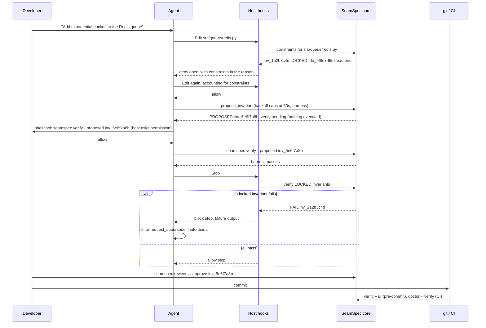
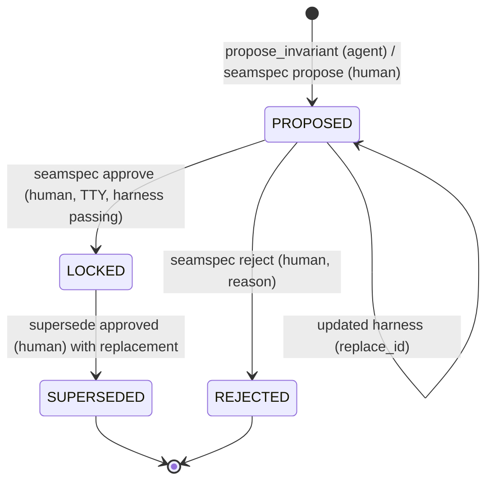
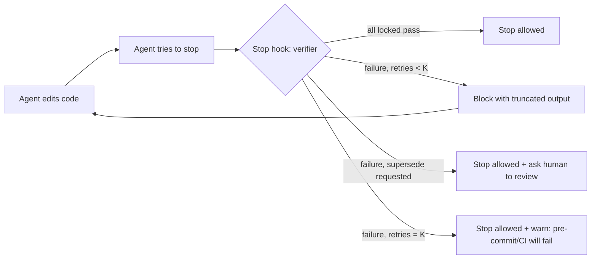

# SeamSpec — Design Specification

> **Status:** Draft v1.0 · **Supersedes:** `Idea.md`, `mcp_advantages.md`
> **Tagline:** *Build first; every seam that works gets a spec.*

---

## Table of Contents

0. [What Changed From Idea.md](#0-what-changed-from-ideamd)
1. [The Problem](#1-the-problem)
2. [What SeamSpec Is](#2-what-seamspec-is)
3. [Design Principles](#3-design-principles)
4. [SeamSpec vs OpenSpec](#4-seamspec-vs-openspec)
5. [The "Pick Two" Resolution](#5-the-pick-two-resolution)
6. [System Architecture](#6-system-architecture)
7. [Enforcement Model](#7-enforcement-model)
8. [Host Support Matrix](#8-host-support-matrix)
9. [Data Model & Storage](#9-data-model--storage)
10. [Record Schemas](#10-record-schemas)
11. [Lifecycles](#11-lifecycles)
12. [The Verifier (Not a Sandbox)](#12-the-verifier-not-a-sandbox)
    - [12A. Language Support](#12a-language-support)
13. [BRAINDUMP.md](#13-braindumpmd)
14. [MCP Surface](#14-mcp-surface)
15. [CLI Surface](#15-cli-surface)
    - [15A. Workflow Commands](#15a-workflow-commands)
16. [Host Adapters & Hook Specifications](#16-host-adapters--hook-specifications)
17. [The Self-Healing Loop](#17-the-self-healing-loop)
18. [Agent Directive (Advisory Layer)](#18-agent-directive-advisory-layer)
19. [Reference Implementation](#19-reference-implementation)
20. [Security Considerations](#20-security-considerations)
21. [Package Layout](#21-package-layout)
22. [Roadmap](#22-roadmap)
23. [Benchmark Plan](#23-benchmark-plan)
24. [Positioning & Launch](#24-positioning--launch)
25. [Risks & Mitigations](#25-risks--mitigations)
26. [Resolved Decisions](#26-resolved-decisions)
27. [Appendix A — Idea.md Issue → Fix Map](#appendix-a--ideamd-issue--fix-map)
28. [Appendix B — Glossary](#appendix-b--glossary)

---

## 0. What Changed From Idea.md

| Area | Idea.md | This spec | Why |
|---|---|---|---|
| Enforcement | "Architecturally blocked" via MCP | Hooks + git pre-commit + CI enforce; MCP is the interface | MCP tools are only called when the agent chooses to call them; they cannot intercept edits |
| Developer overhead | "Zero" | **Near-zero**: one-keystroke approval of proposed invariants | Fully autonomous locking produces junk invariants |
| Invariant lifecycle | `PROPOSED` existed but code jumped to `LOCKED`; no retirement | `PROPOSED → LOCKED → SUPERSEDED`, plus `REJECTED`; human-gated transitions | Without a way to retire rules, the ledger blocks legitimate change |
| Sandbox | "Isolated Sandbox Loop" with `shell=True` | **Verifier**: fixed commands from config, argv lists, timeouts | Containers add friction and no real security over what the agent can already do |
| Storage | Single `ledger.json` | **One file per record**; index is generated and local | Avoids git merge conflicts |
| Schema location | `.seamspec/schema.json` | Schema ships **in the package**; records reference `schema_version` | Schema is a definition, not project data |
| Scope matching | Substring (`f in scope`) | gitignore-style globs (`pathspec`) + optional tags | Substring matching never matched globs |
| Tamper detection | `hash()` (randomized per process) | SHA-256 of assertion **and** test file | `hash()` is not stable across runs |
| BRAINDUMP.md | Agent "read-only" yet also strikes through notes | Human-owned; SeamSpec writes only below a marker; gitignored by default | Resolves the contradiction; protects personal notes |
| Braindump extraction | Implied separate LLM | The **in-session agent** classifies; SeamSpec validates and stores | SeamSpec stays model-free, needs no API keys |
| MCP tool count | Growing | **7 small tools + 2 resources**; every tool has a CLI equivalent | Tool definitions cost context on every session (see §4.3) |
| Workflow commands | None (only rules-file directives) | **`/seamspec:*` chat slash commands** + MCP prompts, rendered per host from one template set (§15A) | Gives developers explicit "crystallize" moments without leaving the chat |
| Execution consent | Agent-supplied shell commands run inside the MCP server | **MCP never runs unapproved code**; proposed tests run only via the agent's permission-checked shell tool, MCP elicitation, or the human; one-time auto-run consent; repo trust; env scrubbing (§12.4) | With no sandbox, *who decides when code runs* is the control |
| Review load | Unbounded agent proposals | Per-run cap + **project-wide pending cap** (`proposals.max_pending = 10`); rejection can record a dead end with one key (§11.1, §26) | Too many proposals for the human to review would kill the approval step |
| Host support | "Runs identically" everywhere | Explicit per-host matrix; same core, different enforcement strength | Hosts differ in hook capabilities |
| Languages | Implicitly Python (`pytest`, `.seamspec/tests/`) | **Language-agnostic runners**: v0.1 presets for Python, TypeScript/JavaScript, Go, Rust, plus `custom`; per-runner test folders; failure attribution via JUnit XML, `go test -json`, or isolated reruns (§12A) | Go and Rust can't run tests from `.seamspec/`; every project language must work |
| Positioning | OpenSpec described as manual and heavy | Honest comparison: the difference is *when* the gate happens and *whether the spec runs* | A strawman comparison would be called out by expert readers |

---

## 1. The Problem

Conversational AI coding ("vibecoding") collapses the time from idea to running prototype. But long sessions hit an **entropy wall**:

| Phase | What happens |
|---|---|
| Early turns | High velocity; the agent holds the full picture |
| Middle turns | Constraints stated earlier silently erode as context fills with diffs and tool output |
| Late turns | Circular regressions: fixing bug A reintroduces bug B; approaches that already failed get retried |

> [!NOTE]
> The turn numbers in `Idea.md` (1–3 / 4–8 / 9+) are plausible but unmeasured. §23 defines a benchmark to measure this instead of asserting it.

Root causes:

1. **Constraint amnesia** — decisions live only in chat history, which scrolls out of effective attention.
2. **No negative memory** — nothing records *what was tried and failed*, so agents retry dead ends.
3. **No executable contract** — rules are prose; nothing mechanically checks that earlier decisions still hold.
4. **Cross-session reset** — a new session starts from zero except for whatever static rules file exists.

---

## 2. What SeamSpec Is

**SeamSpec is an open-source governance layer for AI coding agents that turns validated decisions into protected, executable invariants — while the developer keeps vibecoding.**

In one line: **OpenSpec is "specify, then build." SeamSpec is "build, and the spec hardens behind you."**

It maintains a **living ledger** of:

- **Invariants** — behavioral rules, each backed by an executable test, scoped to files.
- **Dead ends** — approaches that were tried and failed, with the failure symptom.
- **Decisions (ADRs)** — the *why* behind invariants, in Michael Nygard format.

And it **enforces** them through host hooks, git, and CI — not through prompt compliance.

---

## 3. Design Principles

1. **Enforce outcomes, not actions.** Agents can modify files many ways (Edit tool, Bash, scripts). Enforcement that matters checks *results* (tests pass, hashes match), not *which tool was used*.
2. **Asymmetric trust.** Things that *constrain the future* (invariants) require human approval. Things that merely *warn* (dead ends) can be recorded by the agent directly.
3. **Near-zero, not zero, overhead.** One keystroke to approve is the price of trustworthy rules.
4. **One brain, many adapters.** A single core library; CLI, MCP, hooks, git, and CI are thin adapters over it. They can never disagree.
5. **Model-free core.** SeamSpec never calls an LLM itself. The agent already in the session does all language work; SeamSpec validates, stores, verifies, and enforces.
6. **Honest claims.** Every capability is labeled with its real enforcement strength per host.
7. **Git-native.** Plain files, one record per file, reviewable in PRs, mergeable without conflicts.
8. **Fail open in-session, fail closed at the gate.** A crashing hook must not brick the agent; CI is the uncompromising backstop.

---

## 4. SeamSpec vs OpenSpec

### 4.1 What OpenSpec Is

OpenSpec is a spec-driven development framework. Work flows through a proposal lifecycle:

1. **Propose** — the agent drafts `openspec/changes/<id>/` with `proposal.md`, delta specs (`ADDED` / `MODIFIED` / `REMOVED`), `tasks.md`, and optional `design.md`.
2. **Review** — a human reviews the proposal *before* implementation.
3. **Apply** — the agent works through `tasks.md`.
4. **Validate** — `openspec validate` checks the **structure** of specs and changes.
5. **Archive** — `openspec archive` merges deltas into `openspec/specs/`, the source of truth.

OpenSpec **does not execute code**. Its CLI validates documents and manages their lifecycle.

### 4.2 The Real Differences

| Dimension | OpenSpec | SeamSpec |
|---|---|---|
| **When the spec exists** | Before code — describes the *intended* future | After green tests — records *proven* behavior |
| **Nature of the spec** | Prescriptive design document | Empirical, accumulated record |
| **Where the human gate is** | Before implementation (proposal review) | After verification (invariant approval) |
| **Does the spec run?** | No — prose and structure validation | Yes — every invariant is an executable test |
| **Enforcement** | Agent reads `AGENTS.md` / slash commands | Hooks, git pre-commit, CI |
| **On violation** | Human notices and steers | Agent is blocked from finishing; tests must pass or a supersede must be requested |
| **Memory** | Current system state + archived changes | Current state + **failed approaches** + provenance of every rule |
| **Developer flow** | Stop, propose, review, then build | Keep building; review proposed invariants in batches |

> [!IMPORTANT]
> **Honest trade-off:** Because SeamSpec's spec is backward-looking, it **prevents regressions, not bad designs**. OpenSpec's up-front review can catch a wrong architecture before code exists; SeamSpec can only ensure you don't break what already works. The two are complementary, and a future `import` origin type (§10.1) can ingest OpenSpec requirements as proposed invariants.

> [!NOTE]
> The developer-overhead difference is smaller than `Idea.md` claimed: in current OpenSpec, the AI drafts proposals and humans review. The defensible difference is **gate timing** and **executability**, not who types.

### 4.3 OpenSpec and MCP (Issue #319)

Issue [#319](https://github.com/Fission-AI/OpenSpec/issues/319) ("Implement OpenSpec as an MCP Server") was opened Nov 2025 and closed as *not planned* in Aug 2026, moved to Discussions #1539.

- The proposed MCP surface was **document management only**: `list-specs`, `get-change`, `validate-change`, `show-delta`, `compare-specs`, plus proposal prompts. Even with MCP, OpenSpec's model remains a human-reviewed proposal lifecycle — no execution, no tests, no enforcement.
- A maintainer pushed back on MCP itself, comparing it to `gh` CLI vs GitHub MCP: **MCP tool definitions consume context in every session**, even when unused. Other commenters agreed a CLI serves both humans and scripts.
- Adjacent work exists: a community PR (#379) and [`Pimzino/spec-workflow-mcp`](https://github.com/Pimzino/spec-workflow-mcp).

**Lessons applied to SeamSpec:**

1. **CLI first.** Every MCP tool has a CLI equivalent; agents without MCP can use `seamspec context <files>` via shell. MCP is optional.
2. **Small MCP surface.** 7 tools, 2 resources; target < 1,500 tokens of tool definitions (measured in CI, §22).
3. **The argument for MCP** in SeamSpec is **structured, validated writes** to the ledger (propose, log dead end, request supersede) that work identically in every client — a stronger case than read-only document access.

---

## 5. The "Pick Two" Resolution

`Idea.md` promised three things that conflict:

| Promise | Meaning |
|---|---|
| **Zero overhead** | Developer never reviews anything |
| **Autonomous** | Agent locks invariants on its own |
| **Trustworthy** | Locked rules are correct and enforced |

- Zero overhead + autonomous → junk tests get locked (trivially true, overfit, implementation-coupled).
- Autonomous + trustworthy → requires human approval (not zero overhead).
- Zero overhead + trustworthy → requires near-perfect inference that doesn't exist.

**Resolution: Autonomous + Trustworthy, with near-zero overhead.**

- The agent **proposes** invariants autonomously (with tests that already pass).
- The human **approves in batches** with one keystroke (`seamspec review`).
- Pre-commit shows a non-blocking reminder: `3 invariants awaiting review`.
- Dead ends need no approval (asymmetric trust, §3).

---

## 6. System Architecture

### 6.1 Layers


| Layer | Responsibility | Enforcement role |
|---|---|---|
| **Core** | All logic: storage, matching, verification, lifecycle | None directly — pure logic |
| **CLI** | Human UX + hook/git/CI entry points | Entry point for every gate |
| **MCP server** | Agent-facing typed tools and resources | None — interface only |
| **Host hooks** | Inject constraints, gate edits, gate completion | In-session enforcement |
| **git pre-commit** | Run locked invariants before commit | Local backstop (skippable with `--no-verify`) |
| **CI** | Full verification + ledger integrity | Final, unskippable gate |

### 6.2 End-to-End Flow



---

## 7. Enforcement Model

### 7.1 Layers of Enforcement

| # | Layer | Mechanism | Strength | Catches Bash writes? |
|---|---|---|---|---|
| 1 | Context | MCP `get_constraints`, rules file | Soft | n/a |
| 2 | Pre-edit gate | Host `PreToolUse` hook: **deny once** with constraints in the reason | Hard for Edit/Write tools | ❌ |
| 3 | Ledger protection | `PreToolUse` denies direct edits to `.seamspec/**` and to every runner's harness files (§12A.5) | Hard for Edit/Write tools | ❌ (caught by layer 4/6) |
| 4 | Completion gate | Host `Stop` hook runs the verifier; blocks finishing while locked invariants fail | Hard, retry-capped | ✅ (checks outcomes) |
| 5 | Local backstop | git pre-commit: `seamspec verify --all --gate` | Hard, skippable | ✅ |
| 6 | Final gate | CI: `seamspec doctor --ci` + `seamspec verify --all --ci` | Hard, unskippable | ✅ |

> [!IMPORTANT]
> Layers 2–3 are an **early-warning system**. Layers 4–6 are **the wall**, because they check outcomes regardless of how files were modified.

### 7.2 The "Deny Once" Gate

Rather than depending on host-specific context-injection fields, the pre-edit gate uses a portable pattern:

1. Agent attempts to edit a file governed by locked invariants or active dead ends.
2. Hook checks session state for key `(session_id, file, ledger_revision)`.
3. **First attempt:** deny, with the constraints rendered in the denial reason. Record the key.
4. **Second attempt:** allow. The agent has now provably *received* the constraints.
5. If the ledger changes (`ledger_revision` differs), the gate re-arms.

Cost: one extra tool call per governed file per session. Configurable via `hooks.gate_mode`: `deny_once` (default), `context_only` (if the host supports injecting context without denying), `off`.

### 7.3 Modes

`seamspec init --mode <mode>`:

| Mode | Installs | Enforcement | Use when |
|---|---|---|---|
| `advisory` | MCP config + rules file | Prompt-based (labeled honestly) | Trying SeamSpec; hosts without hooks |
| `enforced` *(default)* | + host hooks + git pre-commit | In-session + commit-time | Daily individual use |
| `strict` | + CI workflow, `fail_closed = true`, `trust_level = "harness"`, CODEOWNERS entry for `.seamspec/` | Everything above, hooks fail closed, any new upstream test needs re-trust | Teams, shared repos |

`advisory` mode **never runs tests automatically**. `enforced` and `strict` show a one-time auto-run consent screen at `init`, and automatic runs only happen in trusted clones (§12.4).

### 7.4 Known Limits (Stated Publicly)

- Agents can modify files via Bash, bypassing `PreToolUse` matchers on Edit/Write. Layers 4–6 catch the *outcome*.
- `git commit --no-verify` skips pre-commit. CI does not.
- Host hook APIs evolve; adapters must be re-verified per release (§8).
- SeamSpec guards against regressions of *approved* behavior. It does not judge whether new code is good.
- **No sandbox:** approved tests, and the project code they import, run with the developer's user permissions. SeamSpec controls *when* code runs and *who consented* (§12.4), not what that code can access.

---

## 8. Host Support Matrix

| Capability | Claude Code | VS Code (Copilot agent) | Cursor | Cline / Windsurf / other MCP clients |
|---|---|---|---|---|
| MCP tools + resources | ✅ | ✅ | ✅ | ✅ |
| CLI fallback via shell | ✅ | ✅ | ✅ | ✅ |
| Pre-edit gate (deny once) | ✅ `PreToolUse` | ✅ `PreToolUse` → `permissionDecision: "deny"` | ✅ `preToolUse` → `permission: "deny"` | ❌ |
| Ledger protection | ✅ | ✅ | ✅ | ❌ |
| Completion gate | ✅ `Stop` + `decision: block` | ✅ `Stop` + `decision: block` | ✅ `stop` + `followup_message` (auto-continue, capped by `loop_limit`) | ❌ |
| Session-start nudge (§13.9) | ✅ `SessionStart` | ✅ `SessionStart` | ✅ `sessionStart` (local agents) | Directive fallback |
| git pre-commit | ✅ | ✅ | ✅ | ✅ |
| CI gate | ✅ | ✅ | ✅ | ✅ |
| **Tier** | **Full** | **Full** *(hooks API in Preview)* | **Full** | **Commit-time** |

> [!WARNING]
> Copilot and Cursor capabilities were re-checked against their official hook docs on 2026-10-05 (VS Code agent hooks reference; cursor.com/docs/hooks), **not yet hands-on**. VS Code labels agent hooks as Preview. Cursor's completion gate works by auto-submitting a "fix this" follow-up message rather than refusing to stop, and Cursor cloud agents don't run every hook (e.g. `sessionStart`). Every adapter is a thin config file over the shared CLI and must be re-verified before each release. `seamspec doctor` reports the detected tier per host.

**Launch strategy:** Claude Code stays the demo host (most mature hooks). Claude Code, Copilot and Cursor all target the Full tier from v1; other MCP clients get commit-time enforcement until they add hooks.

---

## 9. Data Model & Storage

### 9.1 Directory Layout

```
<repo>/
├── BRAINDUMP.md                      # human-owned scratchpad (gitignored by default)
├── .mcp.json                         # Claude Code MCP config (generated)
├── .claude/
│   ├── settings.json                 # Claude Code hooks (generated/merged)
│   └── commands/seamspec/*.md        # /seamspec:* workflow commands (generated, §15A)
├── .github/
│   ├── hooks/seamspec.json           # VS Code Copilot hooks (generated)
│   ├── prompts/seamspec-*.prompt.md  # Copilot workflow commands (generated, §15A)
│   ├── workflows/seamspec.yml        # CI gate (strict mode)
│   └── CODEOWNERS                    # .seamspec/ ownership (strict mode)
├── .cursor/
│   ├── mcp.json
│   ├── commands/seamspec-*.md        # Cursor workflow commands (generated, §15A)
│   └── hooks.json                    # if supported
├── .vscode/mcp.json
└── .seamspec/
    ├── config.toml                   # project configuration (committed)
    ├── commands/                     # optional per-project overrides of command templates (committed)
    ├── invariants/
    │   ├── inv_1a2b3c4d.json         # one file per invariant (committed)
    │   └── inv_5e6f7a8b.json
    ├── dead_ends/
    │   └── de_9f8e7d6c.json          # one file per dead end (committed)
    ├── adrs/
    │   └── ADR-20261003-4f8a-redis-queue-backoff.md   # Nygard format + YAML frontmatter
    ├── tests/                        # default harness_dir (pytest); other runners choose their own (§12A)
    │   ├── conftest.py               # makes project importable (pytest runner)
    │   └── test_inv_1a2b3c4d.py      # one harness per invariant
    ├── retired/                      # harnesses of SUPERSEDED/REJECTED invariants, moved out of test trees (§12A.5)
    └── .local/                       # gitignored: machine-local state
        ├── index.json                # generated cache; rebuilt when stale
        ├── sessions/                 # hook state per session_id
        ├── braindump.json            # processed braindump item state
        ├── requests/                 # pending supersede requests
        ├── reports/                  # per-runner test reports (JUnit XML), overwritten each run
        ├── last_verify.json          # last verifier results + tree fingerprint
        └── store.lock
```

Harnesses for other languages live where their toolchain can find them (§12A.2):

```
<repo>/
├── tests/seamspec/inv_5e6f7a8b.test.ts                 # vitest / jest
├── internal/seamspec/inv_0d1e2f3a/seamspec_test.go     # go (one package per invariant)
└── tests/seamspec_inv_8a9b0c1d.rs                      # cargo (top-level integration test)
```

### 9.2 Why One File Per Record

- Two branches each adding an invariant create **two new files** → no merge conflict.
- PR diffs show exactly which rule changed.
- The index (`.local/index.json`) is a **generated cache**, never committed, rebuilt when any record's mtime is newer.

### 9.3 IDs

| Record | Format | Example | Notes |
|---|---|---|---|
| Invariant | `inv_` + 8 hex | `inv_1a2b3c4d` | Random; checked for collision at creation |
| Dead end | `de_` + 8 hex | `de_9f8e7d6c` | Random |
| ADR | `ADR-YYYYMMDD-` + 4 hex | `ADR-20261003-4f8a` | Date-ordered and branch-safe; sequential numbers collide across branches |
| Braindump item | `bd_` + 8 hex of normalized text | `bd_77aa0c12` | Content-derived; editing an item makes it a new item |

### 9.4 Schema Location

- JSON Schemas ship **inside the package** at `seamspec/schemas/v1/*.json` and are published on GitHub Pages at `https://seamspec.github.io/schemas/v1/` (the `$id` base). Validation always uses the packaged copy, so the URL is an identifier, not a runtime dependency. If a custom domain is acquired later, the old URLs keep serving (redirect pages) so existing `$id`s never break.
- Each record carries `"schema_version": "1"`.
- `seamspec doctor` validates every record; `seamspec migrate` upgrades records when the schema version changes.

### 9.5 `config.toml`

```toml
schema_version = "1"
mode = "enforced"              # advisory | enforced | strict

[verify]
timeout_seconds = 120          # per runner invocation
max_output_chars = 4000        # truncated output fed back to the agent
max_stop_retries = 3           # self-healing ceiling (K)
run_on_stop = "auto"           # auto | all | scoped (only invariants matching changed files)
stop_all_threshold = 100       # auto: run all LOCKED below this count, scoped at or above it
isolate_on_failure = 10        # if a group fails and can't be attributed, rerun up to N harnesses one at a time

# Runners are generated by `seamspec init` from detected languages (§12A.7).
# Full preset list: §12A.3.
[runners.pytest]
cmd = ["pytest", "-q", "-p", "no:cacheprovider", "--junitxml={report}", "{each}"]
harness_dir = ".seamspec/tests"
filename = "test_{id}.py"
report = "junit"
paths = ["**/*.py"]

[runners.vitest]
cmd = ["npx", "vitest", "run", "--reporter=default", "--reporter=junit", "--outputFile.junit={report}", "{each}"]
harness_dir = "tests/seamspec"
filename = "{id}.test.ts"
report = "junit"
paths = ["**/*.ts", "**/*.tsx", "**/*.js", "**/*.jsx"]

[hooks]
gate_mode = "deny_once"        # deny_once | context_only | off
fail_closed = false            # strict mode defaults to true

[braindump]
path = "BRAINDUMP.md"
marker = "<!-- seamspec:processed -->"
redact_secrets = true
nudge = "ask"                  # ask | off — session-start offer to sort new notes (§13.9)

[protect]
paths = [".seamspec/**"]

[commands]
namespace = "seamspec"         # /seamspec:lock (Claude Code) or /seamspec-lock (Cursor, Copilot)
hosts = ["auto"]               # auto | claude | cursor | vscode
max_proposals_per_run = 3      # cap for /seamspec:checkpoint and /seamspec:drain

[proposals]
max_pending = 10               # project-wide cap on PROPOSED invariants awaiting review

[execution]                    # §12.4 Execution Consent
run_proposed = "auto"          # auto | host | ask | never — how proposed (unapproved) tests may run
env_passthrough = []           # extra env vars tests may see, e.g. ["DATABASE_URL"]
trust_level = "runners"        # runners | harness — strict mode defaults to harness
```

- Commands are **argv lists**, never shell strings.
- `{each}` expands the runner's `each` template once per harness (default `["{path}"]`); `{report}` is the report file SeamSpec reads afterwards. `{harnesses}` is accepted as an alias for `{each}`. Full key reference: §12A.3.
- The agent never supplies a command; it supplies a **runner name** that must exist in config.
- **Mode-dependent defaults:** in `strict` mode, `hooks.fail_closed` defaults to `true` and `execution.trust_level` to `"harness"`. `seamspec init --mode strict` writes those values into `config.toml`; if a key is missing, the config loader applies the same strict defaults. An explicit value in `config.toml` always wins (§19.2), and `doctor` warns when a `strict` repo has loosened either one.

---

## 10. Record Schemas

### 10.1 Invariant (`seamspec/schemas/v1/invariant.json`)

```json
{
  "$schema": "https://json-schema.org/draft/2020-12/schema",
  "$id": "https://seamspec.github.io/schemas/v1/invariant.json",
  "title": "Invariant",
  "type": "object",
  "additionalProperties": false,
  "required": ["schema_version", "id", "title", "assertion", "scope", "status", "origin", "verification", "created_at"],
  "properties": {
    "schema_version": { "const": "1" },
    "id": { "type": "string", "pattern": "^inv_[a-f0-9]{8}$" },
    "title": { "type": "string", "minLength": 3, "maxLength": 120 },
    "assertion": {
      "type": "string",
      "minLength": 10,
      "description": "Behavioral rule in plain language, e.g. 'Retry delay never exceeds 30s'"
    },
    "scope": {
      "type": "object",
      "additionalProperties": false,
      "required": ["paths"],
      "properties": {
        "paths": {
          "type": "array", "minItems": 1, "items": { "type": "string" },
          "description": "gitignore-style globs relative to repo root, e.g. src/queue/**"
        },
        "tags": {
          "type": "array", "items": { "type": "string" },
          "description": "Cross-cutting concerns, e.g. tenant-isolation"
        }
      }
    },
    "status": { "enum": ["PROPOSED", "LOCKED", "SUPERSEDED", "REJECTED"] },
    "origin": {
      "type": "object",
      "additionalProperties": false,
      "required": ["type", "text"],
      "properties": {
        "type": { "enum": ["prompt", "braindump", "manual", "import"] },
        "text": { "type": "string", "maxLength": 2000, "description": "Redacted copy of the originating intent" },
        "ref": { "type": ["string", "null"], "description": "e.g. braindump item id bd_77aa0c12" }
      }
    },
    "verification": {
      "type": "object",
      "additionalProperties": false,
      "required": ["runner", "harness_path"],
      "properties": {
        "runner": { "type": "string" },
        "harness_path": { "type": "string" },
        "harness_sha256": { "type": ["string", "null"], "pattern": "^[a-f0-9]{64}$" },
        "assertion_sha256": { "type": ["string", "null"], "pattern": "^[a-f0-9]{64}$" }
      }
    },
    "adr_id": { "type": ["string", "null"], "pattern": "^ADR-[0-9]{8}-[a-f0-9]{4}$" },
    "created_at": { "type": "string", "format": "date-time" },
    "approved_at": { "type": ["string", "null"], "format": "date-time" },
    "approved_by": { "type": ["string", "null"] },
    "superseded_by": { "type": ["string", "null"], "pattern": "^inv_[a-f0-9]{8}$" },
    "status_reason": { "type": ["string", "null"], "description": "Why rejected or superseded" }
  },
  "allOf": [
    {
      "if": { "properties": { "status": { "const": "LOCKED" } } },
      "then": {
        "required": ["approved_at", "approved_by"],
        "properties": {
          "verification": { "required": ["harness_sha256", "assertion_sha256"] }
        }
      }
    },
    {
      "if": { "properties": { "status": { "const": "SUPERSEDED" } } },
      "then": { "required": ["superseded_by", "status_reason"] }
    },
    {
      "if": { "properties": { "status": { "const": "REJECTED" } } },
      "then": { "required": ["status_reason"] }
    }
  ]
}
```

**Example — `.seamspec/invariants/inv_1a2b3c4d.json`:**

```json
{
  "schema_version": "1",
  "id": "inv_1a2b3c4d",
  "title": "Redis retry delay is capped",
  "assertion": "Exponential backoff for Redis queue retries never exceeds 30 seconds between attempts.",
  "scope": { "paths": ["src/queue/**"], "tags": ["resilience"] },
  "status": "LOCKED",
  "origin": {
    "type": "prompt",
    "text": "Add exponential backoff to the Redis queue, but don't let it wait more than 30s.",
    "ref": null
  },
  "verification": {
    "runner": "pytest",
    "harness_path": ".seamspec/tests/test_inv_1a2b3c4d.py",
    "harness_sha256": "3f1c...e9",
    "assertion_sha256": "a87d...10"
  },
  "adr_id": "ADR-20261003-4f8a",
  "created_at": "2026-10-03T08:12:00Z",
  "approved_at": "2026-10-03T08:20:41Z",
  "approved_by": "vamship",
  "superseded_by": null,
  "status_reason": null
}
```

### 10.2 Dead End (`seamspec/schemas/v1/dead_end.json`)

```json
{
  "$schema": "https://json-schema.org/draft/2020-12/schema",
  "$id": "https://seamspec.github.io/schemas/v1/dead_end.json",
  "title": "DeadEnd",
  "type": "object",
  "additionalProperties": false,
  "required": ["schema_version", "id", "scope", "approach", "failure_symptom", "source", "status", "created_at"],
  "properties": {
    "schema_version": { "const": "1" },
    "id": { "type": "string", "pattern": "^de_[a-f0-9]{8}$" },
    "scope": {
      "type": "object",
      "additionalProperties": false,
      "required": ["paths"],
      "properties": {
        "paths": { "type": "array", "minItems": 1, "items": { "type": "string" } },
        "tags": { "type": "array", "items": { "type": "string" } }
      }
    },
    "approach": { "type": "string", "minLength": 10, "description": "What was tried" },
    "failure_symptom": { "type": "string", "maxLength": 1000, "description": "Why it failed (truncated traceback or reason)" },
    "source": { "enum": ["verifier", "braindump", "manual", "agent"] },
    "related_invariant": { "type": ["string", "null"], "pattern": "^inv_[a-f0-9]{8}$" },
    "status": { "enum": ["ACTIVE", "RETIRED"] },
    "retired_reason": { "type": ["string", "null"], "description": "e.g. 'Fixed upstream in redis-py 6.2'" },
    "created_at": { "type": "string", "format": "date-time" }
  }
}
```

Dead ends can be **retired** when circumstances change (library upgraded, constraint removed), so they don't block a now-valid approach forever.

### 10.3 ADR (Markdown + YAML frontmatter)

**`.seamspec/adrs/ADR-20261003-4f8a-redis-queue-backoff.md`:**

```markdown
---
id: ADR-20261003-4f8a
title: Redis queue uses capped exponential backoff
status: ACCEPTED            # PROPOSED | ACCEPTED | SUPERSEDED | REJECTED
date: 2026-10-03
scopes: ["src/queue/**"]
invariants: ["inv_1a2b3c4d"]
supersedes: null
superseded_by: null
---

# ADR-20261003-4f8a: Redis queue uses capped exponential backoff

## Context
Transient Redis failures caused retry storms. Fixed-interval retries amplified load during outages.

## Decision
Use exponential backoff with full jitter, base 100ms, capped at 30s.

## Enforced Invariants
* `inv_1a2b3c4d` — Retry delay never exceeds 30 seconds.

## Consequences
* Worst-case recovery latency is bounded at 30s per attempt.
* Queue consumers must tolerate delayed redelivery.
```

ADRs are created as `PROPOSED` alongside their invariants and become `ACCEPTED` when the invariant is approved. An ADR may exist without invariants (`propose_decision`) for decisions that are not mechanically testable.

---

## 11. Lifecycles

### 11.1 Invariant State Machine



| Transition | Actor | Preconditions | Effects |
|---|---|---|---|
| → `PROPOSED` | Agent or human | Valid schema; runner exists; harness written by SeamSpec; fewer than `proposals.max_pending` invariants already `PROPOSED` (agent only; humans and `replace_id` updates are exempt). **Nothing is executed**; verification is `pending` until run through a consented path (§12.4) | Record + harness + draft ADR created |
| `PROPOSED` → `PROPOSED` | Agent | `replace_id` points to a `PROPOSED` record | Harness/assertion updated; verification reset to `pending` |
| `PROPOSED` → `LOCKED` | **Human only** | Interactive TTY; human has been shown the full harness; harness passes when run at approval; (optional) red-green proof (§25) | Hashes computed; `approved_at/by` set; ADR → `ACCEPTED` |
| `PROPOSED` → `REJECTED` | Human | Reason given | `review` then asks *"Also record as dead end? [y/N]"* (default **No**); `reject --dead-end` does the same non-interactively. Never automatic |
| `LOCKED` → `SUPERSEDED` | **Human only** | Pending supersede request or explicit command; replacement invariant (may be `null` for pure retirement, with reason) | Old record keeps history; excluded from verification; ADR → `SUPERSEDED` |

**Pending-proposal cap.** When `proposals.max_pending` is reached, `propose_invariant` returns `{ "error": "queue_full", "pending": 10, "message": "Review queue is full. Ask the user to run `seamspec review`." }` and writes nothing. The cap applies to the review backlog, not to a single session, because the backlog is what overwhelms the human. Dead ends are not capped (they need no approval).

**Why rejection doesn't auto-create a dead end.** People reject proposals for different reasons: bad wording, wrong scope, or a genuinely wrong approach. Only the last one is a dead end, so the human decides with one key. When they say yes, the dead end gets the proposal's scope, `approach` = the assertion, and `failure_symptom` = the rejection reason.

### 11.2 Supersede Flow (Intentional Breaking Changes)

When the agent's change legitimately breaks a `LOCKED` invariant:

1. Stop hook blocks with the failure and instructions: *"If this change is intentional, call `request_supersede(invariant_id, reason, replacement)` and tell the user."*
2. Agent calls `request_supersede` → request saved to `.seamspec/.local/requests/`.
3. Stop hook sees a pending request for that failing invariant → **allows stop** (no infinite loop) and emits a user-facing message.
4. Pre-commit and CI still fail until the human runs `seamspec review` and approves the supersede.

This is the escape hatch that keeps the ratchet from becoming a cage.

### 11.3 Dead End Lifecycle

`ACTIVE` (agent may create directly) → `RETIRED` (human, with reason). Dead ends appear in `seamspec review` as a non-blocking list so humans can retire bogus ones.

---

## 12. The Verifier (Not a Sandbox)

### 12.1 Why No Sandbox

- OpenSpec needs no sandbox because it never executes code. SeamSpec executes tests, so it needs a **runner**, not isolation.
- The agent already runs arbitrary commands on the host with the developer's permissions. Containerizing SeamSpec's test runs adds **no real security** and significant friction (Docker, images, dependency parity).
- Containers may come later as an opt-in `--isolated` flag (§22).

### 12.2 Verifier Behavior

| Concern | Behavior |
|---|---|
| Command source | `config.toml` runners only; agent supplies a runner **name** |
| Invocation | `subprocess.run(argv, shell=False, timeout=...)` |
| Selection | Explicit list of harness paths for `LOCKED` invariants — never a whole directory, so superseded harnesses never run. `PROPOSED` harnesses run only through a consented path (§12.4) |
| Environment | Minimal, scrubbed environment plus `execution.env_passthrough` (§12.4.7) |
| Grouping | One invocation per runner with all its harnesses (`{each}`); failures are attributed per invariant (§12A.4) |
| Timeouts | Per runner invocation; timeout = failure with clear message |
| Missing runner binary | Failure with actionable message (`pytest not found; install or fix config`) |
| Integrity | Before running, compare `harness_sha256` and `assertion_sha256` of each `LOCKED` invariant; mismatch = **integrity failure** |
| Output | Head (1,000 chars) + tail (3,000 chars) kept; tail usually contains the failure |
| Caching | Results + tree fingerprint saved to `.local/last_verify.json`; Stop hook skips re-running if the tree is unchanged since the last green run |
| Scoped mode | `--changed` runs invariants whose scope matches files changed vs `HEAD`. The Stop hook uses it automatically once there are `verify.stop_all_threshold` or more `LOCKED` invariants (`run_on_stop = "auto"`); pre-commit and CI always run **all** |

### 12.3 Making Harnesses Import the Project

`seamspec init` writes `.seamspec/tests/conftest.py` for the pytest runner:

```python
# Generated by seamspec init. Makes the project root importable from harnesses.
import sys
from pathlib import Path

ROOT = Path(__file__).resolve().parents[2]
if str(ROOT) not in sys.path:
    sys.path.insert(0, str(ROOT))
```

Other runners get equivalent setup (e.g. vitest root config) as they are added.

### 12.4 Execution Consent

There is no sandbox, so isolation is not the control. **Consent is: who decides when code runs.**

> [!IMPORTANT]
> **Principle:** SeamSpec never runs unapproved code that the agent couldn't already run through its own permission-checked tools. It must never widen what the agent is allowed to do.

#### 12.4.1 Why This Matters

Hosts (Claude Code, Cursor, VS Code) normally ask before the agent runs shell commands, unless the user allowlists them. A test file is arbitrary code. If the MCP server ran agent-written tests directly, an agent *not* allowed to run Bash could still execute anything by "proposing a test", and any MCP tool-approval prompt would say "propose_invariant", not "run this code". This section closes that hole.

#### 12.4.2 Execution Paths

| Trigger | What runs | Code author | Consent mechanism |
|---|---|---|---|
| Agent calls `propose_invariant` (MCP) | **Nothing** | — | — |
| Agent runs `seamspec verify --proposed <id>` with its shell tool | The proposed test + project code | Agent | **Host's own shell permission prompt / allowlist** |
| `run_proposed = "ask"`, or `"auto"` on a client that supports elicitation | The proposed test, after the user clicks *Run* | Agent | Explicit per-run approval in the host UI |
| Human runs `seamspec review` / `approve` | The test the human was just shown | Agent, reviewed | Explicit approval at an interactive terminal |
| Human runs `seamspec verify` | Requested tests | — | Explicit: the human typed it |
| Stop hook | **LOCKED tests only** (+ the project code they import) | Approved | One-time auto-run consent + repo trust |
| git pre-commit | **LOCKED tests only** | Approved | Auto-run consent + repo trust + the human chose to commit |
| CI | **LOCKED tests only** | Approved | CI policy: read-only token, no secrets (§16.5) |

#### 12.4.3 Rules

1. **MCP never executes unapproved code.** `propose_invariant` writes the harness and returns `verify: { status: "pending", run: "seamspec verify --proposed <id>" }`. The MCP `verify` tool only accepts `changed` / `all`, which run `LOCKED` tests.
2. **Proposed tests run only through a consented path:** the agent's shell tool (host permissions apply), MCP elicitation (`ask` mode), or the human.
3. **Automatic runs only execute approved, integrity-checked tests**, and only in trusted clones with auto-run consent recorded.
4. **Approval is consent to future runs.** `seamspec review` shows the full harness *before* the approve keypress, not hidden behind a "view" key.
5. **Hooks never run proposed tests.**
6. **`seamspec init` never allowlists SeamSpec commands in any host.** If a user allowlists `seamspec verify` themselves, proposed tests run without prompts; that is their informed choice, and `doctor` reports it.

#### 12.4.4 `execution.run_proposed` Modes

| Mode | Behavior |
|---|---|
| `auto` *(default)* | Uses `ask` when the connected MCP client declares elicitation support during initialization, otherwise `host`. Decided per session, so it adapts as hosts add elicitation |
| `host` | MCP returns the command; the agent runs it with its shell tool, so the host's permission model applies |
| `ask` | The MCP server uses elicitation to show the test code and ask "Run this test?". Falls back to `host` if the client doesn't support elicitation |
| `never` | Proposed tests only run when the human approves them in `seamspec review` |

#### 12.4.5 Auto-Run Consent at `init`

In `enforced` / `strict` mode, `seamspec init` shows a one-time consent screen and records the answer in `.seamspec/.local/consent.json` (per machine, never committed):

```text
SeamSpec will automatically run your LOCKED (human-approved) tests:
  • when the agent tries to finish a task (Stop hook)
  • before every git commit (pre-commit)

These tests import project code that the agent may have changed.
They run with YOUR user permissions. There is no sandbox.
Secrets are stripped from the environment, but files on disk are readable.

Allow automatic test runs in this repository? [y/N]
```

- Answering **No** installs everything in `advisory` mode.
- Scripted setups must pass the explicit `--accept-auto-run` flag; a generic `--yes` does not imply consent.

#### 12.4.6 Repo Trust (Trust-on-First-Use)

A cloned repository can arrive with committed hooks, tests, and runner commands written by someone else. SeamSpec treats this like `direnv allow`:

- Trust is stored in `.seamspec/.local/trust.json` (per clone, gitignored): who trusted, when, and a hash of the `[runners]` table plus `execution.env_passthrough`.
- **Untrusted** when: no trust record (fresh clone), or the runners hash changed since trust was granted.
- With `trust_level = "harness"` (the **default in `strict` mode**), the set of `LOCKED` harness hashes is also included, so *any* new or changed approved test from upstream requires re-trust. `strict` users have opted into rigor, and this is the one setting that stops a teammate's (or a compromised PR's) new test from running on your machine without you seeing it.

| Situation | Behavior when untrusted |
|---|---|
| Stop hook | Allows stop, **runs no tests**, shows: "Run `seamspec trust`" |
| git pre-commit | Fails with: "This clone is not trusted. Run `seamspec trust`." |
| Human runs `seamspec verify` | Offers to run `seamspec trust` first |
| CI (`--ci`) | Not applicable; CI policy is the consent |

`seamspec trust` (interactive terminal required) shows the runner commands, env passthrough, number of `LOCKED` tests, and the harness files changed since the last trust, then asks for confirmation.

**Why runners, not every test, by default:** approved tests arrive through reviewed records (PRs, CODEOWNERS on `.seamspec/`). The `[runners]` commands are the one setting that changes *which executable* runs, so that is what re-prompts.

#### 12.4.7 Environment Scrubbing

Tests run with a minimal environment: `PATH`, `HOME`, `USER`, `LANG`, `LC_*`, `TERM`, `TMPDIR`, `SHELL`, `VIRTUAL_ENV`, `PYTHONPATH`, `NODE_PATH`, plus anything listed in `execution.env_passthrough`. Everything else is removed: `AWS_*`, `GITHUB_TOKEN`, `*_API_KEY`, and so on. `SEAMSPEC_VERIFY=1` is set so projects can detect test runs.

#### 12.4.8 What This Does Not Do

- It does **not** isolate code. Approved tests and project code can read files on disk (e.g. `~/.aws/credentials`), use the network, and spawn processes, exactly like running `pytest` yourself.
- It does **not** stop the agent from running code through its own shell tool when the host allows it. SeamSpec neither adds nor removes that ability.
- Opt-in container isolation (`--isolated`) is on the Phase 3 roadmap (§22).

---

## 12A. Language Support

### 12A.1 Principle

SeamSpec works with **any project language** because it never reads or understands project code. For each invariant it:

1. stores the rule in plain language,
2. saves a test that **the agent writes in the project's language**,
3. runs a test command from `config.toml` and reads pass/fail.

SeamSpec itself is written in Python. That is only the tool's implementation language, the same way git is written in C. The project does not need Python.

Supporting a language takes four things:

| Need | Provided by |
|---|---|
| A command that runs the test | Runner preset: argv in `config.toml` (§12A.3) |
| A place the toolchain will find the test | `harness_dir` + `filename` per runner (§12A.5) |
| Knowing *which* rule failed | `report` format, or isolated reruns (§12A.4) |
| Test can import the project | Per-language setup (§12A.6) |

### 12A.2 v0.1 Presets

| Language | Runner | Harness location | Failure report | Notes |
|---|---|---|---|---|
| Python | `pytest` | `.seamspec/tests/test_{id}.py` | JUnit XML (built in) | `conftest.py` makes the project importable (§12.3). A plain `pytest` run skips dot-folders, so harnesses only run through SeamSpec |
| TypeScript / JavaScript | `vitest` | `tests/seamspec/{id}.test.ts` | JUnit XML (built in) | Uses the project's existing vitest config |
| TypeScript / JavaScript | `jest` | `tests/seamspec/{id}.test.ts` | JUnit XML via `jest-junit` (dev dependency) | `--runTestsByPath` treats arguments as paths, not regexes |
| Go | `go` | `internal/seamspec/{id}/seamspec_test.go` | `go test -json` (built in) | **One package per invariant**, so a broken proposed test can't break compiling approved ones. Go ignores folders starting with `.`, so harnesses can't live in `.seamspec/` |
| Rust | `cargo` | `tests/seamspec_{id}.rs` | Isolated reruns | Cargo only discovers integration tests at the top level of `tests/`. `--test <name>` compiles only the selected harnesses |
| Anything else | `custom` | You choose | Isolated reruns (or JUnit if your tool writes it) | Any command that exits 0 on pass and non-zero on failure |

`{id}` is the full invariant ID (e.g. `inv_1a2b3c4d`), so every harness path contains it. Attribution relies on this (§12A.4).

> [!NOTE]
> *(verify)* Whether vitest and jest discover test files inside dot-folders by default. If they do, the JS presets can move into `.seamspec/tests/` like pytest.

**Works today via `custom`, presets in Phase 2:** Java/Kotlin (Maven/Gradle + Surefire JUnit), C# (`dotnet test` + JUnit logger), Ruby (`rspec` + `rspec_junit_formatter`), PHP (`phpunit --log-junit`).

### 12A.3 Runner Configuration

**Keys:**

| Key | Meaning | Default |
|---|---|---|
| `cmd` | argv list. Tokens: `{each}` (per-harness arguments), `{report}` (report file path). `{harnesses}` = alias for `{each}` | required |
| `each` | Arguments added once per harness. Variables: `{path}` (file), `{dir}` (`./`-prefixed folder), `{stem}` (file name without extension), `{id}`. Duplicates are removed | `["{path}"]` |
| `harness_dir` | Folder this runner's harnesses are written to (relative, inside the repo) | `.seamspec/tests` |
| `filename` | File name under `harness_dir`; may include a subfolder | required |
| `report` | `junit` \| `go-test-json` \| `none` | `none` |
| `env` | Extra environment variables for this runner only; values may use `{report}` | `{}` |
| `paths` | Project files this runner tests. Used to suggest a runner to the agent and by `doctor` | `[]` |

All runner keys, including `env`, are part of the repo-trust hash (§12.4.6). Changing any of them requires `seamspec trust` again.

**Remaining presets** (pytest and vitest are shown in §9.5):

```toml
[runners.jest]
cmd = ["npx", "jest", "--ci", "--runTestsByPath", "--reporters=default", "--reporters=jest-junit", "{each}"]
harness_dir = "tests/seamspec"
filename = "{id}.test.ts"
report = "junit"
env = { JEST_JUNIT_OUTPUT_FILE = "{report}", JEST_JUNIT_ADD_FILE_ATTRIBUTE = "true" }
paths = ["**/*.ts", "**/*.tsx", "**/*.js", "**/*.jsx"]

[runners.go]
cmd = ["go", "test", "-json", "{each}"]
each = ["{dir}"]                       # ./internal/seamspec/inv_1a2b3c4d
harness_dir = "internal/seamspec"
filename = "{id}/seamspec_test.go"
report = "go-test-json"
paths = ["**/*.go"]

[runners.cargo]
cmd = ["cargo", "test", "{each}"]
each = ["--test", "{stem}"]            # --test seamspec_inv_1a2b3c4d
harness_dir = "tests"
filename = "seamspec_{id}.rs"
report = "none"
paths = ["**/*.rs"]

[runners.custom]                       # example: your own script
cmd = ["./scripts/seamspec-test.sh", "{each}"]
harness_dir = "tests/seamspec"
filename = "{id}.test"
report = "none"
```

### 12A.4 Knowing Which Rule Failed

One command runs many harnesses. Without attribution, one failure would mark every rule in the group as failing. The verifier tries these in order:

1. **`junit`:** parse the report. A `<testcase>` belongs to an invariant when that invariant's ID appears in its `file`, `classname`, or `name`. Every harness file name contains the ID, so this works for any framework that writes JUnit XML.
2. **`go-test-json`:** every event carries the `Package`, and each harness package path ends in the invariant ID. The JSON is turned into plain text before it is shown to the agent.
3. **Isolated reruns (fallback):** used when `report = "none"`, or when the report is missing or doesn't cover every harness (e.g. the test crashed before writing it). If the group failed and has at most `verify.isolate_on_failure` (10) harnesses, each one is rerun alone. Reruns only happen on failure and only for `LOCKED` tests that already have consent. Above the limit, the whole group is reported.

### 12A.5 Where Tests Live

When `harness_dir` is outside `.seamspec/`, harnesses sit in the project's normal test tree:

- **Protection follows them.** Effective protected paths = `protect.paths` + one glob per runner built from `harness_dir/filename` with `{id}` → `inv_*` (e.g. `tests/seamspec_inv_*.rs`, `internal/seamspec/inv_*/**`). The PreToolUse hook, CODEOWNERS (strict mode), and `doctor --ci` all use this list.
- **The project's own test command also runs them.** `go test ./...`, `cargo test`, and `npm test` pick up harnesses like any other test. For `LOCKED` rules that is extra coverage. A `PROPOSED` harness that doesn't compile can break the developer's normal test run until it is fixed or rejected; `doctor` lists proposals older than 3 days.
- **Retired harnesses leave the test tree.** When an invariant becomes `SUPERSEDED` or `REJECTED`, its harness moves to `.seamspec/retired/<id>/` so the project's test command never runs a retired rule. The record keeps the harness hash for history.

### 12A.6 Making Project Code Importable

| Language | Setup |
|---|---|
| Python | `init` writes `.seamspec/tests/conftest.py` (§12.3) |
| TypeScript / JavaScript | Relative imports from `tests/seamspec/`; the existing `tsconfig` and vitest/jest config apply |
| Go | Each harness is its own package inside the module and imports project packages by module path (from `go.mod`). Tests exercise exported behavior, which suits behavior-level invariants |
| Rust | Integration tests import the crate by name, which needs a library target. Binary-only crates are tested by running the binary via `env!("CARGO_BIN_EXE_<name>")` |

`get_constraints` / `seamspec context` include, per runner, the harness location and the import hint above, so the agent writes harnesses that compile on the first try.

### 12A.7 Language Detection at `init`

| Marker file | Runner added |
|---|---|
| `pyproject.toml`, `setup.py`, `requirements*.txt` | `pytest` |
| `package.json` listing `vitest` | `vitest` |
| `package.json` listing `jest` | `jest` (prints the install command if `jest-junit` is missing; never installs it) |
| `go.mod` | `go` |
| `Cargo.toml` | `cargo` |
| None found | All presets written commented out; the user picks one |

- Several markers produce several runners (polyglot repos). Each invariant names its runner.
- `get_constraints` returns the runners whose `paths` match the files being edited, so the agent picks the right one.
- `doctor` warns when an invariant's scope doesn't overlap its runner's `paths`.

### 12A.8 Installing SeamSpec in Non-Python Projects

- **Recommended:** `uv tool install seamspec`. uv downloads a suitable Python by itself, so nothing else needs setting up. `pipx install seamspec` also works.
- Hooks and pre-commit call `seamspec` from `PATH`.
- **CI:** `astral-sh/setup-uv` + `uv tool install seamspec`, plus the project's own toolchain (§16.5).
- **Phase 2:** `npx seamspec` wrapper for JS developers (runs through `uvx`). **Phase 3:** standalone binary.

### 12A.9 Limits

- One harness = one file (one folder for Go). Frameworks that need tests registered elsewhere (e.g. Cargo `[[test]]` for subfolders, multi-module Maven) need a `custom` runner.
- Runners run from the repo root. Per-runner working directories (`cwd`) for monorepos with several Go modules or Cargo workspaces are Phase 2.
- Attribution quality depends on the report. Frameworks without JUnit output fall back to isolated reruns, which cost time only when something fails.

---

## 13. BRAINDUMP.md

### 13.1 Purpose

Developers already keep a messy scratchpad next to their IDE. BRAINDUMP.md makes it a first-class, low-friction input: **capture is decoupled from structure.** Write chaotic thoughts; SeamSpec helps distill them into proposed invariants, decisions, and dead ends.

### 13.2 Ownership Rules

1. **The human owns everything above the marker.** SeamSpec never rewrites, reorders, or strikes through it.
2. **SeamSpec owns everything below the marker** (`<!-- seamspec:processed -->`), where it appends a log of what each item became.
3. **The source of truth for "processed" is `.seamspec/.local/braindump.json`**, keyed by item id — not the markdown.
4. **`seamspec drain --tidy`** (human-invoked only) moves processed items from the human section into the managed section. This is the *only* operation that touches the human section, and only on explicit request.

### 13.3 Git Policy

- **Gitignored by default** — it's a personal scratchpad that may contain Slack snippets, half-formed ideas, or secrets.
- Because it is gitignored, every record created from it **copies a redacted `origin.text`** so teammates can still see why a rule exists.
- Teams that want a shared braindump can remove it from `.gitignore`; nothing else changes.

### 13.4 Template

```markdown
# BRAINDUMP.md
<!-- Write anything. Bullets, paragraphs, pasted snippets. SeamSpec only reads above the marker. -->

- Thinking about swapping the in-memory queue for SQLite with WAL mode.
- Tenant isolation must not leak if `org_id` is missing from the header — reject with 400.
- Look at how Stripe handles idempotent webhooks; maybe an `Idempotency-Key` header check?
- Error format should be RFC 7807 problem details everywhere.
- Tried caching JWT validation per-request in a global dict — leaked across tenants. Don't.
- TODO benchmark Redis pipelining under load.

<!-- seamspec:processed -->
## Processed (managed by SeamSpec)
```

### 13.5 Parsing

- Items = list entries (`-`, `*`, `+`, `1.`, optional `[ ]`/`[x]`) and standalone paragraphs above the marker.
- Headings, horizontal rules, and HTML comments are ignored.
- Indented continuation lines join their item.
- Item id = `bd_` + first 8 hex of SHA-256 of whitespace-normalized, lowercased text.

### 13.6 Drain Classification

The **in-session agent** classifies each pending item; SeamSpec stores the result:

| Classification | Example | Result |
|---|---|---|
| **Constraint** | "Tenant isolation must not leak if `org_id` is missing" | `propose_invariant` (with harness) → `PROPOSED` |
| **Decision** | "RFC 7807 errors everywhere" | `propose_decision` (ADR) and/or `propose_invariant` |
| **Failed approach** | "Global dict JWT cache leaked across tenants" | `log_dead_end` → `ACTIVE` |
| **Exploration / question** | "Look at how Stripe handles idempotency" | Dismissed as `exploration` (stays in braindump) |
| **Task** | "Benchmark Redis pipelining" | Dismissed as `todo` (stays in braindump) |

Every write uses `origin.type = "braindump"` and `origin.ref = <item id>`. Dismissals are recorded via `braindump_pending(dismiss=[...])`. **Nothing from a drain is ever `LOCKED` without human approval.**

### 13.7 Managed Section Format

```markdown
<!-- seamspec:processed -->
## Processed (managed by SeamSpec)
- `bd_77aa0c12` → invariant `inv_5e6f7a8b` (PROPOSED) — "Tenant isolation must not leak…"
- `bd_0c3e91fa` → dead end `de_9f8e7d6c` — "Tried caching JWT validation per-request…"
- `bd_4b1d22e0` → dismissed (todo) — "TODO benchmark Redis pipelining…"
```

### 13.8 Secret Redaction

Before copying text into committed records, a redaction pass replaces common secret patterns (AWS keys, `sk-…`, `ghp_…`, bearer tokens, `password=…`, private key blocks) with `[REDACTED]`. Configurable via `braindump.redact_secrets`.

### 13.9 Session-Start Nudge

**Goal:** nobody has to remember `/seamspec:drain`. When a session starts, SeamSpec counts what's waiting and tells the agent; the agent asks the user once.

1. The host fires its session-start hook → `seamspec hook <host> session-start` (§16).
2. SeamSpec computes, model-free, with no test runs (target < 200 ms):
   - `new_notes`: pending braindump items (§13.5 parse, minus ids in `.seamspec/.local/braindump.json`)
   - `awaiting_review`: `PROPOSED` invariants, draft ADRs and supersede requests
   - `last_verify`: included only if the last recorded verify was red
3. Nothing waiting → **no output**. Silence is the default.
4. Otherwise it injects a short note into the agent's context:

```text
SeamSpec: BRAINDUMP.md has 4 new notes. Ask the user once whether to sort them now
(same as /seamspec:drain). Do not drain without a yes.
SeamSpec: 3 items await human review. Remind the user to run `seamspec review` when they pause.
```

**Rules**

- **Ask, never auto-drain.** Draining spends the user's tokens and records dead ends immediately, so it needs a yes. A yes runs the normal drain (§13.6); every rule it proposes still waits for `seamspec review`.
- **Nudge only on change.** `.seamspec/.local/nudge.json` stores a hash of the pending item ids at the last nudge. If the user declined and wrote nothing new, later sessions stay quiet. New items → nudge again.
- **Once per session.** After a no, the agent doesn't offer again in that session (§18 rule 10).
- **Startup and clear only.** Not on resume or compaction, so it never interrupts a task in progress.
- **Fail silent.** Any error → no output. The nudge is convenience, never enforcement.
- **Fallback.** Hosts without a session-start hook rely on the directive (§18 rule 10): on its first turn the agent runs `seamspec status --json` (which reports `braindump.new_notes` and `awaiting_review`) and asks the same question.
- `braindump.nudge = "off"` disables it.

---

## 14. MCP Surface

**7 tools + 2 resources + 7 prompts.** Every tool maps 1:1 to a CLI command. Target: < 1,500 tokens of tool definitions. Prompts power the workflow commands (§15A) and are user-invoked, so they don't add to the model's context until someone runs one.

### 14.1 Tools

| Tool | Purpose | CLI equivalent |
|---|---|---|
| `get_constraints(files)` | Locked + proposed invariants, active dead ends, ADR summaries for these files | `seamspec context <files>` |
| `propose_invariant(...)` | Create or update (`replace_id`) a `PROPOSED` invariant with its harness and optional draft ADR. **Does not run the test** (§12.4). Returns `queue_full` at the pending cap (§11.1) | `seamspec propose --json -` |
| `propose_decision(...)` | Create a `PROPOSED` ADR without an invariant | `seamspec propose-decision --json -` |
| `log_dead_end(...)` | Record a failed approach (`ACTIVE`, no approval needed) | `seamspec dead-end --json -` |
| `request_supersede(invariant_id, reason, replacement?)` | Ask the human to retire/replace a locked invariant | `seamspec supersede --request` |
| `verify(scope)` | Run `LOCKED` invariant tests (`changed` / `all`). **Never runs proposed tests** | `seamspec verify` |
| `braindump_pending(dismiss?)` | List unprocessed braindump items; optionally dismiss items as `todo` / `exploration` | `seamspec drain` |

**Signatures:**

```text
get_constraints(files: list[str]) -> ConstraintSet

propose_invariant(
    title: str,
    assertion: str,
    scope_paths: list[str],
    runner: str,                       # must exist in config.toml
    harness_code: str,                 # SeamSpec chooses the path
    origin_text: str,
    origin_type: "prompt" | "braindump" | "manual" = "prompt",
    origin_ref: str | None = None,     # e.g. braindump item id
    scope_tags: list[str] = [],
    replace_id: str | None = None,     # update an existing PROPOSED invariant
    adr: { context: str, decision: str, consequences: list[str] } | None = None
) -> { id, status, harness_path, verify: { status: "pending", run: "seamspec verify --proposed <id>" } }
  | { error: "queue_full", pending: int, message: str }   # proposals.max_pending reached; nothing written

propose_decision(title: str, context: str, decision: str, consequences: list[str],
                 scope_paths: list[str], origin_text: str, origin_ref: str | None = None) -> { adr_id }

log_dead_end(scope_paths: list[str], approach: str, failure_symptom: str,
             related_invariant: str | None = None, origin_ref: str | None = None) -> { id }

request_supersede(invariant_id: str, reason: str, replacement_id: str | None = None) -> { request_id }

verify(scope: "changed" | "all" = "all") -> VerifyReport     # LOCKED tests only

braindump_pending(dismiss: list[{ item_id: str, as: "todo" | "exploration" }] = []) -> { pending: list[Item] }
```

### 14.2 Resources

| URI | Content |
|---|---|
| `seamspec://adrs` | One line per ADR: id, title, status, scopes (~200 tokens) |
| `seamspec://adrs/{adr_id}` | Full ADR markdown |

> [!NOTE]
> Scoped constraint lookup is a **tool** (`get_constraints`), not a resource, because most hosts attach resources at the user's request rather than letting the model pull them automatically.

### 14.3 MCP Configuration Per Host

**Claude Code — `.mcp.json` (project root):**

```json
{
  "mcpServers": {
    "seamspec": { "command": "seamspec", "args": ["mcp"] }
  }
}
```

**Cursor — `.cursor/mcp.json`:**

```json
{
  "mcpServers": {
    "seamspec": { "command": "seamspec", "args": ["mcp"] }
  }
}
```

**VS Code — `.vscode/mcp.json`** (note the `servers` key):

```json
{
  "servers": {
    "seamspec": { "type": "stdio", "command": "seamspec", "args": ["mcp"] }
  }
}
```

**Cline / others:** `seamspec init` prints the snippet for the host's own MCP settings file.

The server resolves the project root from `SEAMSPEC_ROOT`, then by walking up from its working directory to find `.seamspec/config.toml`.

### 14.4 Prompts

The server exposes the 7 workflow commands (`lock`, `dead-end`, `drain`, `checkpoint`, `supersede`, `context`, `status`) as MCP prompts, rendered from the same templates as the host slash-command files. See §15A.5.

---

## 15. CLI Surface

| Command | Purpose |
|---|---|
| `seamspec init [--mode advisory\|enforced\|strict] [--hosts auto\|claude,vscode,cursor] [--accept-auto-run]` | Scaffold `.seamspec/`, config, BRAINDUMP template, `.gitignore` entries, MCP configs, hooks, pre-commit, (strict) CI + CODEOWNERS. Shows the auto-run consent screen in enforced/strict mode (§12.4.5). Merges into existing files; never clobbers |
| `seamspec status [--json]` | Counts by status, pending reviews, new braindump notes, last verify result, detected host tiers |
| `seamspec context <files...>` | Human/agent-readable constraints for files (MCP-free fallback) |
| `seamspec review` | Interactive batch review: proposed invariants, decisions, supersede requests, recent dead ends. Each proposal's full test code is shown **before** the approve prompt (§12.4.3). Keys: `a`pprove `r`eject `s`kip `q`uit. After `r`, asks for a reason, then *"Also record as dead end? [y/N]"* |
| `seamspec approve <id>` / `reject <id> --reason [--dead-end]` | Non-batch equivalents (TTY required for approve) |
| `seamspec supersede <id> --reason [--replacement <id>]` | Human-initiated supersede, or approve a pending request |
| `seamspec retire-dead-end <id> --reason` | Retire a dead end |
| `seamspec propose --json -` / `dead-end --json -` | Agent writes via shell when MCP is unavailable |
| `seamspec verify [--changed\|--all\|--proposed <id...>] [--gate] [--ci] [--json]` | Run the verifier; `--gate` exits non-zero on failure and prints pending-review reminder. `--proposed` runs unapproved tests and is meant to be invoked by the human or through the agent's permission-checked shell tool (§12.4) |
| `seamspec drain [--json] [--tidy]` | List pending braindump items; `--tidy` moves processed items below the marker |
| `seamspec doctor [--ci]` | Validate schemas, hashes, hook installation, host tiers, MCP token budget; `--ci` adds ledger-forward-only checks against the base branch |
| `seamspec mcp` | Run the MCP server (stdio) |
| `seamspec trust [--show]` | Trust this clone for automatic test runs (interactive); `--show` prints the current trust state (§12.4.6) |
| `seamspec hook <host> <event>` | Internal: host hook entry point (reads JSON on stdin) |
| `seamspec migrate` | Upgrade records to the current schema version |
| `seamspec commands sync [--hosts ...]` | Regenerate host slash-command files from templates (after upgrades or override edits) |
| `seamspec commands list` | Show available workflow commands, per-host invocation names, and override/drift status |

---

## 15A. Workflow Commands

SeamSpec has **two command surfaces**:

| Surface | Who runs it | Where | Purpose |
|---|---|---|---|
| **Workflow commands** (`/seamspec:*`) | Developer, inside the agent chat | Claude Code, Cursor, VS Code Copilot, MCP clients | Drive the workflow: capture behavior, log failures, drain the braindump, check in at the end of a session |
| **CLI** (`seamspec …`) | Developer in a terminal; hooks, git, CI | Shell | Approvals, verification, setup, enforcement entry points |

> [!IMPORTANT]
> **Workflow commands propose; only the CLI approves.** A slash command runs inside the agent, so it can never lock an invariant. `seamspec review` / `approve` need an interactive terminal (§19.8).

### 15A.1 Design Rules

1. **Propose, never approve.** Commands can create `PROPOSED` invariants, draft ADRs, dead ends, and supersede *requests*. Nothing more.
2. **Thin prompts over tools.** Each command is a short, pre-written prompt that calls MCP tools (or the CLI `--json` fallback). All validation lives in the core, so a badly behaved prompt can't write invalid records.
3. **One source, rendered per host.** Templates live in the package (`seamspec/templates/commands/`). `seamspec init` / `commands sync` render them into each host's native format and expose them as MCP prompts.
4. **Overridable per project.** A file at `.seamspec/commands/<name>.md` replaces the packaged template for that project; `seamspec doctor` reports drift between generated files and templates.
5. **Consistent output.** Every command ends with the same summary block (§15A.3) so results are easy to scan and demo.
6. **Not enforcement.** Commands are convenience. Hooks, pre-commit, and CI remain the guards (§7).
7. **No context cost until used.** Unlike tool definitions, slash commands and MCP prompts are user-invoked and don't sit in the model's context every turn.
8. **Never required.** Every command has a plain-language equivalent the agent recognises ("sort my braindump", "protect this", "that didn't work", "streaks should reset at 4am now"; §18 rule 9). The agent also acts unprompted where the directive says so. The slash form is a reliable shortcut for when the agent misses a moment. The only command a human must run is `seamspec review`, and pre-commit, the session-start nudge (§13.9) and the agent all remind them when it's due.

### 15A.2 Command Catalog

| Command | Argument | When to use | Tools called | Result |
|---|---|---|---|---|
| `/seamspec:lock` | `<behavior>` (required) | "This works. Protect it." | `get_constraints`, `propose_invariant` | One `PROPOSED` invariant + passing test + optional draft ADR |
| `/seamspec:dead-end` | `[note]` (optional) | "That approach failed. Don't retry it." | `get_constraints`, `log_dead_end` | One `ACTIVE` dead end |
| `/seamspec:drain` | — | After writing in BRAINDUMP.md | `braindump_pending`, `propose_invariant`, `propose_decision`, `log_dead_end` | Items proposed, logged, dismissed, or left pending |
| `/seamspec:checkpoint` | `[focus]` (optional) | End of a session or before a commit | `verify`, `get_constraints`, `propose_invariant`, `log_dead_end` | Verification result + up to N proposals + dead ends |
| `/seamspec:supersede` | `<invariant_id> <reason>` | A requirement genuinely changed | `get_constraints`, `propose_invariant`, `request_supersede` | Replacement `PROPOSED` invariant + supersede request |
| `/seamspec:context` | `[files...]` (optional) | Before a big change | `get_constraints` | Plain-language explanation of what applies |
| `/seamspec:status` | — | Anytime | MCP prompt renders status server-side; host files run `seamspec status --json` | Counts, pending reviews, last verify, host tiers |

The signature commands are **`/seamspec:lock`** and **`/seamspec:checkpoint`**: the explicit moments where the spec hardens behind you.

### 15A.3 Canonical Templates

Templates live in `seamspec/templates/commands/<name>.md`. Frontmatter is SeamSpec's own format; the renderer translates it per host (§15A.4).

**Template placeholders:**

| Placeholder | Rendered as |
|---|---|
| `{{args}}` | Claude Code: `$ARGUMENTS` · Copilot: `${input:<arg_name>}` · Cursor: "the text the user typed after the command" · MCP prompt: the argument value |
| `{{max_proposals}}` | `commands.max_proposals_per_run` from `config.toml` |
| `{{runners}}` | Runner names from `config.toml`, e.g. `pytest, vitest` |

**Standard footer** (appended to every rendered command):

```markdown
---
Rules for every SeamSpec command:
- Never approve invariants and never edit files under `.seamspec/` directly.
- `propose_invariant` never runs tests. After proposing, run `seamspec verify --proposed <ids>`
  with your shell tool; the user may be asked to allow it. Never try to work around that prompt.
- If SeamSpec MCP tools are unavailable, use the CLI instead: `seamspec context <files>`,
  `seamspec propose --json -`, `seamspec dead-end --json -`, `seamspec verify --json`, `seamspec drain --json`.
- End your reply with the SeamSpec summary block:

  SeamSpec · <command>
  ✅ <created or passed items, with ids>
  ⏭  <dismissed or skipped items>
  ⚠️ <failures or items needing attention>
  Next: <one action for the user, e.g. "run `seamspec review` (3 pending)">
```

#### `lock.md`

```markdown
---
name: lock
description: Protect a behavior you just built as a proposed SeamSpec invariant
argument: { name: behavior, hint: "<behavior to protect>", required: true }
---
Protect this behavior as a SeamSpec invariant: {{args}}

1. Identify the files that implement it. Call `get_constraints` on them. If the new rule
   conflicts with a LOCKED invariant, stop and explain the conflict instead of proposing.
2. Write ONE focused, behavior-level test: inputs → outputs, or a property over a range.
   Do not test private helpers or internal structure. Available runners: {{runners}}.
3. Call `propose_invariant` with:
   - a precise one-sentence `assertion`
   - the narrowest `scope_paths` globs that cover the behavior
   - `origin_text` = the user's original request for this behavior, quoted
   - `adr_context` / `adr_decision` / `adr_consequences` if a design choice was made
4. `propose_invariant` does not run the test. Run it with your shell tool:
   `seamspec verify --proposed <id>` (the user may be asked to allow this).
5. If the test fails: fix the test only if the test is wrong; if the code is wrong, report
   the bug and do not keep the proposal. Retry a fixed test with `replace_id`, then run it again.
```

#### `dead-end.md`

```markdown
---
name: dead-end
description: Record an approach that was tried and failed, so it is not retried
argument: { name: note, hint: "[what failed]", required: false }
---
Record a failed approach as a SeamSpec dead end. User note (may be empty): {{args}}

1. Use the user's note, or identify the most recent approach in this conversation that was
   tried and abandoned. Only log approaches that were actually tried, not speculative worries.
2. Write `approach` as one specific sentence (library, pattern, config, algorithm).
3. Write `failure_symptom` as the observed evidence: error message, failing test, measured
   number, or incorrect behavior.
4. Choose the narrowest `scope_paths`. If it relates to an existing invariant (check with
   `get_constraints`), set `related_invariant`.
5. Call `log_dead_end`.
```

#### `drain.md`

```markdown
---
name: drain
description: Turn pending BRAINDUMP.md items into proposals, dead ends, or dismissals
---
Process pending items from BRAINDUMP.md.

1. Call `braindump_pending()`.
2. Classify each item as exactly one of: constraint, decision, failed_approach, exploration, task.
   If unsure between constraint and exploration, choose exploration.
3. constraint:
   - If the code it governs exists, write a behavior-level test and call `propose_invariant`
     with origin_type="braindump", origin_ref=<item id>, origin_text=<item text>.
   - If the code does not exist yet, leave the item pending and say so.
4. decision → `propose_decision` with origin_ref; also `propose_invariant` if it is testable now.
5. failed_approach → `log_dead_end` with origin_ref.
6. exploration and task → dismiss them all in one call: `braindump_pending(dismiss=[...])`.
7. Create at most {{max_proposals}} invariant proposals; leave the rest pending and say so.
8. Never modify BRAINDUMP.md.
```

#### `checkpoint.md`

```markdown
---
name: checkpoint
description: End-of-session check — verify, protect new behavior, log failed approaches
argument: { name: focus, hint: "[area to focus on]", required: false }
---
Run a SeamSpec checkpoint for this session. Optional focus: {{args}}

1. Call `verify(scope="all")`. If any LOCKED invariant fails, stop here: report it and either
   fix the regression or, if the change is intentional, follow the supersede steps.
2. Find files changed this session: `git diff --name-only HEAD` plus untracked files.
3. Call `get_constraints` on them so you don't duplicate existing invariants.
4. Pick up to {{max_proposals}} behaviors established this session that are worth protecting:
   explicit user constraints, user-visible behavior, security, data integrity. Skip cosmetic or
   trivial behavior. Propose each with `propose_invariant`.
5. Log every approach tried and abandoned this session with `log_dead_end`.
```

#### `supersede.md`

```markdown
---
name: supersede
description: Replace a locked invariant whose requirement genuinely changed
argument: { name: target, hint: "<invariant_id> <reason>", required: true }
---
A LOCKED invariant needs to change: {{args}}

1. Read the invariant via `get_constraints` on its scope, and its ADR via `seamspec://adrs/{adr_id}`.
2. If the new behavior is unclear from the reason, ask the user one clarifying question first.
3. Write a test for the NEW behavior and call `propose_invariant` (this is the replacement).
4. Call `request_supersede(invariant_id, reason, replacement_id)`.
5. Do not edit or delete the old invariant's test.
6. Tell the user that pre-commit and CI will block until they run `seamspec review` and
   approve the supersede.
```

#### `context.md`

```markdown
---
name: context
description: Explain which SeamSpec invariants, dead ends, and decisions apply to files
argument: { name: files, hint: "[files...]", required: false }
---
Show SeamSpec constraints for: {{args}}

1. If no files were given, use files discussed in this conversation, else `git diff --name-only HEAD`.
2. Call `get_constraints(files)`.
3. Explain in plain language: LOCKED invariants (must hold), PROPOSED (pending review),
   dead ends (avoid), and linked ADRs. Flag anything that conflicts with the current plan.
```

#### `status.md`

```markdown
---
name: status
description: Show SeamSpec status for this repository
---
Run `seamspec status --json` and summarize: mode, host tiers, invariant counts by status,
active dead ends, pending reviews, and the last verify result.
```

### 15A.4 Host Rendering

| Host | Generated file | Invoked as | Argument mapping |
|---|---|---|---|
| Claude Code | `.claude/commands/seamspec/lock.md` | `/seamspec:lock` *(namespacing to verify)* | `$ARGUMENTS` |
| Cursor | `.cursor/commands/seamspec-lock.md` | `/seamspec-lock` | Text typed after the command *(to verify)* |
| VS Code Copilot | `.github/prompts/seamspec-lock.prompt.md` | `/seamspec-lock` | `${input:behavior}` *(to verify)* |
| Any MCP client | MCP prompt `lock` | Host-dependent (e.g. `/mcp__seamspec__lock`) | Prompt argument |

Every generated file starts with a header so humans know not to hand-edit it:

```markdown
<!-- Generated by seamspec 0.1.0 from template "lock" (sha256:3f1c…). Edit .seamspec/commands/lock.md and run `seamspec commands sync`. -->
```

**Claude Code — `.claude/commands/seamspec/lock.md`:**

```markdown
---
description: Protect a behavior you just built as a proposed SeamSpec invariant
argument-hint: <behavior to protect>
---
<!-- Generated by seamspec … -->
Protect this behavior as a SeamSpec invariant: $ARGUMENTS
…(template body)…
…(standard footer)…
```

**VS Code Copilot — `.github/prompts/seamspec-lock.prompt.md`** *(frontmatter keys to verify)*:

```markdown
---
description: Protect a behavior you just built as a proposed SeamSpec invariant
mode: agent
---
<!-- Generated by seamspec … -->
Protect this behavior as a SeamSpec invariant: ${input:behavior:behavior to protect}
…(template body)…
…(standard footer)…
```

**Cursor — `.cursor/commands/seamspec-lock.md`:**

```markdown
<!-- Generated by seamspec … -->
Protect this behavior as a SeamSpec invariant: use the text the user typed after the command.
…(template body)…
…(standard footer)…
```

> [!WARNING]
> Slash-command file formats, namespacing, and argument syntax differ between hosts and change over time. The renderer is a small per-host function with snapshot tests; check each host's current docs before every release.

### 15A.5 MCP Prompts

The same templates are exposed as MCP prompts so any MCP client gets the workflow, even without generated files. Prompts can also compute content server-side; `status` returns live data instead of asking the agent to run a shell command.

```python
# seamspec/mcp_server.py (continued)
from .core.commands import render_command


@mcp.prompt(name="lock", description="Protect a behavior you just built as a proposed SeamSpec invariant")
def lock_prompt(behavior: str) -> str:
    return render_command("lock", host="mcp", args=behavior)


@mcp.prompt(name="drain", description="Turn pending BRAINDUMP.md items into proposals, dead ends, or dismissals")
def drain_prompt() -> str:
    return render_command("drain", host="mcp")


@mcp.prompt(name="status", description="Show SeamSpec status for this repository")
def status_prompt() -> str:
    status = _svc().status_text()  # computed server-side, no shell needed
    return f"Current SeamSpec status:\n\n{status}\n\nSummarize this for the user in the SeamSpec summary block."


# dead-end, checkpoint, supersede, and context follow the same pattern.
```

### 15A.6 Example Sessions

**Lock a behavior, then log a failed approach:**

```text
You:    Add exponential backoff to the Redis queue, never wait more than 30s.
Agent:  [implements backoff_delay() with full jitter, capped at 30s]

You:    /seamspec:lock retry delay never exceeds 30s
Agent:  [proposes inv_5e6f7a8b, then runs `seamspec verify --proposed inv_5e6f7a8b`;
         the host asks you to allow the command → you allow]
        SeamSpec · lock
        ✅ inv_5e6f7a8b "Redis retry delay is capped" (PROPOSED)
           scope src/queue/** · test .seamspec/tests/test_inv_5e6f7a8b.py (2 passing)
        ✅ ADR-20261003-4f8a drafted
        Next: run `seamspec review` (1 pending)

You:    I tried a shared global retry counter first; it caused a thundering herd.
        /seamspec:dead-end
Agent:  SeamSpec · dead-end
        ✅ de_9f8e7d6c on src/queue/**
           "Global retry counter shared across workers → thundering herd on recovery"
        Next: nothing required
```

**Drain the braindump:**

```text
You:    /seamspec:drain
Agent:  SeamSpec · drain
        ✅ bd_77aa0c12 → inv_2c4d6e8f (PROPOSED) "Missing org_id header → 400, never cross-tenant data"
        ✅ bd_a1b2c3d4 → ADR-20261003-91bc (PROPOSED) "RFC 7807 problem details for all errors"
        ✅ bd_0c3e91fa → de_31415926 "Global dict JWT cache leaked across tenants"
        ⏭  bd_4b1d22e0 dismissed (task) "Benchmark Redis pipelining"
        ⏭  bd_5e5e5e5e dismissed (exploration) "Look at Stripe idempotency"
        ⚠️ bd_6f6f6f6f left pending: "Rate-limit per API key" (code doesn't exist yet)
        Next: run `seamspec review` (2 pending)
```

**End-of-session checkpoint:**

```text
You:    /seamspec:checkpoint
Agent:  SeamSpec · checkpoint
        ✅ verify: 14/14 LOCKED invariants passing
        ✅ inv_8a9b0c1d (PROPOSED) "Expired JWT returns 401 with WWW-Authenticate header"
        ✅ de_27182818 "Caching JWKS without a TTL served revoked keys"
        ⏭  skipped: log message formatting (cosmetic)
        Next: run `seamspec review` (3 invariants, 1 ADR pending)
```

**A requirement changes:**

```text
You:    /seamspec:supersede inv_5e6f7a8b product wants a 60s cap for batch jobs
Agent:  SeamSpec · supersede
        ✅ inv_0d1e2f3a (PROPOSED) "Retry delay ≤ 60s for batch queues, ≤ 30s otherwise"
        ✅ supersede request for inv_5e6f7a8b → inv_0d1e2f3a
        ⚠️ pre-commit and CI will block until the supersede is approved
        Next: run `seamspec review` (1 supersede, 1 invariant pending)
```

### 15A.7 A Day With SeamSpec

| Moment | Developer does | Surface |
|---|---|---|
| Morning | Jots ideas in BRAINDUMP.md. At session start the agent offers to sort them (§13.9); says yes (or runs `/seamspec:drain`) | File + session-start nudge |
| Before a risky refactor | `/seamspec:context src/auth/` | Workflow command |
| Feature works | `/seamspec:lock <behavior>` | Workflow command |
| Approach fails | `/seamspec:dead-end` | Workflow command |
| Agent edits a governed file | Nothing; the hook gate fires on its own | Hooks |
| Agent breaks a locked rule | Nothing; the Stop hook blocks until fixed | Hooks |
| Requirement changes | `/seamspec:supersede <id> <reason>` | Workflow command |
| End of session | `/seamspec:checkpoint` | Workflow command |
| Before committing | `seamspec review` (approve/reject in a batch) | CLI |
| Commit / PR | Nothing; pre-commit and CI verify | git + CI |

---

## 16. Host Adapters & Hook Specifications

### 16.1 Claude Code

**`.claude/settings.json`** (merged by `seamspec init`):

```json
{
  "hooks": {
    "SessionStart": [
      {
        "matcher": "startup|clear",
        "hooks": [{ "type": "command", "command": "seamspec hook claude session-start", "timeout": 5 }]
      }
    ],
    "PreToolUse": [
      {
        "matcher": "Edit|Write|MultiEdit",
        "hooks": [{ "type": "command", "command": "seamspec hook claude pre-tool-use", "timeout": 15 }]
      }
    ],
    "Stop": [
      {
        "hooks": [{ "type": "command", "command": "seamspec hook claude stop", "timeout": 300 }]
      }
    ]
  }
}
```

**`SessionStart` behavior** (`seamspec hook claude session-start`): implements §13.9. Reads stdin JSON (`session_id`, `source`), computes the counts, and prints nothing when nothing is waiting. Otherwise:

```json
{
  "hookSpecificOutput": {
    "hookEventName": "SessionStart",
    "additionalContext": "SeamSpec: BRAINDUMP.md has 4 new notes. Ask the user once whether to sort them now (same as /seamspec:drain). Do not drain without a yes.\nSeamSpec: 3 items await human review. Remind the user to run `seamspec review` when they pause."
  }
}
```

Never blocks, never runs tests; any error → exit 0 with no output.

**`PreToolUse` behavior** (`seamspec hook claude pre-tool-use`):

1. Read stdin JSON: `session_id`, `cwd`, `tool_name`, `tool_input.file_path`.
2. If the path is outside the repo → allow (no output).
3. If the path matches `protect.paths` or any runner's harness glob (§12A.5) → **deny**: *"Direct edits to SeamSpec records and harnesses are blocked. Use SeamSpec tools (`propose_invariant`, `log_dead_end`, …) or the `seamspec` CLI."*
4. Compute constraints for the file. None → allow.
5. If `(session_id, file, ledger_revision)` already seen → allow.
6. Otherwise record it and **deny once** with rendered constraints:

```json
{
  "hookSpecificOutput": {
    "hookEventName": "PreToolUse",
    "permissionDecision": "deny",
    "permissionDecisionReason": "SeamSpec: src/queue/redis.py is governed by:\n- [LOCKED] inv_1a2b3c4d: Retry delay never exceeds 30s (ADR-20261003-4f8a)\nAvoid known dead ends:\n- de_9f8e7d6c: Global retry counter shared across workers — caused thundering herd\nRe-attempt the edit once your change respects these constraints."
  }
}
```

**`Stop` behavior** (`seamspec hook claude stop`):

1. Read stdin JSON: `session_id`, `stop_hook_active`.
2. If `stop_hook_active` is `false`, reset this session's retry counter (fresh stop).
3. If auto-run consent is missing or the clone is not trusted (§12.4) → allow, with a warning; **no tests run**.
4. If the tree fingerprint equals the last **green** verify → allow.
5. Run the verifier on `LOCKED` invariants only. Selection follows `verify.run_on_stop`: `auto` (default) runs all of them below `stop_all_threshold` (100) and only those matching changed files at or above it. Proposed tests never run here.
6. All pass → save result, allow.
7. Failures:
   - If every failing invariant has a pending supersede request → allow, with a user-facing message to run `seamspec review`.
   - If retries ≥ `max_stop_retries` → allow, with a warning that pre-commit/CI will fail.
   - Else increment the counter and **block**:

```json
{
  "decision": "block",
  "reason": "SeamSpec: locked invariant failed.\n[FAIL] inv_1a2b3c4d — Retry delay never exceeds 30s\n<truncated runner output>\nFix the regression. If this behavior change is intentional, call request_supersede('inv_1a2b3c4d', reason, replacement_id) and tell the user. Attempt 2 of 3."
}
```

8. Any internal error → allow (fail open) and print a warning to stderr, unless `hooks.fail_closed = true`.

### 16.2 VS Code (Copilot Agent)

**`.github/hooks/seamspec.json`** *(per the VS Code agent hooks reference, 2026-10-05; hooks API is Preview)*:

```json
{
  "hooks": {
    "SessionStart": [
      { "type": "command", "command": "seamspec hook vscode session-start", "timeout": 5 }
    ],
    "PreToolUse": [
      { "type": "command", "command": "seamspec hook vscode pre-tool-use", "timeout": 15 }
    ],
    "Stop": [
      { "type": "command", "command": "seamspec hook vscode stop", "timeout": 300 }
    ]
  }
}
```

The `vscode` adapter normalizes the payload and maps decisions to the host's output format, reusing the same core logic as Claude Code:

- `session-start`: §13.9; returns `hookSpecificOutput.additionalContext`.
- `pre-tool-use`: VS Code has no matcher field, so the adapter itself ignores tools that aren't file edits (by `tool_name`). Deny-once and ledger protection return `hookSpecificOutput.permissionDecision: "deny"` with the constraints in `permissionDecisionReason`.
- `stop`: same logic as §16.1, using `stop_hook_active` for the retry counter; a failure returns `hookSpecificOutput: { hookEventName: "Stop", decision: "block", reason }`.
- **Fail open carefully:** an error or non-zero exit from a `PreToolUse` hook may deny the tool call in VS Code, so on internal errors the adapter must exit 0 with an explicit allow (unless `hooks.fail_closed = true`).
- Tier: **Full** (per docs; confirm hands-on before release).

### 16.3 Cursor

**`.cursor/hooks.json`** *(per cursor.com/docs/hooks, 2026-10-05)*:

```json
{
  "version": 1,
  "hooks": {
    "sessionStart": [{ "command": "seamspec hook cursor session-start" }],
    "preToolUse": [{ "command": "seamspec hook cursor pre-tool-use", "matcher": "Write" }],
    "afterFileEdit": [{ "command": "seamspec hook cursor after-file-edit" }],
    "stop": [{ "command": "seamspec hook cursor stop", "loop_limit": 3 }]
  }
}
```

- `session-start`: §13.9; returns `additional_context`. It's fire-and-forget in Cursor and not run by cloud agents, where the directive fallback applies.
- `pre-tool-use`: deny-once and ledger protection; returns `{ "permission": "deny", "agent_message": "<constraints>", "user_message": "SeamSpec showed the agent the rules for <file>" }`. Cursor treats invalid JSON from permission hooks as a block, so on internal errors the adapter prints `{ "permission": "allow" }` to fail open (unless `hooks.fail_closed = true`). *(Confirm the edit tool name(s) for the matcher before release.)*
- `after-file-edit`: records edited files into session state (for scoped verify).
- `stop`: runs the verifier on `LOCKED` invariants. On failure it returns `{ "followup_message": "SeamSpec: locked invariant failed … Fix it, or call request_supersede and tell the user." }`; Cursor auto-submits that as the next message, so the agent keeps working. `loop_limit` is set to `verify.max_stop_retries` (default 3). If `status` is `aborted` (the user pressed stop), it does nothing.
- Tier: **Full** (per docs; confirm hands-on before release). The visible difference from Claude Code: the "fix it" message appears in the chat as an automatic follow-up.

### 16.4 git pre-commit

Installed to `.git/hooks/pre-commit` (or registered with `pre-commit` / Husky / Lefthook if detected):

```sh
#!/bin/sh
# Installed by seamspec init. Remove this file to uninstall.
exec seamspec verify --all --gate
```

`--gate` behavior: exit non-zero if any `LOCKED` invariant fails or integrity check fails; print `N items awaiting review` as a non-blocking reminder. In an untrusted clone it fails with "Run `seamspec trust`" instead of running anything (§12.4.6).

### 16.5 CI (strict mode)

**`.github/workflows/seamspec.yml`:**

```yaml
name: seamspec
on:
  pull_request:                 # never pull_request_target: fork PRs must not get secrets or write access
  push:
    branches: [main]

permissions:
  contents: read                # read-only token for the job that runs tests

jobs:
  verify:
    runs-on: ubuntu-latest
    # Do not expose repository secrets to this job; tests are code from the PR.
    steps:
      - uses: actions/checkout@v4
        with:
          fetch-depth: 0            # needed for ledger forward-only checks
      - uses: astral-sh/setup-uv@v5
      - run: uv tool install seamspec
      # Install the project's toolchain and dependencies so harnesses can run, e.g.:
      # - run: uv sync                              (Python)
      # - uses: actions/setup-node@v4 + npm ci       (TypeScript/JavaScript)
      # - uses: actions/setup-go@v5                  (Go)
      # - uses: dtolnay/rust-toolchain@stable        (Rust)
      - run: seamspec doctor --ci
      - run: seamspec verify --all --ci   # --ci skips local trust/consent; CI policy is the consent
```

**`doctor --ci` checks:**

| Check | Fails when |
|---|---|
| Schema | Any record fails JSON Schema validation |
| Integrity | Any `LOCKED` harness or assertion hash mismatches |
| Forward-only | A `LOCKED` invariant on the base branch is deleted or modified on this branch without transitioning to `SUPERSEDED` |
| Harness protection | A `LOCKED` invariant's harness file changed without a supersede |
| Approval provenance | A record is `LOCKED` but lacks `approved_at` / `approved_by` |
| MCP budget | Tool definitions exceed the token budget (repo's own CI) |

**`CODEOWNERS`** (strict mode):

```
/.seamspec/ @your-team/leads
# One line per runner harness glob, generated by init (§12A.5), e.g.:
/tests/seamspec/ @your-team/leads
/internal/seamspec/ @your-team/leads
/tests/seamspec_inv_*.rs @your-team/leads
```

---

## 17. The Self-Healing Loop

The "self-healing loop" from `Idea.md` is now **host-enforced** rather than trusted to the model:



- **K** = `verify.max_stop_retries` (default 3).
- The host, not the model, decides whether the agent may finish.
- `stop_hook_active` + the session retry counter prevent infinite loops and runaway cost.

---

## 18. Agent Directive (Advisory Layer)

Written to `CLAUDE.md`, `.cursorrules` / `.cursor/rules/seamspec.mdc`, `.github/copilot-instructions.md`, or `AGENTS.md`. This is the **soft** layer; hooks, git, and CI are the hard layers.

```markdown
# SeamSpec Protocol

This repository uses SeamSpec. Locked invariants are enforced by hooks, pre-commit, and CI —
failing them will block you from finishing and block commits.

1. Before editing a file, call `get_constraints(files)` (or run `seamspec context <files>`).
   Respect every LOCKED invariant. Do not reuse approaches listed as dead ends.
2. When you establish a new behavior worth protecting, call `propose_invariant` with a focused,
   behavior-level test (not implementation details). The tool does not run the test: run
   `seamspec verify --proposed <id>` with your shell tool and fix the test until it passes.
3. When an approach fails, call `log_dead_end` with what you tried and why it failed.
4. If your change must intentionally break a LOCKED invariant, do not edit or delete its test.
   Call `request_supersede(invariant_id, reason, replacement_id)` and tell the user.
5. Never edit files under `.seamspec/` directly; use SeamSpec tools.
6. When asked to "drain the braindump", call `braindump_pending`, classify each item as
   constraint / decision / failed approach / exploration / task, and use the matching tool.
   Dismiss explorations and tasks via `braindump_pending(dismiss=[...])`.
7. Only humans approve invariants. Remind the user to run `seamspec review` when proposals are pending.
8. When the user runs a `/seamspec:*` workflow command, follow its steps exactly and end with
   the SeamSpec summary block.
9. Users don't have to type commands. Treat plain requests as the matching workflow command:
   "sort my braindump" → drain; "protect this" / "lock that" → lock; "that didn't work" → dead-end;
   a changed requirement for a LOCKED rule → supersede; "what applies here?" → context;
   "wrap up" → checkpoint.
10. At the start of a session, if SeamSpec reports new braindump notes (via the session-start hook,
    or `seamspec status --json` on hosts without one), ask the user once whether to sort them.
    Do not drain without a yes, and don't ask again this session after a no. If items await
    review, mention `seamspec review` once.
```

---

## 19. Reference Implementation

Python ≥ 3.11. Dependencies: `mcp`, `pydantic>=2`, `typer`, `rich`, `pathspec`, `filelock`, `jsonschema`.

### 19.1 `seamspec/core/root.py`

```python
from __future__ import annotations

import os
from pathlib import Path


class RootNotFound(RuntimeError):
    pass


def find_root(start: Path | None = None) -> Path:
    """Resolve the project root: $SEAMSPEC_ROOT, else walk up to .seamspec/config.toml."""
    env = os.environ.get("SEAMSPEC_ROOT")
    if env:
        return Path(env).resolve()
    current = (start or Path.cwd()).resolve()
    for candidate in (current, *current.parents):
        if (candidate / ".seamspec" / "config.toml").is_file():
            return candidate
    raise RootNotFound("No .seamspec/config.toml found. Run `seamspec init`.")


def to_rel(root: Path, path: str | Path) -> str | None:
    """Repo-relative POSIX path, or None if outside the repo."""
    p = Path(path)
    p = (p if p.is_absolute() else root / p).resolve()
    try:
        return p.relative_to(root.resolve()).as_posix()
    except ValueError:
        return None
```

### 19.2 `seamspec/core/config.py`

```python
from __future__ import annotations

import tomllib
from pathlib import Path, PurePosixPath
from typing import Literal

from pydantic import BaseModel, Field, field_validator, model_validator


class RunnerCfg(BaseModel):
    cmd: list[str] = Field(min_length=1)        # argv tokens; {each} and {report} are expanded
    filename: str                               # e.g. "test_{id}.py" or "{id}/seamspec_test.go"
    harness_dir: str = ".seamspec/tests"
    each: list[str] = Field(default_factory=lambda: ["{path}"])  # vars: {path} {dir} {stem} {id}
    report: Literal["junit", "go-test-json", "none"] = "none"
    env: dict[str, str] = Field(default_factory=dict)            # runner-only env; may use {report}
    paths: list[str] = Field(default_factory=list)               # project files this runner covers

    @field_validator("harness_dir", "filename")
    @classmethod
    def _inside_repo(cls, v: str) -> str:
        p = PurePosixPath(v)
        if p.is_absolute() or ".." in p.parts:
            raise ValueError("must be a relative path inside the repo")
        return v

    def harness_path(self, inv_id: str) -> str:
        return str(PurePosixPath(self.harness_dir) / self.filename.format(id=inv_id))

    def protect_glob(self) -> str:
        """Glob covering every harness of this runner (§12A.5)."""
        rel = PurePosixPath(self.harness_dir) / self.filename.format(id="inv_*")
        return f"{rel.parent}/**" if "inv_*" in rel.parent.name else str(rel)


class VerifyCfg(BaseModel):
    timeout_seconds: int = 120
    max_output_chars: int = 4000
    max_stop_retries: int = 3
    run_on_stop: Literal["auto", "all", "scoped"] = "auto"
    stop_all_threshold: int = Field(default=100, ge=1)  # auto: all below, scoped at/above
    isolate_on_failure: int = Field(default=10, ge=0)   # max one-at-a-time reruns for attribution


class HooksCfg(BaseModel):
    gate_mode: Literal["deny_once", "context_only", "off"] = "deny_once"
    fail_closed: bool = False


class BraindumpCfg(BaseModel):
    path: str = "BRAINDUMP.md"
    marker: str = "<!-- seamspec:processed -->"
    redact_secrets: bool = True


class ProtectCfg(BaseModel):
    paths: list[str] = Field(default_factory=lambda: [".seamspec/**"])


class CommandsCfg(BaseModel):
    namespace: str = "seamspec"
    hosts: list[str] = Field(default_factory=lambda: ["auto"])
    max_proposals_per_run: int = 3


class ProposalsCfg(BaseModel):
    max_pending: int = Field(default=10, ge=1)  # project-wide PROPOSED backlog cap


class ExecutionCfg(BaseModel):
    run_proposed: Literal["auto", "host", "ask", "never"] = "auto"
    env_passthrough: list[str] = Field(default_factory=list)
    trust_level: Literal["runners", "harness"] = "runners"


class Config(BaseModel):
    schema_version: Literal["1"] = "1"
    mode: Literal["advisory", "enforced", "strict"] = "enforced"
    verify: VerifyCfg = Field(default_factory=VerifyCfg)
    runners: dict[str, RunnerCfg]
    hooks: HooksCfg = Field(default_factory=HooksCfg)
    braindump: BraindumpCfg = Field(default_factory=BraindumpCfg)
    protect: ProtectCfg = Field(default_factory=ProtectCfg)
    commands: CommandsCfg = Field(default_factory=CommandsCfg)
    proposals: ProposalsCfg = Field(default_factory=ProposalsCfg)
    execution: ExecutionCfg = Field(default_factory=ExecutionCfg)

    @model_validator(mode="after")
    def _strict_defaults(self) -> "Config":
        """strict mode tightens defaults the user did not set explicitly in config.toml."""
        if self.mode == "strict":
            if "fail_closed" not in self.hooks.model_fields_set:
                self.hooks.fail_closed = True
            if "trust_level" not in self.execution.model_fields_set:
                self.execution.trust_level = "harness"
        return self


def load_config(root: Path) -> Config:
    data = tomllib.loads((root / ".seamspec" / "config.toml").read_text(encoding="utf-8"))
    return Config.model_validate(data)
```

### 19.3 `seamspec/core/models.py`

```python
from __future__ import annotations

from datetime import datetime, timezone
from enum import Enum
from typing import Literal

from pydantic import BaseModel, Field


def utcnow() -> datetime:
    return datetime.now(timezone.utc)


class InvStatus(str, Enum):
    PROPOSED = "PROPOSED"
    LOCKED = "LOCKED"
    SUPERSEDED = "SUPERSEDED"
    REJECTED = "REJECTED"


class Scope(BaseModel):
    paths: list[str] = Field(min_length=1)
    tags: list[str] = Field(default_factory=list)


class Origin(BaseModel):
    type: Literal["prompt", "braindump", "manual", "import"]
    text: str = Field(max_length=2000)
    ref: str | None = None


class Verification(BaseModel):
    runner: str
    harness_path: str
    harness_sha256: str | None = None
    assertion_sha256: str | None = None


class Invariant(BaseModel):
    schema_version: Literal["1"] = "1"
    id: str = Field(pattern=r"^inv_[a-f0-9]{8}$")
    title: str = Field(min_length=3, max_length=120)
    assertion: str = Field(min_length=10)
    scope: Scope
    status: InvStatus = InvStatus.PROPOSED
    origin: Origin
    verification: Verification
    adr_id: str | None = None
    created_at: datetime = Field(default_factory=utcnow)
    approved_at: datetime | None = None
    approved_by: str | None = None
    superseded_by: str | None = None
    status_reason: str | None = None


class DeadEnd(BaseModel):
    schema_version: Literal["1"] = "1"
    id: str = Field(pattern=r"^de_[a-f0-9]{8}$")
    scope: Scope
    approach: str = Field(min_length=10)
    failure_symptom: str = Field(max_length=1000)
    source: Literal["verifier", "braindump", "manual", "agent"]
    related_invariant: str | None = None
    status: Literal["ACTIVE", "RETIRED"] = "ACTIVE"
    retired_reason: str | None = None
    created_at: datetime = Field(default_factory=utcnow)
```

### 19.4 `seamspec/core/store.py`

```python
from __future__ import annotations

import hashlib
import os
import secrets
import tempfile
from pathlib import Path
from typing import TypeVar

from filelock import FileLock
from pydantic import BaseModel

from .models import DeadEnd, Invariant

T = TypeVar("T", bound=BaseModel)

KINDS: dict[str, tuple[str, type[BaseModel]]] = {
    "inv": ("invariants", Invariant),
    "de": ("dead_ends", DeadEnd),
}


def atomic_write(path: Path, text: str) -> None:
    """Write via temp file + fsync + os.replace so readers never see partial files."""
    path.parent.mkdir(parents=True, exist_ok=True)
    fd, tmp = tempfile.mkstemp(dir=path.parent, prefix=f".{path.name}.", suffix=".tmp")
    try:
        with os.fdopen(fd, "w", encoding="utf-8") as f:
            f.write(text)
            f.flush()
            os.fsync(f.fileno())
        os.replace(tmp, path)
    except BaseException:
        Path(tmp).unlink(missing_ok=True)
        raise


class Store:
    def __init__(self, root: Path) -> None:
        self.root = root
        self.base = root / ".seamspec"
        self.local = self.base / ".local"
        self.local.mkdir(parents=True, exist_ok=True)
        self._lock = FileLock(str(self.local / "store.lock"), timeout=10)

    def _folder(self, prefix: str) -> Path:
        return self.base / KINDS[prefix][0]

    def new_id(self, prefix: str) -> str:
        folder = self._folder(prefix)
        while True:
            candidate = f"{prefix}_{secrets.token_hex(4)}"
            if not (folder / f"{candidate}.json").exists():
                return candidate

    def save(self, record: Invariant | DeadEnd) -> Path:
        prefix = record.id.split("_", 1)[0]
        path = self._folder(prefix) / f"{record.id}.json"
        with self._lock:
            atomic_write(path, record.model_dump_json(indent=2) + "\n")
        return path

    def load_all(self, prefix: str) -> list:
        folder, model = self._folder(prefix), KINDS[prefix][1]
        if not folder.is_dir():
            return []
        return [
            model.model_validate_json(p.read_text(encoding="utf-8"))
            for p in sorted(folder.glob(f"{prefix}_*.json"))
        ]

    def get(self, record_id: str):
        prefix = record_id.split("_", 1)[0]
        path = self._folder(prefix) / f"{record_id}.json"
        if not path.is_file():
            raise KeyError(record_id)
        return KINDS[prefix][1].model_validate_json(path.read_text(encoding="utf-8"))

    def revision(self) -> str:
        """Content hash of all records; changes whenever the ledger changes."""
        h = hashlib.sha256()
        for prefix in KINDS:
            folder = self._folder(prefix)
            if folder.is_dir():
                for p in sorted(folder.glob("*.json")):
                    h.update(p.name.encode())
                    h.update(p.read_bytes())
        return h.hexdigest()[:16]
```

### 19.5 `seamspec/core/scope.py` and `hashing.py`

```python
# scope.py
from __future__ import annotations

from functools import lru_cache

import pathspec


@lru_cache(maxsize=512)
def _spec(patterns: tuple[str, ...]) -> pathspec.PathSpec:
    return pathspec.PathSpec.from_lines("gitwildmatch", patterns)


def matches(patterns: list[str], rel_path: str) -> bool:
    return _spec(tuple(patterns)).match_file(rel_path)
```

```python
# hashing.py
from __future__ import annotations

import hashlib
import re
from pathlib import Path


def sha256_bytes(data: bytes) -> str:
    return hashlib.sha256(data).hexdigest()


def sha256_file(path: Path) -> str:
    return sha256_bytes(path.read_bytes())


def normalize_text(text: str) -> str:
    return re.sub(r"\s+", " ", text).strip().lower()


def sha256_text(text: str) -> str:
    return sha256_bytes(normalize_text(text).encode("utf-8"))
```

### 19.6 `seamspec/core/context.py`

```python
from __future__ import annotations

from dataclasses import dataclass, field

from .models import InvStatus
from .root import to_rel
from .scope import matches
from .store import Store


@dataclass
class ConstraintSet:
    files: list[str]
    locked: list = field(default_factory=list)
    proposed: list = field(default_factory=list)
    dead_ends: list = field(default_factory=list)

    @property
    def empty(self) -> bool:
        return not (self.locked or self.dead_ends)

    def render(self) -> str:
        lines = [f"SeamSpec: {', '.join(self.files)} is governed by:"]
        for inv in self.locked:
            adr = f" ({inv.adr_id})" if inv.adr_id else ""
            lines.append(f"- [LOCKED] {inv.id}: {inv.assertion}{adr}")
        for inv in self.proposed:
            lines.append(f"- [PROPOSED] {inv.id}: {inv.assertion}")
        if self.dead_ends:
            lines.append("Avoid known dead ends:")
            for de in self.dead_ends:
                lines.append(f"- {de.id}: {de.approach} — {de.failure_symptom[:200]}")
        return "\n".join(lines)


def constraints_for(store: Store, files: list[str], limit: int = 20) -> ConstraintSet:
    rels = [r for r in (to_rel(store.root, f) for f in files) if r]
    cs = ConstraintSet(files=rels)

    def hit(paths: list[str]) -> bool:
        return any(matches(paths, r) for r in rels)

    for inv in store.load_all("inv"):
        if not hit(inv.scope.paths):
            continue
        if inv.status == InvStatus.LOCKED:
            cs.locked.append(inv)
        elif inv.status == InvStatus.PROPOSED:
            cs.proposed.append(inv)
    cs.dead_ends = [d for d in store.load_all("de") if d.status == "ACTIVE" and hit(d.scope.paths)]

    cs.locked, cs.proposed, cs.dead_ends = cs.locked[:limit], cs.proposed[:limit], cs.dead_ends[:limit]
    return cs
```

### 19.7 `seamspec/core/verifier.py`

```python
from __future__ import annotations

import json
import os
import subprocess
import time
import xml.etree.ElementTree as ET  # production: defusedxml.ElementTree
from collections import defaultdict
from dataclasses import dataclass, field
from pathlib import Path, PurePosixPath

from .config import Config, RunnerCfg
from .hashing import sha256_file, sha256_text
from .models import Invariant, InvStatus


@dataclass
class RunnerResult:
    runner: str
    invariant_ids: list[str]
    passed: bool
    output: str
    duration_s: float
    timed_out: bool = False
    failed_ids: list[str] | None = None  # None = not attributed; the whole group counts as failing


@dataclass
class VerifyReport:
    passed: bool
    integrity_failures: list[str] = field(default_factory=list)
    results: list[RunnerResult] = field(default_factory=list)

    @property
    def failing_ids(self) -> list[str]:
        ids = [msg.split(":", 1)[0] for msg in self.integrity_failures]  # "inv_x: harness modified"
        for r in self.results:
            if not r.passed:
                ids.extend(r.failed_ids if r.failed_ids is not None else r.invariant_ids)
        return ids


def _truncate(text: str, limit: int) -> str:
    if len(text) <= limit:
        return text
    head = limit // 4
    tail = limit - head
    return f"{text[:head]}\n... [truncated {len(text) - limit} chars] ...\n{text[-tail:]}"


def check_integrity(root: Path, inv: Invariant) -> str | None:
    if inv.status != InvStatus.LOCKED:
        return None
    harness = root / inv.verification.harness_path
    if not harness.is_file():
        return f"{inv.id}: harness missing ({inv.verification.harness_path})"
    if sha256_file(harness) != inv.verification.harness_sha256:
        return f"{inv.id}: harness modified since approval"
    if sha256_text(inv.assertion) != inv.verification.assertion_sha256:
        return f"{inv.id}: assertion modified since approval"
    return None


BASE_ENV_KEYS = {
    "PATH", "HOME", "USER", "LANG", "TERM", "TMPDIR", "SHELL",
    "SYSTEMROOT", "VIRTUAL_ENV", "PYTHONPATH", "NODE_PATH",
}


def build_env(cfg: Config) -> dict[str, str]:
    """Minimal environment for test runs: strips secrets such as AWS_*, GITHUB_TOKEN, *_API_KEY (§12.4.7)."""
    allowed = BASE_ENV_KEYS | set(cfg.execution.env_passthrough)
    env = {k: v for k, v in os.environ.items() if k in allowed or k.startswith("LC_")}
    env["SEAMSPEC_VERIFY"] = "1"
    return env


def expand_argv(runner: RunnerCfg, invs: list[Invariant], report_path: Path) -> list[str]:
    """Build argv from config tokens. The only per-invariant values are harness paths
    that SeamSpec generated itself, never agent-supplied strings (§12.2)."""
    per_harness: list[str] = []
    seen: set[tuple[str, ...]] = set()
    for inv in invs:
        p = PurePosixPath(inv.verification.harness_path)
        values = {"path": str(p), "dir": f"./{p.parent}", "stem": p.stem, "id": inv.id}
        chunk = tuple(t.format_map(values) for t in runner.each)
        if chunk not in seen:
            seen.add(chunk)
            per_harness.extend(chunk)
    argv: list[str] = []
    for token in runner.cmd:
        if token in ("{each}", "{harnesses}"):
            argv.extend(per_harness)
        else:
            argv.append(token.replace("{report}", str(report_path)))
    return argv


def _junit_failures(report_path: Path, ids: list[str]) -> set[str] | None:
    """Map <testcase> results to invariants by the ID contained in every harness file name."""
    if not report_path.is_file():
        return None
    try:
        tree = ET.parse(report_path)
    except ET.ParseError:
        return None
    seen: set[str] = set()
    failed: set[str] = set()
    for case in tree.iter("testcase"):
        where = " ".join(case.get(k, "") for k in ("file", "classname", "name"))
        owners = {i for i in ids if i in where}
        seen |= owners
        if case.find("failure") is not None or case.find("error") is not None:
            failed |= owners
    return failed if seen == set(ids) else None  # a harness with no results (e.g. import error) -> unknown


def _go_json(stdout: str, ids: list[str]) -> tuple[set[str] | None, str]:
    """Parse `go test -json`. Returns (failed ids or None, plain-text output for the agent)."""
    seen: set[str] = set()
    failed: set[str] = set()
    text: list[str] = []
    for line in stdout.splitlines():
        try:
            ev = json.loads(line)
        except ValueError:
            text.append(line)  # build errors can be plain text
            continue
        owners = {i for i in ids if ev.get("Package", "").endswith(i)}
        seen |= owners
        if ev.get("Action") == "fail":
            failed |= owners
        elif ev.get("Action") == "output":
            text.append(ev.get("Output", "").rstrip("\n"))
    return (failed if seen == set(ids) else None), "\n".join(text)


def _invoke(root: Path, cfg: Config, name: str, runner: RunnerCfg, invs: list[Invariant]) -> RunnerResult:
    ids = [i.id for i in invs]
    report_path = root / ".seamspec" / ".local" / "reports" / f"{name}.xml"
    report_path.parent.mkdir(parents=True, exist_ok=True)
    report_path.unlink(missing_ok=True)  # never read a stale report
    argv = expand_argv(runner, invs, report_path)
    env = build_env(cfg) | {k: v.replace("{report}", str(report_path)) for k, v in runner.env.items()}

    start = time.monotonic()
    try:
        proc = subprocess.run(
            argv, cwd=root, capture_output=True, text=True,
            timeout=cfg.verify.timeout_seconds, shell=False, env=env,
        )
    except subprocess.TimeoutExpired:
        return RunnerResult(name, ids, False, f"Timed out after {cfg.verify.timeout_seconds}s",
                            time.monotonic() - start, timed_out=True)
    except FileNotFoundError:
        return RunnerResult(name, ids, False,
                            f"Runner executable '{argv[0]}' not found. Install it or fix config.toml.", 0.0)

    stdout = proc.stdout or ""
    failed: set[str] | None = None
    if runner.report == "junit":
        failed = _junit_failures(report_path, ids)
    elif runner.report == "go-test-json":
        failed, stdout = _go_json(stdout, ids)

    passed = proc.returncode == 0
    output = stdout + (("\n" + proc.stderr) if proc.stderr else "")
    return RunnerResult(
        name, ids, passed, _truncate(output, cfg.verify.max_output_chars), time.monotonic() - start,
        failed_ids=sorted(failed) if (failed and not passed) else None,  # empty set on failure = unknown
    )


def run(root: Path, cfg: Config, invariants: list[Invariant]) -> VerifyReport:
    report = VerifyReport(passed=True)

    runnable: list[Invariant] = []
    for inv in invariants:
        problem = check_integrity(root, inv)
        if problem:
            report.integrity_failures.append(problem)
        else:
            runnable.append(inv)

    by_runner: dict[str, list[Invariant]] = defaultdict(list)
    for inv in runnable:
        by_runner[inv.verification.runner].append(inv)

    for name, invs in by_runner.items():
        runner = cfg.runners.get(name)
        if runner is None:
            report.results.append(RunnerResult(name, [i.id for i in invs], False,
                                               f"Unknown runner '{name}' in config.toml", 0.0))
            continue

        result = _invoke(root, cfg, name, runner, invs)
        # Fallback attribution (§12A.4): rerun each harness alone. Same approved, consented tests.
        if (not result.passed and not result.timed_out and result.failed_ids is None
                and 1 < len(invs) <= cfg.verify.isolate_on_failure):
            alone = [i.id for i in invs if not _invoke(root, cfg, name, runner, [i]).passed]
            result.failed_ids = alone or None
        report.results.append(result)

    report.passed = not report.integrity_failures and all(r.passed for r in report.results)
    return report
```

> [!NOTE]
> Attribution order: JUnit XML or `go test -json` when the runner provides it; otherwise isolated reruns for groups up to `verify.isolate_on_failure`; otherwise the whole group is reported (§12A.4).

### 19.8 `seamspec/core/lifecycle.py` (approve excerpt)

```python
from __future__ import annotations

import getpass
import os
import sys

from .config import Config
from .hashing import sha256_file, sha256_text
from .models import InvStatus, utcnow
from .store import Store
from . import verifier


class ApprovalError(RuntimeError):
    pass


def require_interactive() -> None:
    """Approvals need a human at a terminal. Agent shells are typically non-TTY."""
    if os.environ.get("SEAMSPEC_ALLOW_NONINTERACTIVE_APPROVE") == "1":
        return
    if not (sys.stdin.isatty() and sys.stdout.isatty()):
        raise ApprovalError("Approval requires an interactive terminal. Run `seamspec review` yourself.")


def approve(store: Store, cfg: Config, inv_id: str) -> None:
    require_interactive()
    inv = store.get(inv_id)
    if inv.status != InvStatus.PROPOSED:
        raise ApprovalError(f"{inv_id} is {inv.status.value}, not PROPOSED")

    # The review UI has already shown the full harness to the human (§12.4.3 rule 4),
    # so running it here is consented execution.
    report = verifier.run(store.root, cfg, [inv])
    if not report.passed:
        raise ApprovalError(f"{inv_id} harness is failing; cannot approve.")

    harness = store.root / inv.verification.harness_path
    inv.verification.harness_sha256 = sha256_file(harness)
    inv.verification.assertion_sha256 = sha256_text(inv.assertion)
    inv.status = InvStatus.LOCKED
    inv.approved_at = utcnow()
    inv.approved_by = getpass.getuser()
    store.save(inv)
    # Also: mark the linked ADR ACCEPTED (adr.py), append to BRAINDUMP managed section if origin is braindump.
```

> [!NOTE]
> The TTY check is a **speed bump, not a security boundary**. An agent could set the env var via Bash. In strict mode, CI's approval-provenance and forward-only checks plus CODEOWNERS on `.seamspec/` are the real controls.

### 19.9 `seamspec/core/braindump.py`

```python
from __future__ import annotations

import re
from dataclasses import dataclass

from .hashing import normalize_text, sha256_bytes

ITEM_RE = re.compile(r"^\s*(?:[-*+]|\d+\.)\s+(?:\[[ xX]\]\s+)?(.*\S)\s*$")

SECRET_PATTERNS = [
    re.compile(r"AKIA[0-9A-Z]{16}"),
    re.compile(r"\bsk-[A-Za-z0-9_-]{20,}"),
    re.compile(r"\bghp_[A-Za-z0-9]{30,}"),
    re.compile(r"(?i)bearer\s+[A-Za-z0-9._-]{20,}"),
    re.compile(r"(?i)(password|passwd|secret|api[_-]?key)\s*[:=]\s*\S+"),
    re.compile(r"-----BEGIN [A-Z ]*PRIVATE KEY-----[\s\S]*?-----END [A-Z ]*PRIVATE KEY-----"),
]


@dataclass(frozen=True)
class BraindumpItem:
    id: str
    text: str


def redact(text: str) -> str:
    for pattern in SECRET_PATTERNS:
        text = pattern.sub("[REDACTED]", text)
    return text


def parse_items(markdown: str, marker: str) -> list[BraindumpItem]:
    human = markdown.split(marker, 1)[0]
    blocks: list[list[str]] = []
    current: list[str] | None = None
    in_comment = False

    for raw in human.splitlines():
        line = raw.rstrip()
        stripped = line.strip()
        if stripped.startswith("<!--"):
            in_comment = not stripped.endswith("-->")
            current = None
            continue
        if in_comment:
            in_comment = not stripped.endswith("-->")
            continue
        if not stripped or stripped.startswith("#") or stripped == "---":
            current = None
            continue
        m = ITEM_RE.match(line)
        if m:
            current = [m.group(1)]
            blocks.append(current)
        elif current is not None:
            current.append(stripped)
        else:
            current = [stripped]
            blocks.append(current)

    items: list[BraindumpItem] = []
    seen: set[str] = set()
    for block in blocks:
        text = " ".join(block)
        item_id = "bd_" + sha256_bytes(normalize_text(text).encode("utf-8"))[:8]
        if item_id not in seen:
            seen.add(item_id)
            items.append(BraindumpItem(item_id, text))
    return items
```

### 19.10 `seamspec/adapters/claude.py`

```python
from __future__ import annotations

import json
import sys
from pathlib import Path

from ..core import verifier
from ..core.config import Config
from ..core.context import constraints_for
from ..core.models import InvStatus
from ..core.root import to_rel
from ..core.scope import matches
from ..core.session import SessionState  # small JSON-backed state in .local/sessions/
from ..core.store import Store
from ..core.requests import pending_supersede_ids
from ..core.tree import changed_files, tree_fingerprint  # git diff HEAD + untracked files
from ..core.trust import execution_permitted  # auto-run consent + repo trust (§12.4)


def _deny(reason: str) -> dict:
    return {
        "hookSpecificOutput": {
            "hookEventName": "PreToolUse",
            "permissionDecision": "deny",
            "permissionDecisionReason": reason,
        }
    }


def pre_tool_use(payload: dict, store: Store, cfg: Config) -> dict | None:
    if cfg.mode == "advisory" or cfg.hooks.gate_mode == "off":
        return None
    file_path = (payload.get("tool_input") or {}).get("file_path")
    if not file_path:
        return None
    rel = to_rel(store.root, file_path)
    if rel is None:
        return None
    if matches(cfg.protect.paths, rel):
        return _deny("Direct edits to .seamspec/ are blocked. Use SeamSpec tools "
                     "(propose_invariant, log_dead_end, request_supersede) or the seamspec CLI.")

    cs = constraints_for(store, [rel])
    if cs.empty:
        return None

    state = SessionState.load(store, payload["session_id"])
    key = f"{rel}:{store.revision()}"
    if key in state.acknowledged:
        return None
    state.acknowledged.add(key)
    state.save()
    return _deny(cs.render() + "\nRe-attempt the edit once your change respects these constraints.")


def stop(payload: dict, store: Store, cfg: Config) -> dict | None:
    if cfg.mode == "advisory":
        return None
    state = SessionState.load(store, payload["session_id"])
    if not payload.get("stop_hook_active"):
        state.stop_retries = 0

    if not execution_permitted(store, cfg):
        return {"systemMessage": "SeamSpec: tests were not run because this clone is not trusted "
                                 "or auto-run consent is missing. Run `seamspec trust`."}

    fingerprint = tree_fingerprint(store.root)
    if fingerprint == state.last_green_fingerprint:
        return None

    locked = [i for i in store.load_all("inv") if i.status == InvStatus.LOCKED]
    selection = cfg.verify.run_on_stop
    if selection == "auto":
        selection = "all" if len(locked) < cfg.verify.stop_all_threshold else "scoped"
    if selection == "scoped":  # pre-commit and CI still run all
        changed = changed_files(store.root)
        locked = [i for i in locked if any(matches(i.scope.paths, f) for f in changed)]
    report = verifier.run(store.root, cfg, locked)
    if report.passed:
        state.last_green_fingerprint = fingerprint
        state.stop_retries = 0
        state.save()
        return None

    failing = set(report.failing_ids)
    pending = pending_supersede_ids(store)
    if failing and failing <= pending:
        state.save()
        return {"systemMessage": "SeamSpec: supersede requested for "
                                 f"{', '.join(sorted(failing))}. Run `seamspec review` to approve."}

    if state.stop_retries >= cfg.verify.max_stop_retries:
        state.save()
        return {"systemMessage": "SeamSpec: locked invariants still failing after "
                                 f"{state.stop_retries} attempts. Pre-commit and CI will block this change."}

    state.stop_retries += 1
    state.save()
    details = "\n".join(report.integrity_failures + [
        f"[FAIL] {', '.join(r.invariant_ids)} ({r.runner})\n{r.output}" for r in report.results if not r.passed
    ])
    return {
        "decision": "block",
        "reason": (
            "SeamSpec: locked invariant check failed.\n" + details +
            "\nFix the regression. If this behavior change is intentional, call "
            "request_supersede(invariant_id, reason, replacement_id) and tell the user. "
            f"Attempt {state.stop_retries} of {cfg.verify.max_stop_retries}."
        ),
    }


def main(event: str, store: Store, cfg: Config) -> int:
    payload = json.load(sys.stdin)
    handler = {"pre-tool-use": pre_tool_use, "stop": stop}[event]
    try:
        out = handler(payload, store, cfg)
    except Exception as exc:  # fail open unless configured otherwise
        print(f"seamspec hook error: {exc}", file=sys.stderr)
        if cfg.hooks.fail_closed:
            return 2
        return 0
    if out:
        print(json.dumps(out))
    return 0
```

> [!NOTE]
> `systemMessage` and exact output fields must be re-verified against current Claude Code hook docs. If `PreToolUse` supports `additionalContext` in the installed version, `gate_mode = "context_only"` can inject constraints without denying.

### 19.11 `seamspec/mcp_server.py` (excerpt)

```python
from __future__ import annotations

from typing import Literal

from mcp.server.fastmcp import FastMCP

from .services import Services  # wires root, config, store, lifecycle, verifier

mcp = FastMCP(
    name="seamspec",
    instructions="Query and propose project invariants, decisions, and dead ends. "
                 "Only humans approve invariants.",
)


def _svc() -> Services:
    return Services.discover()  # resolves root per call; cheap


@mcp.tool()
def get_constraints(files: list[str]) -> dict:
    """Locked/proposed invariants and active dead ends that apply to these files. Call before editing."""
    return _svc().constraints(files)


@mcp.tool()
def propose_invariant(
    title: str,
    assertion: str,
    scope_paths: list[str],
    runner: str,
    harness_code: str,
    origin_text: str,
    origin_type: Literal["prompt", "braindump", "manual"] = "prompt",
    origin_ref: str | None = None,
    scope_tags: list[str] | None = None,
    replace_id: str | None = None,
    adr_context: str | None = None,
    adr_decision: str | None = None,
    adr_consequences: list[str] | None = None,
) -> dict:
    """Propose (or update a PROPOSED) invariant with a behavior-level test.
    Does NOT run the test: afterwards, run `seamspec verify --proposed <id>` with your shell tool.
    Returns error "queue_full" when the review backlog is at its cap: stop proposing and tell the user."""
    return _svc().propose_invariant(**locals())


@mcp.tool()
def log_dead_end(scope_paths: list[str], approach: str, failure_symptom: str,
                 related_invariant: str | None = None, origin_ref: str | None = None) -> dict:
    """Record an approach that was tried and failed, so it is not retried."""
    return _svc().log_dead_end(**locals())


@mcp.tool()
def request_supersede(invariant_id: str, reason: str, replacement_id: str | None = None) -> dict:
    """Ask the human to retire or replace a LOCKED invariant. Never edit its test instead."""
    return _svc().request_supersede(invariant_id, reason, replacement_id)


@mcp.tool()
def verify(scope: Literal["changed", "all"] = "all") -> dict:
    """Run LOCKED (human-approved) invariant tests and integrity checks. Never runs proposed tests."""
    return _svc().verify(scope)


# propose_decision and braindump_pending follow the same pattern.
# Workflow-command prompts (@mcp.prompt) are shown in §15A.5.


@mcp.resource("seamspec://adrs")
def adrs_summary() -> str:
    return _svc().adrs_summary()


@mcp.resource("seamspec://adrs/{adr_id}")
def adr(adr_id: str) -> str:
    return _svc().adr_markdown(adr_id)


def run() -> None:
    mcp.run(transport="stdio")
```

### 19.12 Example Harness (agent-generated, human-approved)

```python
# .seamspec/tests/test_inv_1a2b3c4d.py
# Invariant inv_1a2b3c4d: Retry delay never exceeds 30 seconds.
import pytest

from src.queue.redis import backoff_delay


@pytest.mark.parametrize("attempt", [0, 1, 5, 10, 50, 1000])
def test_backoff_never_exceeds_cap(attempt):
    assert 0 <= backoff_delay(attempt) <= 30.0


def test_backoff_grows_before_cap():
    assert backoff_delay(3) > backoff_delay(1)
```

Good harnesses test **observable behavior** (inputs → outputs, invariants over ranges), not internal structure.

---

## 20. Security Considerations

| Threat | Mitigation |
|---|---|
| Arbitrary command execution via verifier | Commands only from `config.toml`; argv lists; `shell=False`; agent passes a runner *name* |
| Hanging tests stall the agent | Per-invocation timeouts |
| Agent edits a locked test to make it pass | Harness SHA-256 integrity check (in-session, pre-commit, CI); `.seamspec/**` edit protection; CI forward-only check; CODEOWNERS |
| Agent self-approves | TTY requirement (speed bump); CI approval-provenance check; CODEOWNERS review |
| Secrets from BRAINDUMP leak into git | BRAINDUMP gitignored by default; redaction before copying `origin.text` |
| Prompt injection via ledger text (malicious invariant in a PR) | Ledger content rendered as quoted data with framing; CODEOWNERS review of `.seamspec/`; max lengths on text fields |
| Concurrent agents corrupt records | One file per record; atomic writes; file lock |
| Hook crash bricks the agent | Fail open by default; CI as backstop; `fail_closed` opt-in |
| Runaway Stop-hook loops (cost) | `stop_hook_active` + per-session retry cap |
| Agent runs arbitrary code by "proposing a test", bypassing host shell permissions | MCP never executes unapproved code; proposed tests run only via the agent's permission-checked shell tool, MCP elicitation, or the human (§12.4) |
| Cloned repo ships malicious tests or runner commands | Trust-on-first-use (`seamspec trust`); re-prompt when runner commands change; hooks run nothing until trusted (§12.4.6) |
| Tests read secrets from the environment | Environment scrubbing with an explicit passthrough allowlist (§12.4.7) |
| Fork PR runs malicious tests in CI | `pull_request` only (never `pull_request_target`), read-only token, no secrets in the verify job (§16.5) |
| Approved tests and project code are not isolated | Stated openly (§7.4, §12.4.8); opt-in `--isolated` containers in Phase 3 |

---

## 21. Package Layout

```
seamspec/
├── pyproject.toml
├── README.md
├── LICENSE                         # Apache-2.0
├── seamspec/
│   ├── __init__.py
│   ├── cli.py                      # typer app: init, status, context, review, verify, drain, doctor, mcp, hook, commands
│   ├── mcp_server.py               # thin FastMCP wrapper
│   ├── services.py                 # wires core components for CLI/MCP/adapters
│   ├── schemas/v1/
│   │   ├── invariant.json
│   │   ├── dead_end.json
│   │   └── config.json
│   ├── core/
│   │   ├── root.py
│   │   ├── config.py
│   │   ├── models.py
│   │   ├── store.py
│   │   ├── scope.py
│   │   ├── hashing.py
│   │   ├── context.py
│   │   ├── verifier.py
│   │   ├── lifecycle.py
│   │   ├── adr.py
│   │   ├── braindump.py
│   │   ├── commands.py             # load templates (+ project overrides), render per host
│   │   ├── requests.py             # supersede requests
│   │   ├── session.py              # hook session state
│   │   ├── trust.py                # auto-run consent + repo trust (§12.4)
│   │   ├── runners.py              # presets, language detection, harness paths + protection globs (§12A)
│   │   ├── reports.py              # JUnit XML + go test -json parsing (§12A.4)
│   │   └── tree.py                 # git tree fingerprint, changed files
│   ├── adapters/
│   │   ├── claude.py
│   │   ├── vscode.py
│   │   └── cursor.py
│   ├── installers/                 # init: merge configs without clobbering
│   │   ├── claude.py
│   │   ├── vscode.py
│   │   ├── cursor.py
│   │   ├── git_hooks.py
│   │   ├── commands.py             # write slash-command files per host (§15A.4)
│   │   └── ci.py
│   └── templates/
│       ├── config.toml
│       ├── BRAINDUMP.md
│       ├── conftest.py
│       ├── directive.md            # §18
│       ├── seamspec.yml            # CI workflow
│       └── commands/               # §15A.3 canonical workflow-command templates
│           ├── _footer.md
│           ├── lock.md
│           ├── dead-end.md
│           ├── drain.md
│           ├── checkpoint.md
│           ├── supersede.md
│           ├── context.md
│           └── status.md
└── tests/
    ├── test_store.py
    ├── test_scope.py
    ├── test_verifier.py
    ├── test_lifecycle.py
    ├── test_braindump.py
    ├── test_claude_adapter.py      # feed recorded hook payloads, assert outputs
    ├── test_commands_render.py     # snapshot tests of rendered command files per host
    └── fixtures/sample_repo/
```

---

## 22. Roadmap

### Phase 1 — v0.1 in 6 weeks (solo)

| Week | Deliverables | Exit criteria |
|---|---|---|
| **1** | **Day 1:** names already claimed (PyPI `seamspec`, npm `seamspec` + `@seamspec` org, GitHub org `seamspec`, site `seamspec.github.io`). `root`, `config`, `models`, `store` (atomic, locked, per-record), `scope`, `hashing`, JSON Schemas; `seamspec init` (scaffold only), `status`, `context` | Unit tests green; records validate against schemas; name claimed |
| **2** | `verifier` (runners, `{each}`/`{report}` expansion, timeouts, integrity, env scrubbing, **per-invariant attribution**: JUnit, `go test -json`, isolated reruns), `lifecycle` (propose/approve/reject/supersede, retired-harness move), `adr`, `review` TUI (shows harness before approve); execution consent (`run_proposed`, `init` consent screen, `seamspec trust`); git pre-commit installer; `verify --gate`. **Runner presets** (pytest, vitest, jest, go, cargo, custom) + language detection; fixture repos per language. *(+2–3 days vs. the original plan)* | Can propose → approve → see pre-commit block a regression **in Python, TypeScript, Go, and Rust fixture repos**, with the failing rule named correctly; untrusted clone runs nothing |
| **3** | Claude Code adapter (deny-once gate, protection, Stop gate with retries + supersede escape); MCP server (7 tools, 2 resources, prompts); command renderer + Claude Code commands `/seamspec:lock`, `dead-end`, `context`, `status`; **dogfood on SeamSpec itself** | End-to-end loop works in Claude Code on the sample repo, driven by `/seamspec:lock` |
| **4** | BRAINDUMP parse/drain/tidy + redaction; **session-start nudge** (`SessionStart` / `sessionStart` on all three hosts; directive fallback elsewhere, §13.9); `/seamspec:drain`, `checkpoint`, `supersede`; Cursor + Copilot command rendering; `seamspec commands sync/list`; VS Code Copilot adapter and Cursor adapter (**full tier**: pre-edit gate, completion gate, session start; hands-on verification against current host docs); `doctor` (+ `--ci` forward-only checks, command drift); CI workflow template; `--mode` handling | All three hosts install cleanly with working slash commands; `doctor` reports correct tiers |
| **5** | Benchmark harness and runs (§23); README (incl. per-language quickstarts); docs site; MCP token-budget check in CI; **language-matrix CI** running the fixture repos | Benchmark results reproducible from scripts; all four language fixtures green in CI |
| **6** | 45–60s demo recording; technical write-up; launch | Public repo, PyPI release (`uv tool install seamspec`) |

### Phase 2 — Hardening

- **Red-green proof** on approval: run the harness against `HEAD` in a temporary `git worktree`; it should **fail** on the base and **pass** on the working tree (skippable for characterization tests).
- More presets: Java/Kotlin (Maven/Gradle), C#, Ruby, PHP; per-runner `cwd` for monorepos (multiple Go modules, Cargo workspaces).
- `npx seamspec` wrapper for JS developers.
- Semantic scope matching via tags + optional local embeddings (still model-free core; opt-in).
- `context_only` gate mode where hosts support context injection.

### Phase 3 — Later

- Opt-in `--isolated` verifier (containers).
- Standalone `seamspec` binary (no Python or uv needed).
- `strict` mode option: deny built-in Edit/Write in Claude Code and route edits through an MCP `apply_patch` tool.
- OpenSpec importer (`origin.type = "import"`).
- Team features: shared review queue, dashboards, PR comments summarizing ledger changes.
- git worktree isolation for parallel agents.

---

## 23. Benchmark Plan

**Goal:** replace the asserted "entropy wall" with measured evidence.

| Element | Design |
|---|---|
| Tasks | 3 small but real repos (Python API, TS web app, CLI tool) |
| Scripts | 15-turn prompt sequences: early turns state constraints; later turns request features that *tempt* violating them; include one known dead end |
| Conditions | (A) baseline, (B) `advisory` mode (rules + MCP), (C) `enforced` mode (hooks + pre-commit) |
| Runs | ≥ 5 per condition per task, same model and settings |
| Metrics | Locked-invariant violations at end; regressions introduced and not fixed; dead-end retries; turns to completion; tokens/cost; human interventions |
| Output | Published scripts, raw logs, and a single chart: *violations per session by condition* |

> [!TIP]
> If (B) performs close to (C), that is still a publishable, honest finding — and tells you where SeamSpec's value really is (memory vs enforcement).

---

## 24. Positioning & Launch

### 24.1 Messaging

- **One-liner:** *SeamSpec turns what your AI agent proved into rules it can't silently break.*
- **Contrast:** *OpenSpec: specify, then build. SeamSpec: build, and the spec hardens behind you.*
- **Human hook:** *Keep your messy BRAINDUMP.md. SeamSpec distills it into invariants, decisions, and dead ends.*

### 24.2 Differentiators

1. **Executable invariants** with provenance (prompt → ADR → test).
2. **Negative knowledge** — dead ends as first-class records.
3. **Real enforcement** — hooks, pre-commit, CI; honest per-host tiers.
4. **Near-zero friction** — propose automatically, approve in batches.
5. **Model-free, git-native, CLI-first** — MCP optional.

### 24.3 Landscape (verify each before publishing)

| Tool | Relationship |
|---|---|
| OpenSpec | Complementary: forward-looking design specs vs backward-looking executable invariants |
| GitHub Spec Kit, Kiro | Spec-first workflows; same contrast as OpenSpec |
| `spec-workflow-mcp` | MCP spec workflow; check overlap before launch |
| CLAUDE.md / Cursor rules / Cline Memory Bank | Static memory; no execution, no dead ends, no enforcement |
| Claude Code hooks (raw) | SeamSpec is a structured, cross-host product built on hooks |

### 24.4 Launch Assets

- Demo: prompt → `/seamspec:lock` → `seamspec review` approves → later prompt edits the governed file → constraint gate fires → regression blocked at Stop → `/seamspec:supersede` → human approves → commit passes.
- Write-up: *"Beyond Prompt Compliance: Enforcing AI Coding Invariants with Hooks, Not Hope."*
- Benchmark chart from §23.

---

## 25. Risks & Mitigations

| Risk | Impact | Mitigation |
|---|---|---|
| **Low-quality tests** (trivial, overfit, implementation-coupled) | Ledger becomes noise or blocks refactors | Human approval; directive asks for behavior-level tests; red-green proof (Phase 2); `seamspec review` shows the harness |
| **Review fatigue** | Proposals pile up; users rubber-stamp | Batch review; non-blocking reminders; proposal caps per session; easy reject-to-dead-end |
| **Slow verification at Stop** | Agent loop latency | Tree-fingerprint caching; `run_on_stop = "scoped"`; guidance to keep harnesses fast |
| **Hook API churn** | Adapters break | Thin adapters; recorded-payload tests; `doctor` tier detection; re-verify per release |
| **Scope misses cross-cutting rules** | Invariants not surfaced when relevant | Tags; Stop/pre-commit run *all* locked invariants regardless of scope |
| **Agent gaming** (env var approval, editing via Bash) | Weakened guarantees | Integrity hashes; CI provenance + forward-only checks; CODEOWNERS |
| **Context bloat** | Users disable MCP | 7 tools, token budget in CI, CLI fallback; workflow commands are user-invoked and cost nothing until used |
| **Slash-command format churn** | Commands break or lose arguments on some hosts | Single template source; per-host renderer with snapshot tests; MCP prompts as fallback; `doctor` drift check |
| **Python-first runners** | Limits TS audience at launch | Runner abstraction from day one; vitest template in v0.1 |
| **Ledger ossification** | Rules outlive their purpose | Supersede flow; dead-end retirement; `status` shows stale rules (no scope matches in repo) |

---

## 26. Resolved Decisions

Formerly "Open Questions". Resolved 2026-10-03.

| # | Question | Decision | Rationale | Where applied |
|---|---|---|---|---|
| 1 | `run_on_stop` once ledgers grow | New default **`auto`**: all `LOCKED` below `stop_all_threshold` (100), scoped at or above | The Stop hook fires every time the agent tries to finish, so it must stay fast. Pre-commit and CI always run **all**, so full coverage is kept | §9.5, §12.2, §16.1, §19.2, §19.10 |
| 2 | Verify proposed invariants at Stop? | **No.** Only at proposal time (consented path) and at approval | Hooks run approved tests only. Running unapproved code in a hook would break §12.4 | §12.4.3 rule 5 (unchanged) |
| 3 | Auto-convert rejected invariants into dead ends? | **No. `review` asks** *"Also record as dead end? [y/N]"*; `reject --dead-end` does the same non-interactively | Rejections have different causes; only a wrong approach is a dead end. Auto-conversion would clutter the dead-end list | §11.1, §15 |
| 4 | Proposal cap | Keep **3 per command run**; add **10 pending project-wide** (`proposals.max_pending`). At the cap, `propose_invariant` returns `queue_full` | The real risk is a review backlog too big for the human, not one busy session | §9.5, §11.1, §14.1, §19.2, §19.11 |
| 5 | License | **Apache-2.0** | Explicit patent grant; companies prefer it for a governance tool | §21 |
| 6 | Name and schema domain | **SeamSpec** (CLI `seamspec`). *Name history:* drafted as "VibeSpec"; dropped 2026-10-03 because GitHub user/org `vibespec` was taken and `vibespec.dev` resolves. `seamspec` was free everywhere and is now claimed: PyPI (0.0.3), npm (0.0.1) + `@seamspec` org, GitHub org `seamspec`. Schema `$id`s use `https://seamspec.github.io/schemas/v1/` | Names get taken, and a schema `$id` should never move | §9.4, §10, §22 |
| 7 | `run_proposed` default | New default **`auto`**: `ask` when the MCP client declares elicitation support, else `host` | `ask` shows the human a consent prompt in the IDE, which is stronger than relying on the agent's shell permissions. Falling back is safe while host support is unverified | §9.5, §12.4.2, §12.4.4, §19.2 |
| 8 | `trust_level` in `strict` | **Yes, defaults to `harness`** (explicit config wins). `fail_closed` follows the same rule | `strict` users opted into rigor; any new upstream test should need re-trust before it runs locally | §7.3, §9.5, §12.4.6, §19.2 |

**Still open (non-blocking):**

1. Does each target host's MCP client declare elicitation support today? This decides how often `auto` resolves to `ask` *(verify in Week 4)*.
2. Is 100 the right `stop_all_threshold`? Tune it with Stop-hook timing data from the benchmark (§23).

---

## Appendix A — Idea.md Issue → Fix Map

| Idea.md issue | Location (Idea.md) | Fix in this spec |
|---|---|---|
| "Architecturally blocked" via MCP | §4, L30 | §7 enforcement layers; MCP is interface only |
| Agent self-locks invariants | `lock_decision_and_invariants` | `propose_invariant` + human `approve` (§11) |
| No invariant retirement | — | Supersede flow (§11.2) |
| Substring scope matching | `audit_intent_against_invariants` | `pathspec` globs + tags (§19.5) |
| `hash()` for tamper detection | L335 | SHA-256 of harness + assertion (§19.5, §19.7) |
| Same harness written N times | L322–325 | One harness per invariant, path chosen by SeamSpec |
| `shell=True`, no timeout | L266 | argv from config, timeouts (§12, §19.7) |
| CWD-relative paths | L207–210 | `find_root` via env / walk-up (§19.1) |
| Non-atomic, unlocked ledger writes | L220–223 | Atomic writes + file lock + per-record files (§19.4) |
| ADR numbering collisions, unsanitized slug | L309, L313 | `ADR-YYYYMMDD-xxxx` IDs; sanitized slugs (§9.3) |
| `date -u` subprocess | L368 | `datetime.now(timezone.utc)` (§19.3) |
| Default ledger missing required field | L215 | Per-record schema; no monolithic ledger |
| `datetime.utcnow()` deprecated | L78 | Timezone-aware datetimes |
| "Atomic Git Commit" not implemented | Diagram | Removed; git integration is pre-commit + CI |
| Inconsistent tool names | §4, `.cursorrules`, code | Single tool list (§14) used everywhere |
| Wrong IDE config paths/keys | §5.3 | Corrected per host (§14.3) |
| Regression sweep ran whole test directory | L275–279 | Explicit harness list for LOCKED only (§12.2) |
| BRAINDUMP read-only vs strike-through contradiction | L547 vs L573 | Ownership rules + marker (§13.2) |
| `drain` locks items directly | L573 | Everything lands `PROPOSED` (§13.6) |
| Hidden LLM dependency for braindump parsing | L599–601 | In-session agent classifies; model-free core (§3, §13.6) |
| Duplicated sections, stray `"""`, broken LaTeX | Throughout | Clean single document |

---

## Appendix B — Glossary

| Term | Meaning |
|---|---|
| **Invariant** | A behavioral rule backed by an executable test, scoped to files |
| **Harness** | The test file that verifies an invariant |
| **Dead end** | A recorded approach that was tried and failed |
| **ADR** | Architecture Decision Record (Nygard format) explaining *why* |
| **Ledger** | The set of all invariant, dead-end, and ADR records in `.seamspec/` |
| **Verifier** | Component that runs harnesses with configured runners and checks integrity |
| **Gate** | An enforcement point that can block the agent or a commit |
| **Deny once** | Pre-edit gate pattern: first edit of a governed file is denied with constraints; retry is allowed |
| **Supersede** | Human-approved retirement/replacement of a locked invariant |
| **Tier** | Enforcement strength available on a given host (Full / Near-full / Commit-time) |
| **Drain** | Processing pending BRAINDUMP items into proposals, dead ends, or dismissals |
| **Workflow command** | A `/seamspec:*` chat slash command (or MCP prompt) that guides the agent through a SeamSpec operation; it can propose but never approve |
| **Checkpoint** | End-of-session workflow command: verify, propose invariants for new behavior, log failed approaches |
| **Execution consent** | The rules for who decides when code runs; MCP never runs unapproved code (§12.4) |
| **Repo trust** | Per-clone approval (`seamspec trust`) required before hooks and pre-commit run any tests |
